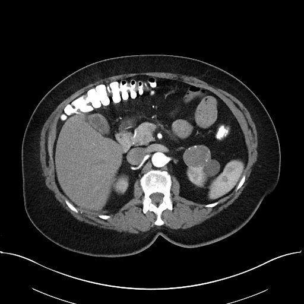

## 문제
73세 여자가 건강검진 복부 초음파에서 왼쪽 신장 종괴가 발견되어 왔다. 옆구리 통증과 육안 혈뇨는 없다. 고혈압과 제2형 당뇨병으로 약을 먹고 있으며 혼자 일상생활을 하고 매일 한 시간씩 걷는다. 혈압 134/80 mmHg, 체질량지수 36 kg/m² 이다. 혈청 크레아티닌 1.1 mg/dL, 추정 사구체여과율 50 mL/min/1.73m² 이고 요검사에서 적혈구는 없다. 조영 증강 복부 CT 동맥기 영상은 그림과 같다. 종괴는 지름 3.9 cm 이고 종괴 안에 지방 감쇠는 없으며, 신정맥 침범·림프절 비대는 없고 흉부 CT 는 정상이다. 오른쪽 신장은 정상이다. 치료로 가장 적절한 것은?

- A. 체외 방사선치료
- B. 1년 뒤 CT 재촬영만 한다
- C. 신장부분절제술
- D. 근치적 신장절제술
- E. 수니티닙 투여

_조영 증강 복부 CT 동맥기 축상면 1장, 연부조직 창, 표준 표시 방향 (TCIA, CC BY 3.0 — 자르기·보정·분할 표시 없음)_

## 정답 및 해설
> 정답: C

- **정답 핵심**: CT 에서 왼쪽 신장 앞내측에 약 4 cm 둥글고 지방 없는 고형 종괴가 조영된다 — 성인에서 이런 종괴는 다른 근거가 없는 한 신세포암으로 다룬다. 지름 4 cm 이하로 신장에 국한되고 정맥 침범·림프절·원격전이가 없으므로 cT1a 다. T1a 는 신장부분절제술이 표준이며, 이 환자는 추정 사구체여과율 50 의 만성 신장병과 당뇨병·고혈압이 있어 신장 기능을 아끼는 것이 특히 중요하다. 수술 병리는 유두상 신세포암 pT1a 였다.
- **원리**: <b>왜 신장을 아끼나</b>: 신장 하나를 통째로 떼면 남은 신장이 과여과로 버티게 되고, 이미 사구체여과율이 떨어진 사람에서는 만성 신장병이 진행하고 심혈관 사건이 늘어난다. 작은 신세포암은 부분절제와 근치절제의 암 조절 성적이 비슷하므로, 기술적으로 가능하면 종양만 떼는 신장부분절제술이 표준이다.  <b>T1a 의 기준</b>: 지름 4 cm 이하로 신장에 국한된 종양이 T1a 다. 이 크기에서는 전이 위험이 낮고 신장 보존 수술의 이득이 가장 크다. 종양이 크거나(T2 이상) 신장 깊이 중앙에 있어 부분절제가 어렵거나 신정맥을 침범하면 근치적 신장절제술을 고른다.  <b>관찰과 소작은 언제</b>: 기대여명이 짧거나 수술 위험이 큰 환자의 작은 종괴(대개 3 cm 이하)는 능동 감시나 고주파·냉동 소작을 할 수 있다. 이 환자는 혼자 생활하고 활동적이어서 수술 위험이 금기 수준이 아니고, 종양도 4 cm 에 가까워 근치 치료를 미룰 이유가 적다. 국소 신세포암에는 보조 표적치료나 방사선이 첫 치료가 아니다.
- **비교**: <table><thead><tr><th style="width:24%">항목</th><th style="width:38%">신장부분절제술(정답)</th><th>근치적 신장절제술(가장 가까운 오답)</th></tr></thead><tbody> <tr><td>대상</td><td><b>T1a(≤ 4 cm)</b>, 가능하면 T1b 도</td><td>T2 이상, 신정맥 침범, 중앙부 종양으로 부분절제 불가</td></tr> <tr><td>신기능</td><td>남는 신실질이 많다 — 만성 신장병 환자에게 유리</td><td>사구체여과율이 크게 떨어질 수 있다</td></tr> <tr><td>암 조절</td><td>T1a 에서 근치술과 비슷</td><td>비슷 — 작은 종양에서는 이득 없이 신장만 잃는다</td></tr> </tbody></table> 크기와 위치가 부분절제를 허락하면 신장을 아끼고, 종양이 크거나 혈관을 침범하면 신장 전체를 뗀다.
- **오답 이유**:
  - ① 체외 방사선치료는 수술을 받을 수 없는 환자의 뼈·뇌 전이 통증 조절이나 정위 방사선 대안을 고를 때 정답이 될 수 있다.
  - ② 1년 뒤 재촬영만 하는 것은 기대여명이 짧거나 수술 위험이 큰 환자의 3 cm 이하 작은 종괴에서 능동 감시를 고를 때 정답이 된다.
  - ④ 근치적 신장절제술은 종양이 7 cm 를 넘거나 신정맥을 침범하거나 신장 중앙에 있어 부분절제가 기술적으로 어려울 때 정답이 된다.
  - ⑤ 수니티닙 같은 표적치료는 원격전이가 있는 진행성 신세포암의 전신 치료로 정답이 되며 국소 T1a 종양의 첫 치료가 아니다.
- **함정**: 고령이라는 이유만으로 관찰을 고르거나, 암이니 신장 전체를 떼는 것이 안전하다고 생각하는 것 — T1a 는 신장 보존이 표준이다.
- **학습목표**: 지방 없이 조영되는 4 cm 이하 신장 고형 종괴를 T1a 신세포암으로 보고, 만성 신장병이 있는 환자에서 신장부분절제술을 고른다
- **근거·출처**: Loscalzo J, Fauci AS, Kasper DL, et al., eds. Harrison's Principles of Internal Medicine, 22nd ed. McGraw Hill; 2025. Chapter 90: Renal Cell Carcinoma

## 출처
- The Cancer Imaging Archive (CC BY 3.0) · KiTS-00021 · Creative Commons Attribution 3.0 Unported · https://www.cancerimagingarchive.net/data-usage-policies-and-restrictions/
