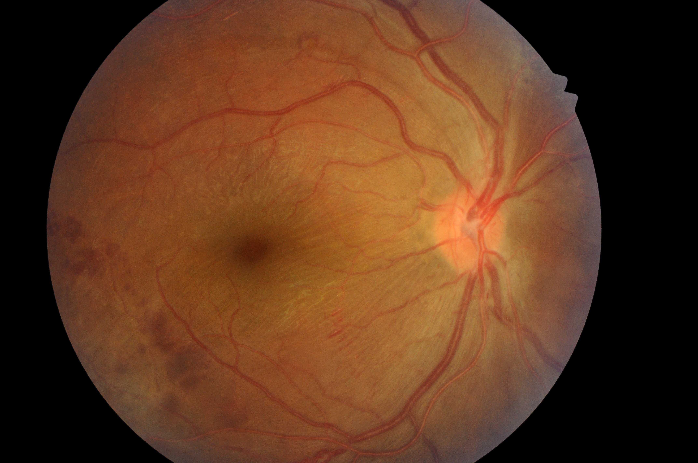

## 문제
A patient with type 2 diabetes mellitus for 18 years comes to the ophthalmologist for a routine dilated eye examination. The patient has no visual symptoms. Current medications are metformin and empagliflozin. Blood pressure is 136/82 mm Hg. Visual acuity is 20/25 in both eyes. Intraocular pressure is normal, and there is no relative afferent pupillary defect. A color fundus photograph of the right eye is shown. Similar findings are present in the left eye. Which of the following is the most likely diagnosis?

- A. Central retinal artery occlusion
- B. Nonproliferative diabetic retinopathy
- C. Proliferative diabetic retinopathy
- D. Central retinal vein occlusion
- E. Hypertensive retinopathy

_Color fundus photograph, unaltered apart from scaling (IDRiD, IEEE DataPort, CC BY 4.0 — no crop or adjustment) ※ The clinical scenario in the stem is an authoring assumption — the source dataset has no age or clinical history_

## 정답 및 해설
> 정답: B

- **정답 핵심**: The photograph shows many dot-and-blot intraretinal hemorrhages temporal to the macula and outside the inferior arcade, with a few flame-shaped hemorrhages. There are no new vessels on the optic disc or elsewhere and no preretinal or vitreous hemorrhage. Intraretinal hemorrhages without neovascularization in a patient with long-standing diabetes are nonproliferative diabetic retinopathy; the number of hemorrhages places it at the more advanced end of the nonproliferative stage.
- **원리**: <b>Why the retina bleeds</b>: Chronic hyperglycemia damages retinal capillaries — pericytes are lost, the basement membrane thickens, and the capillary wall bulges into microaneurysms. These leak plasma (hard exudates, macular edema) and rupture into the retina as dot-and-blot hemorrhages in the deeper layers or flame hemorrhages in the nerve fiber layer.  <b>Why neovascularization is the dividing line</b>: As capillaries close, the retina becomes ischemic and releases VEGF. Once new vessels grow from the disc or the retina into the vitreous, the disease is proliferative; these fragile vessels bleed into the vitreous and pull on the retina, which can cause sudden blindness. Before that point the disease is nonproliferative, graded mild, moderate, or severe by the number and distribution of hemorrhages, venous beading, and intraretinal microvascular abnormalities.  <b>Why it matters for management</b>: Nonproliferative disease is treated by controlling glucose, blood pressure, and lipids and by follow-up at intervals that shorten as severity increases. Proliferative disease or center-involving macular edema needs treatment with panretinal photocoagulation or anti-VEGF injections.
- **비교**: <table><thead><tr><th style="width:24%">Feature</th><th style="width:38%">Nonproliferative DR (answer)</th><th>Proliferative DR (closest distractor)</th></tr></thead><tbody> <tr><td>Hemorrhages</td><td>Intraretinal dot-blot and flame</td><td>May also be preretinal (boat-shaped) or vitreous</td></tr> <tr><td>New vessels</td><td><b>None</b></td><td>On the disc (NVD) or elsewhere (NVE)</td></tr> <tr><td>Treatment</td><td>Risk-factor control and close follow-up</td><td>Panretinal photocoagulation or anti-VEGF</td></tr> </tbody></table> The number of hemorrhages grades the nonproliferative stage, but only new vessels or preretinal blood make it proliferative.
- **오답 이유**:
  - (A) Central retinal artery occlusion would be correct for sudden painless loss of vision with a pale, whitened retina and a cherry-red spot at the fovea.
  - (C) Proliferative diabetic retinopathy would be correct if fine new vessels were seen on the optic disc or along the arcades, or if there were preretinal or vitreous hemorrhage.
  - (D) Central retinal vein occlusion would be correct for a unilateral, sudden painless visual loss with hemorrhages in all four quadrants, dilated tortuous veins, and disc swelling.
  - (E) Hypertensive retinopathy would be correct with arteriolar narrowing and arteriovenous nicking, and flame hemorrhages with disc edema in a patient with severely elevated blood pressure.
- **함정**: Equating many hemorrhages with proliferative disease — the stage changes only when new vessels or preretinal blood appear.
- **제작 가정**: IDRiD 는 안저 사진과 망막병증 등급만 있고 나이·성별·병력이 없다 — 당뇨병 유병 기간·증상·시력·혈압을 가정했다 (가정한 정보: type 2 diabetes mellitus for 18 years · has no visual symptoms · Visual acuity is 20/25 in both eyes · Blood pressure is 136/82 mm Hg)
- **학습목표**: 당뇨병 환자의 안저 사진에서 다수의 망막내 출혈이 있고 신생혈관이 없음을 읽어 비증식 당뇨망막병증으로 판단하고 증식 망막병증·망막정맥폐쇄와 가른다
- **근거·출처**: Loscalzo J, Fauci AS, Kasper DL, et al., eds. Harrison's Principles of Internal Medicine, 22nd ed. McGraw Hill; 2025. Chapter 34: Disorders of the Eye · Loscalzo J, Fauci AS, Kasper DL, et al., eds. Harrison's Principles of Internal Medicine, 22nd ed. McGraw Hill; 2025. Chapter 417: Diabetes Mellitus: Complications

## 출처
- IDRiD (IEEE DataPort, CC BY 4.0) · IDRiD_004 · Creative Commons Attribution 4.0 International · https://creativecommons.org/licenses/by/4.0/
