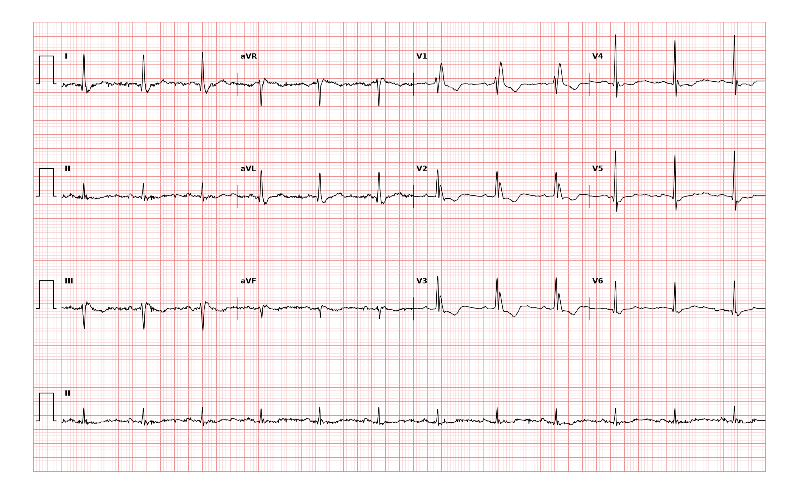

## 문제
79세 남자가 다음 주 백내장 수술을 앞두고 수술 전 검사를 받았다. 어지럼·실신·흉통·호흡곤란은 없고 하루 한 시간씩 산책을 한다. 고혈압으로 암로디핀을 먹고 있다. 혈압 132/78 mmHg, 맥박 84회/분이고 규칙적이다. 심잡음은 없고 폐음은 깨끗하다. 혈청 칼륨 4.3 mEq/L 이다. 이전 심전도는 없다. 12유도 심전도는 그림과 같다. 처치로 가장 적절한 것은?

- A. 수술 중 이소프로테레놀을 지속 주입한다
- B. 추가 처치 없이 예정대로 수술한다
- C. 영구 심박동기를 삽입한 뒤 수술한다
- D. 임시 경정맥 심박조율을 하고 수술한다
- E. 관상동맥조영술을 먼저 한다

_12유도 심전도, 25 mm/s · 10 mm/mV, 3×4 + II 리듬 스트립 (PTB-XL ECG dataset, PhysioNet, CC BY 4.0 — 원신호 그대로 작도)_

## 정답 및 해설
> 정답: B

- **정답 핵심**: 동리듬 약 85회/분이고 PR 은 정상이다. QRS 는 약 0.12 s 로 넓고 V1 에 늦게 오는 큰 R(rsR')과 그에 따르는 ST 하강·T 역전이 있으며, V2·V3 에 rSR' 모양, I·V6 에 넓고 끌리는 S파가 있다 — 완전 우각차단이다. 사지유도에서 축이 왼쪽으로 기울어 좌전속차단이 겹쳤을 수 있다. 그러나 실신·어지럼이 없고 PR 연장이나 2도 이상 방실차단이 없으면 심박동기 적응이 아니며, 증상 없는 각차단은 수술 위험을 높이지 않는다. 저위험 수술(백내장)은 예정대로 한다.
- **원리**: <b>왜 QRS 가 넓어지나</b>: 우각이 막히면 좌심실은 좌각으로 정상 탈분극하지만 우심실은 좌심실에서 심근을 타고 천천히 넘어온 흥분으로 늦게 탈분극한다. 이 늦은 우심실 성분이 오른쪽·앞쪽을 향하므로 V1 에 두 번째 R(R')이, 왼쪽을 보는 I·V6 에는 넓은 S파가 생기고 QRS 가 0.12 s 이상 넓어진다. 재분극도 늦게 끝나는 우심실 쪽 순서를 따라 V1~V3 의 ST-T 가 QRS 마지막 성분과 반대로 향한다(2차성 변화).  <b>왜 대개 치료가 필요 없나</b>: 우각차단만으로는 심실 전체가 여전히 좌각으로 전도받으므로 심박수는 유지된다. 심박동기는 증상이 있는 서맥, 3도·Mobitz 2형 방실차단, 또는 실신과 함께 전도계 질환의 근거가 있을 때 넣는다. 좌전속차단까지 겹친 2속차단도 증상이 없으면 완전 방실차단으로 넘어가는 비율이 해마다 1~2 % 정도라 예방적 심박동기를 넣지 않는다.  <b>언제 더 보나</b>: 새로 생긴 우각차단이 흉통·호흡곤란과 함께 오면 폐색전증이나 심근경색을 생각하고, 젊은 사람에서 우심실 부하 소견이 있으면 심방중격결손을 찾는다. 실신이 있으면 전기생리검사나 장기 감시가 필요하다.
- **비교**: <table><thead><tr><th style="width:24%">항목</th><th style="width:38%">무증상 우각차단(정답: 수술 진행)</th><th>심박동기가 필요한 전도장애(가장 가까운 오답)</th></tr></thead><tbody> <tr><td>증상</td><td><b>없음</b> — 어지럼·실신 없음</td><td>실신, 어지럼, 운동 불내성</td></tr> <tr><td>방실전도</td><td>PR 정상, 모든 P파가 전도</td><td>3도 또는 Mobitz 2형 방실차단, 교대 각차단</td></tr> <tr><td>처치</td><td>관찰, 수술 연기 불필요</td><td>영구 심박동기</td></tr> </tbody></table> 심박동기는 「각이 막혔다」가 아니라 「심실로 전도가 끊기거나 증상이 있다」로 결정한다.
- **오답 이유**:
  - ① 이소프로테레놀 지속 주입은 아트로핀에 반응하지 않는 증상성 서맥에서 심박조율을 준비하는 동안 잠시 쓸 때 정답이 된다.
  - ③ 영구 심박동기는 각차단 환자에게 원인 모를 실신이 있거나 Mobitz 2형·3도 방실차단, 좌우가 번갈아 막히는 교대 각차단이 기록될 때 정답이 된다.
  - ④ 임시 경정맥 심박조율은 혈역학이 불안정한 서맥이나 급성 심근경색 중 새로 생긴 고도 방실차단처럼 당장 박동이 위험할 때 정답이 된다.
  - ⑤ 관상동맥조영술은 전형적 흉통이 있고 새로 생긴 각차단이나 트로포닌 상승으로 급성 관상동맥증후군이 의심될 때 정답이 된다.
- **함정**: 넓은 QRS 와 좌측 축을 보고 「2속차단이니 심박동기」라고 생각하는 것 — 증상과 방실차단이 없으면 예방적 삽입 적응이 아니다.
- **학습목표**: 무증상 환자의 수술 전 심전도에서 완전 우각차단을 읽고, 실신이나 방실차단이 없으면 심박동기·추가 시술 없이 예정 수술을 진행한다
- **근거·출처**: Loscalzo J, Fauci AS, Kasper DL, et al., eds. Harrison's Principles of Internal Medicine, 22nd ed. McGraw Hill; 2025. Chapter 252: The Bradyarrhythmias: Disorders of the Atrioventricular Node · Loscalzo J, Fauci AS, Kasper DL, et al., eds. Harrison's Principles of Internal Medicine, 22nd ed. McGraw Hill; 2025. Chapter 247: Electrocardiography

## 출처
- PTB-XL ECG dataset v1.0.3 (PhysioNet, CC BY 4.0) · record 19444 · Creative Commons Attribution 4.0 International · https://physionet.org/content/ptb-xl/1.0.3/LICENSE.txt
