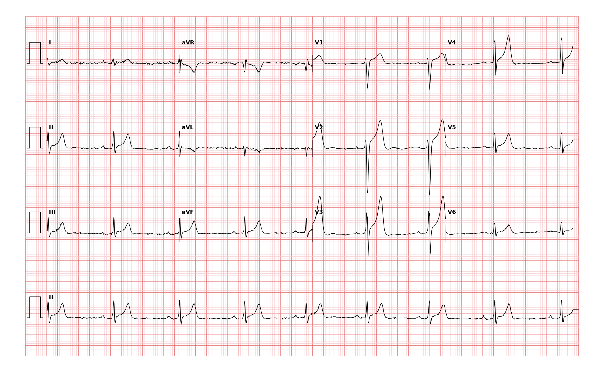

## 문제
A 39-year-old man comes to the physician for a preparticipation evaluation before joining an amateur marathon club. He runs 50 km per week and has no dizziness, syncope, chest pain, or exercise intolerance. He takes no medications and does not use stimulants. Pulse is 50/min and regular, and blood pressure is 118/70 mm Hg. Cardiac examination shows no murmurs. Serum potassium and thyroid-stimulating hormone concentrations are within normal limits. A 12-lead ECG is shown. Which of the following is the most likely diagnosis?

- A. Sinus bradycardia
- B. Junctional escape rhythm
- C. Second-degree atrioventricular block, Mobitz type I
- D. First-degree atrioventricular block
- E. Sinoatrial exit block

_12-lead ECG, 25 mm/s, 10 mm/mV, 3×4 + lead II rhythm strip (PTB-XL, PhysioNet, CC BY 4.0; raw signal, no filtering)_

## 정답 및 해설
> 정답: A

- **정답 핵심**: On the lead II rhythm strip, the RR interval is about 1.2 seconds (6 large boxes), giving a rate of about 49/min. Every QRS complex is preceded by an upright P wave of the same shape with a constant, normal PR interval, the QRS is narrow, and there are no dropped beats or pauses. This is sinus bradycardia. The J-point elevation with prominent T waves in V2-V3 is an early repolarization pattern, which, like the bradycardia, is common in endurance athletes.
- **원리**: <b>Why athletes are bradycardic</b>: Endurance training increases stroke volume, so the same cardiac output is achieved with fewer beats, and vagal tone on the sinoatrial node rises. The sinus node itself also remodels and fires more slowly. Resting rates of 40-50/min are therefore normal in trained athletes and need no treatment if they are asymptomatic and the rate increases appropriately with exercise.  <b>How to prove the rhythm is sinus</b>: The sinus node is in the high right atrium, so atrial depolarization spreads downward and leftward and the P wave is upright in leads I and II. If each QRS is preceded by such a P wave at a constant PR interval, the impulse is coming from the sinus node. A junctional pacemaker activates the atria backward from below, so the P wave is absent, inverted in II, or appears just after the QRS.  <b>When bradycardia is a disease</b>: Sinus node dysfunction is suspected when slow rates cause dizziness, syncope, or fatigue, when the rate fails to rise with exercise (chronotropic incompetence), or when pauses occur. Drugs (beta-blockers, calcium-channel blockers), hypothyroidism, hyperkalemia, and raised intracranial pressure are reversible causes to exclude.
- **비교**: <table><thead><tr><th style="width:24%">Feature</th><th style="width:38%">Sinus bradycardia (answer)</th><th>Junctional escape rhythm (closest distractor)</th></tr></thead><tbody> <tr><td>P wave</td><td><b>Upright in II before every QRS</b></td><td>Absent, inverted in II, or just after the QRS</td></tr> <tr><td>PR interval</td><td>Constant, 0.12-0.20 s</td><td>Short (below 0.12 s) or none</td></tr> <tr><td>Rate</td><td>Below 60/min</td><td>Usually 40-60/min</td></tr> </tbody></table> Both are slow and narrow; the position and direction of the P wave decide where the beat started.
- **오답 이유**:
  - (B) Junctional escape rhythm would be correct if P waves were absent or inverted in lead II, appearing just before with a short PR interval or after each narrow QRS.
  - (C) Mobitz type I block would be correct if the PR interval lengthened progressively until a P wave was not followed by a QRS, producing grouped beats.
  - (D) First-degree atrioventricular block would be correct if every P wave were conducted but with a constant PR interval longer than 0.20 seconds.
  - (E) Sinoatrial exit block would be correct if a whole P-QRS-T complex were suddenly missing, with a pause equal to an exact multiple of the preceding PP interval.
- **함정**: Calling every slow regular rhythm in an athlete a junctional or block rhythm — first find the P wave in lead II and check that the PR interval is constant.
- **학습목표**: 모든 QRS 앞에 같은 모양의 양성 P파와 일정한 PR 이 있는 50회/분 미만 리듬을 동서맥으로 읽고 접합부 리듬·방실차단과 가른다
- **근거·출처**: Loscalzo J, Fauci AS, Kasper DL, et al., eds. Harrison's Principles of Internal Medicine, 22nd ed. McGraw Hill; 2025. Chapter 251: The Bradyarrhythmias: Disorders of the Sinoatrial Node · Loscalzo J, Fauci AS, Kasper DL, et al., eds. Harrison's Principles of Internal Medicine, 22nd ed. McGraw Hill; 2025. Chapter 247: Electrocardiography

## 출처
- PTB-XL ECG dataset v1.0.3 (PhysioNet, CC BY 4.0) · record 3616 · Creative Commons Attribution 4.0 International · https://physionet.org/content/ptb-xl/1.0.3/LICENSE.txt
