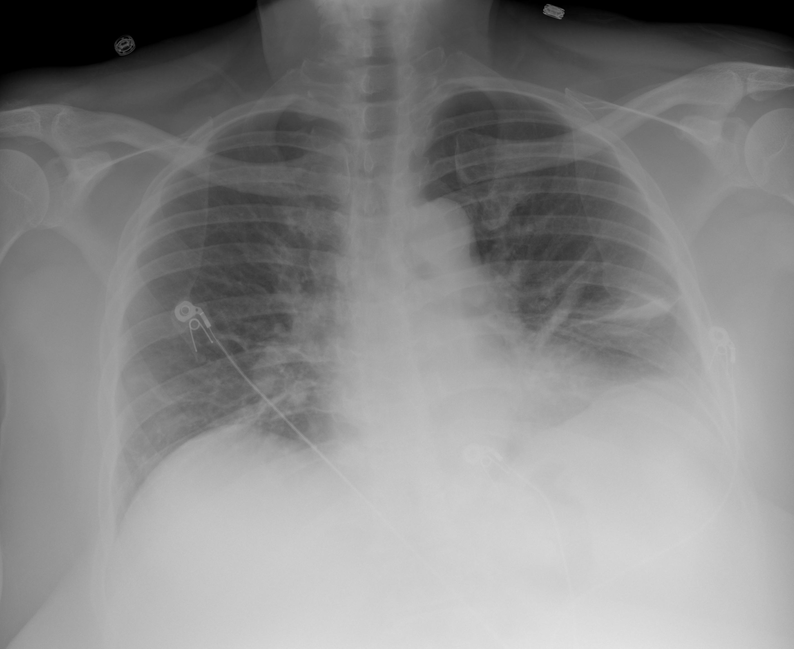

## 문제
A 57-year-old woman comes to the emergency department because of fever, cough, and increasing shortness of breath for 7 days. A nasal swab test for SARS-CoV-2 was positive 6 days ago. She has hypertension treated with amlodipine. Her temperature is 38.4°C (101.1°F), pulse is 104/min, respirations are 26/min, and blood pressure is 128/80 mm Hg. Pulse oximetry on room air shows an oxygen saturation of 89%. Crackles are heard at both lung bases. She is alert and able to speak in full sentences. Serum creatinine and liver function tests are within normal limits. A chest radiograph is shown. In addition to supplemental oxygen, which of the following is the most appropriate pharmacotherapy?

- A. Oseltamivir
- B. Dexamethasone
- C. Azithromycin
- D. Hydroxychloroquine
- E. Ivermectin

_Frontal chest radiograph, unaltered apart from scaling (The Cancer Imaging Archive, CC BY 4.0; no cropping or window adjustment)_

## 정답 및 해설
> 정답: B

- **정답 핵심**: The radiograph shows ill-defined opacities in both lower lung zones, more extensive on the left, with low lung volumes and no pneumothorax or cavity. In a patient with confirmed SARS-CoV-2 infection in the second week of illness, bilateral opacities with an oxygen saturation of 89% on room air indicate severe COVID-19 pneumonia. Dexamethasone 6 mg daily for up to 10 days reduces mortality in patients who need supplemental oxygen, and remdesivir may be added early in the oxygen-requiring phase.
- **원리**: <b>Why a corticosteroid now</b>: COVID-19 has two phases. In the first week, viral replication dominates, and antivirals help most. From the second week, lung injury is driven largely by the host inflammatory response, producing bilateral, often lower-zone and peripheral opacities and hypoxemia. Dexamethasone dampens this response and lowered 28-day mortality in hospitalized patients who required oxygen or mechanical ventilation, but not in patients who did not need oxygen.  <b>Why oxygen saturation is the switch</b>: The benefit of dexamethasone depends on disease severity. A saturation below 94% on room air or infiltrates involving much of the lung define severe disease, and this is exactly the group in which steroids save lives. Giving steroids to a patient without hypoxemia may cause harm by delaying viral clearance.  <b>Why the radiograph matters</b>: Bilateral airspace opacities confirm parenchymal involvement rather than airway disease alone, and they help exclude alternatives such as lobar bacterial pneumonia with a single dense consolidation or pneumothorax.
- **비교**: <table><thead><tr><th style="width:24%">Feature</th><th style="width:38%">Severe COVID-19 pneumonia (answer)</th><th>Bacterial lobar pneumonia (azithromycin distractor)</th></tr></thead><tbody> <tr><td>Radiograph</td><td><b>Bilateral</b>, ill-defined lower-zone opacities</td><td>One dense lobar consolidation with air bronchograms</td></tr> <tr><td>Course</td><td>Worsening in week 2 after a positive test</td><td>Abrupt onset, purulent sputum</td></tr> <tr><td>Key drug</td><td>Dexamethasone (+ remdesivir)</td><td>Beta-lactam plus macrolide</td></tr> </tbody></table> Routine antibiotics are not given in COVID-19 pneumonia unless bacterial coinfection is suspected; the hypoxemia from bilateral viral pneumonitis is what calls for steroids.
- **오답 이유**:
  - (A) Oseltamivir would be correct for confirmed or suspected influenza with a positive influenza test, not for SARS-CoV-2 pneumonia.
  - (C) Azithromycin would be correct, together with a beta-lactam, for community-acquired bacterial pneumonia with a lobar consolidation and purulent sputum.
  - (D) Hydroxychloroquine would be correct for systemic lupus erythematosus or malaria; trials showed no benefit and possible harm in COVID-19.
  - (E) Ivermectin would be correct for strongyloidiasis or scabies; randomized trials showed no benefit for COVID-19 outcomes.
- **함정**: Choosing an antibiotic because the radiograph shows opacities — bilateral opacities in confirmed COVID-19 with hypoxemia call for dexamethasone.
- **학습목표**: 코로나19 확진 환자의 흉부 X선에서 양측 하폐야 음영을 읽고, 실내 공기에서 산소포화도가 94 % 미만이면 산소와 덱사메타손을 시작한다
- **근거·출처**: Loscalzo J, Fauci AS, Kasper DL, et al., eds. Harrison's Principles of Internal Medicine, 22nd ed. McGraw Hill; 2025. Chapter 205: SARS-CoV-2 and COVID-19

## 출처
- COVID-19-AR, The Cancer Imaging Archive (CC BY 4.0) · series …16258715 · Creative Commons Attribution 4.0 International · https://www.cancerimagingarchive.net/data-usage-policies-and-restrictions/
