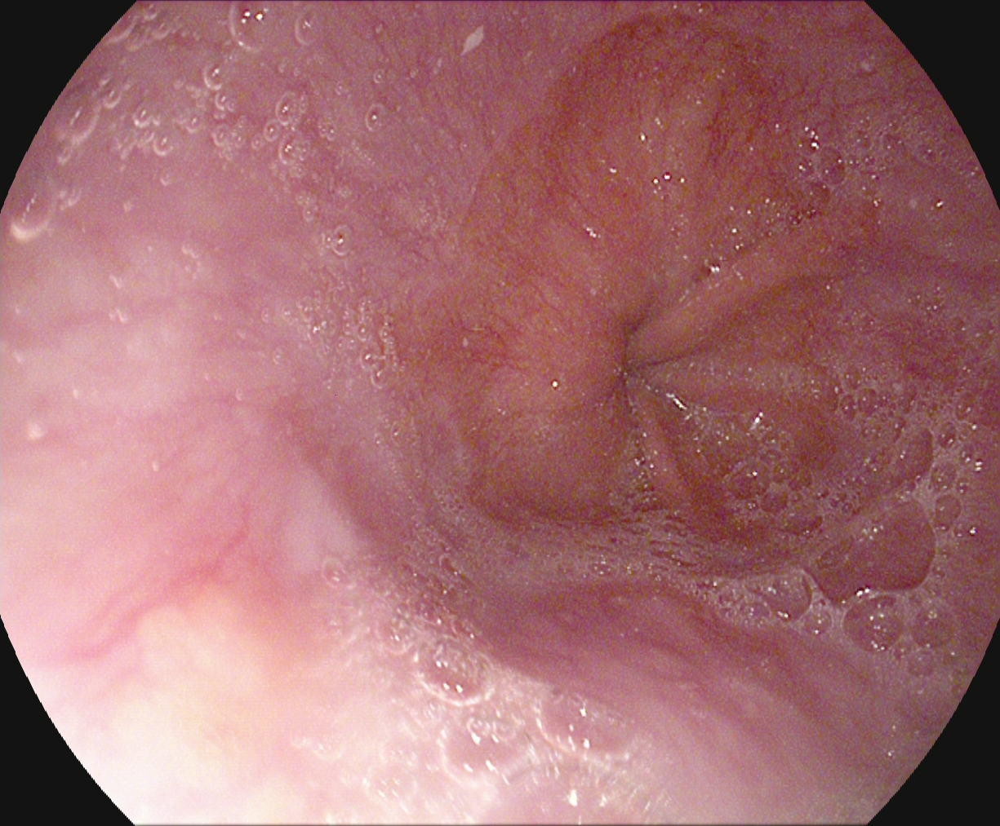

## 문제
A patient with long-standing heartburn that occurs several times a week despite intermittent over-the-counter antacid use is referred for upper endoscopy. There is no dysphagia, weight loss, vomiting, or melena. Physical examination shows no abnormalities. Hemoglobin concentration is within the reference range. During upper endoscopy, a photograph of the gastroesophageal junction region is obtained and is shown. No ulcer, nodule, or mass is seen elsewhere in the esophagus or stomach. Which of the following is the most appropriate next step in management?

- A. Laparoscopic fundoplication, no biopsy
- B. Mucosal biopsies and a daily proton pump inhibitor
- C. Transhiatal esophagectomy after staging CT
- D. Endoscopic mucosal resection of the segment
- E. Repeat endoscopy in 6 months, no biopsy

_Upper endoscopic photograph as provided by the dataset, downscaled only (HyperKvasir, OSF, CC BY 4.0; no cropping or color adjustment) ※ The clinical scenario in the stem is an authoring assumption — the source dataset has no age or clinical history_

## 정답 및 해설
> 정답: B

- **정답 핵심**: The photograph shows salmon-colored mucosa extending above the gastroesophageal junction as a short tongue into the paler squamous lining, without ulcer or nodule. This appearance suggests Barrett esophagus, but the diagnosis requires histologic confirmation of intestinal metaplasia with goblet cells. Biopsies are taken from the abnormal segment (four-quadrant biopsies every 1-2 cm, plus any visible lesion), and a proton pump inhibitor is given for reflux and to allow accurate grading of dysplasia. Histology then sets surveillance or endoscopic therapy.
- **원리**: <b>Why the mucosa turns salmon-colored</b>: Chronic acid and bile reflux injure the stratified squamous epithelium of the distal esophagus. During healing, the epithelium can be replaced by columnar epithelium that resists acid better; when it contains goblet cells it is called intestinal metaplasia. Endoscopically, this columnar lining looks reddish-orange (salmon) compared with the pale pink squamous mucosa and extends above the top of the gastric folds.  <b>Why biopsy is mandatory</b>: The color change alone is not diagnostic — an irregular Z-line or a hiatal hernia can look similar. Barrett esophagus is defined histologically, and its cancer risk depends on dysplasia: nondysplastic Barrett progresses to adenocarcinoma in roughly 0.2-0.5% per year, whereas high-grade dysplasia carries a much higher risk.  <b>Why acid suppression first</b>: Active inflammation can mimic dysplasia under the microscope. A proton pump inhibitor heals esophagitis so that pathologists can grade dysplasia accurately, and it controls symptoms.
- **비교**: <table><thead><tr><th style="width:24%">Feature</th><th style="width:38%">Biopsy + PPI (answer)</th><th>Endoscopic mucosal resection (closest distractor)</th></tr></thead><tbody> <tr><td>Lesion</td><td><b>Flat</b> salmon-colored mucosa, no nodule</td><td>Visible nodule or raised lesion within Barrett mucosa</td></tr> <tr><td>Histology known?</td><td>No — must be established</td><td>Usually after dysplasia or early cancer is suspected</td></tr> <tr><td>Next decision</td><td>Surveillance interval or ablation by dysplasia grade</td><td>Staging of the resected lesion, then ablation</td></tr> </tbody></table> Flat Barrett-appearing mucosa is first sampled; resection is reserved for nodular lesions or confirmed dysplasia.
- **오답 이유**:
  - (A) Fundoplication would be correct for well-documented reflux not controlled by or intolerant of a PPI, and it does not replace biopsy of the abnormal segment.
  - (C) Esophagectomy would be correct for invasive adenocarcinoma beyond the submucosa that cannot be treated endoscopically, not for unbiopsied flat mucosa.
  - (D) Endoscopic mucosal resection would be correct for a visible nodule within Barrett mucosa or for confirmed high-grade dysplasia with a raised lesion.
  - (E) Repeat endoscopy without biopsy would never establish the diagnosis; repeat endoscopy at 3-5 years is correct only after biopsy shows nondysplastic Barrett.
- **함정**: Treating the salmon-colored mucosa as a diagnosis by appearance — Barrett esophagus requires biopsy showing intestinal metaplasia.
- **제작 가정**: HyperKvasir 는 내시경 사진과 소견 분류만 있고 나이·성별·병력이 없다 — 오래된 위식도역류 증상으로 내시경을 받는 상황을 가정했다 (가정한 정보: long-standing heartburn · upper endoscopy)
- **학습목표**: 상부 내시경에서 위식도 접합부 위로 올라온 연어빛 점막을 바렛식도 의심 소견으로 읽고, 장상피화생과 이형성 여부를 정하는 체계적 생검을 다음 단계로 고른다
- **근거·출처**: Loscalzo J, Fauci AS, Kasper DL, et al., eds. Harrison's Principles of Internal Medicine, 22nd ed. McGraw Hill; 2025. Chapter 334: Diseases of the Esophagus · Shaheen NJ, Falk GW, Iyer PG, et al. Diagnosis and management of Barrett's esophagus: an updated ACG guideline. Am J Gastroenterol. 2022;117(4):559-587

## 출처
- HyperKvasir (OSF, CC BY 4.0) · 237b6b27-a102-46b7-9aa5-ba99c7bcb6c7.jpg · Creative Commons Attribution 4.0 International · https://datasets.simula.no/hyper-kvasir/
