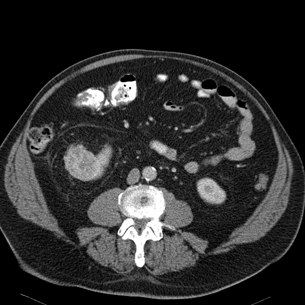

## 문제
73세 남자가 일주일 전 한 차례 통증 없는 붉은 소변을 보아 비뇨의학과에 왔다. 옆구리 통증·체중 감소·발열은 없다. 고혈압으로 약을 먹고 있으며 40갑년 흡연력이 있다. 혈압 138/84 mmHg 이고 복부 진찰에서 만져지는 종괴는 없다. 혈색소 13.8 g/dL, 혈청 크레아티닌 1.0 mg/dL, 칼슘·간기능은 정상이다. 소변검사에서 적혈구 10~19/고배율시야이다. 조영 증강 복부 CT 축상면 영상은 그림과 같으며, 림프절 비대·신정맥 침범은 없고 반대쪽 신장은 정상이다. 다음 처치로 가장 적절한 것은?

- A. 흉부 CT 로 병기를 확인한 뒤 신장 절제술(가능하면 부분절제)을 한다
- B. 경피적 바늘 생검으로 조직을 확인한 뒤 치료를 정한다
- C. 6개월 뒤 CT 를 다시 찍어 크기 변화를 본다
- D. 면역관문억제제 전신 치료를 시작한다
- E. 방광경과 요세포검사만 하고 신장 종괴는 추적한다

_조영 증강 복부 CT 동맥기 축상면 1장, 연부조직 창, 표준 표시 방향 (TCIA, CC BY 3.0 — 자르기·보정·분할 표시 없음)_

## 정답 및 해설
> 정답: A

- **정답 핵심**: CT 에서 오른쪽 신장 앞쪽에 약 5 cm 의 둥근 고형 종괴가 피질만큼 강하게 조영증강되고 중심부에 저음영 부위가 있으며, 지방·석회는 보이지 않는다. 지방이 없는 강한 조영증강 고형 신장 종괴는 다른 근거가 없는 한 신세포암으로 다루며, 4~7 cm 로 cT1b 다. 영상이 전형적이고 수술할 수 있는 환자라면 생검이 치료를 바꾸지 않으므로, 흉부 CT 로 폐 전이를 확인한 뒤 수술로 제거한다(기술적으로 가능하면 신기능을 보존하는 부분절제). 흡연력 있는 노인의 육안적 혈뇨이므로 방광경으로 요로상피암도 함께 확인한다. 이 종괴는 수술 병리에서 호산성 과립세포종으로 밝혀졌다 — 영상으로는 신세포암과 구별할 수 없다.
- **원리**: <b>왜 지방과 조영증강을 보나</b>: 신장 종괴의 첫 갈림은 낭성인가 고형인가, 그다음은 육안적 지방이 있는가다. 거시적 지방(-10 HU 이하)이 있으면 혈관근지방종으로 진단이 끝나지만, 지방 없이 15~20 HU 이상 조영증강되는 고형 종괴는 80~90 % 가 악성(대부분 투명세포 신세포암)이다.  <b>왜 생검 없이 수술하나</b>: 생검은 진단적 정확도가 높지만 음성이어도 악성을 배제하지 못하고, 호산성 과립세포종과 호산성 신세포암(혐색소형)은 작은 조직으로 구별이 어렵다. 수술할 수 있는 환자에서 전형적 영상이면 결과가 치료를 바꾸지 않는다. 생검은 수술 후보가 아니거나, 림프종·전이암·감염이 의심되거나, 능동 감시·열치료를 고를 때 쓴다.  <b>왜 흉부 CT 인가</b>: 신세포암은 혈행성으로 폐에 가장 흔히 전이한다. 병기(T1b N0 M0 인지)를 정해야 국소 수술로 완치를 노릴지, 전신 치료를 고려할지 정할 수 있다. 뼈스캔·뇌 MRI 는 증상이나 혈청 칼슘·ALP 상승이 있을 때만 한다.
- **비교**: <table><thead><tr><th style="width:24%">항목</th><th style="width:38%">수술(정답)</th><th>경피적 생검(가장 가까운 오답)</th></tr></thead><tbody> <tr><td>적응</td><td>전형적 고형 종괴 + <b>수술 가능한 환자</b></td><td>수술 불가·고위험, 림프종·전이·감염 의심, 감시나 열치료 계획</td></tr> <tr><td>결과가 치료를 바꾸나</td><td>병리로 최종 확인</td><td>음성이어도 악성 배제 못 함 — 이 환자에서는 바꾸지 않음</td></tr> <tr><td>크기 기준</td><td>4~7 cm(cT1b) — 부분절제 가능하면 우선</td><td>1~3 cm 의 작은 종괴에서 더 자주 고려</td></tr> </tbody></table> 생검은 「결과에 따라 치료가 달라질 때」만 한다 — 수술할 사람의 전형적 종괴에서는 수술 병리가 진단이다.
- **오답 이유**:
  - ② 경피적 생검은 고령·동반 질환으로 수술 후보가 아니거나 림프종·전이암이 의심될 때, 또는 능동 감시·열치료를 택할 때 정답이 된다.
  - ③ 6개월 추적 CT 는 기대여명이 짧거나 수술 위험이 큰 환자의 2 cm 안팎 작은 고형 종괴에서 능동 감시를 택할 때 정답이 된다.
  - ④ 면역관문억제제는 폐·뼈 전이가 있는 진행성 신세포암에서 정답이며, 국소 병변은 수술로 완치를 노린다.
  - ⑤ 방광경·요세포검사만 하는 것은 영상에서 신장 종괴가 없고 혈뇨의 원인으로 방광암을 찾을 때 정답이 되며, 이 종괴를 추적할 근거는 없다.
- **함정**: 수술 전에 반드시 조직 진단이 필요하다고 생각해 생검을 고르는 것 — 수술할 환자의 전형적 고형 신장 종괴는 생검이 치료를 바꾸지 않는다.
- **학습목표**: 조영 CT 에서 지방 없이 강하게 조영되는 5 cm 신장 고형 종괴(cT1b)를 신세포암으로 보고 생검 없이 흉부 CT 로 병기를 정한 뒤 수술로 제거한다
- **근거·출처**: Loscalzo J, Fauci AS, Kasper DL, et al., eds. Harrison's Principles of Internal Medicine, 22nd ed. McGraw Hill; 2025. Chapter 90: Renal Cell Carcinoma

## 출처
- The Cancer Imaging Archive (CC BY 3.0) · KiTS-00104 · Creative Commons Attribution 3.0 Unported · https://www.cancerimagingarchive.net/data-usage-policies-and-restrictions/
