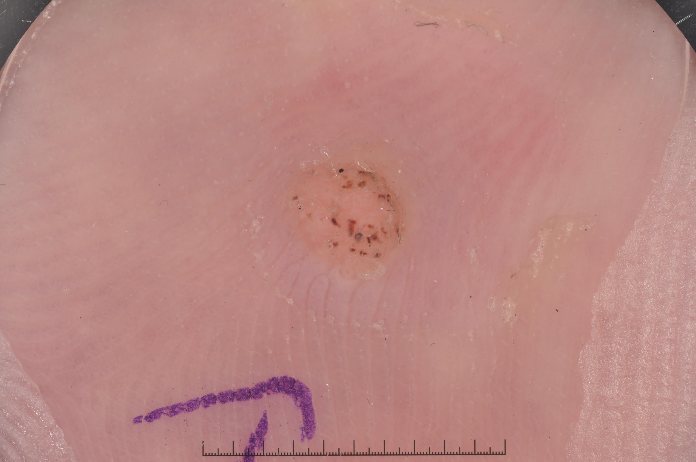

## 문제
70세 남자가 4개월 전부터 발바닥에 생긴 아픈 병변으로 왔다. 걸을 때 아프고, 특히 양옆에서 꼬집듯 누르면 더 아프다. 일주일에 몇 번 공공 수영장에서 맨발로 다닌다. 당뇨병이나 말초혈관 질환은 없다. 진찰에서 발바닥에 지름 6 mm 의 단단한 각질성 구진이 있다. 메스로 표면을 깎아 내자 바늘 끝 같은 출혈점이 생긴다. 발등동맥 맥박은 정상이다. 병변의 더모스코피(피부확대경) 사진은 그림과 같다. 진단으로 가장 적절한 것은?

- A. 발바닥 사마귀
- B. 티눈
- C. 말단 흑자 흑색종
- D. 굳은살
- E. 지루각화증

_피부확대경 사진, 피부 표시와 자를 포함한 원본 그대로 크기 조정만 (ISIC Archive, CC0 — 크롭·색보정 없음)_

## 정답 및 해설
> 정답: A

- **정답 핵심**: 피부확대경에서 노란빛 각질성 구진이 발바닥의 정상 피부선(지문 능선)을 끊고 있고, 그 위에 붉은갈색~검은 점과 짧은 선이 흩어져 있다. 이 점들은 길어진 진피유두 안의 늘어난 모세혈관이 눌려 혈전이 생긴 것으로 바이러스 사마귀의 특징이며, 표면을 깎으면 같은 혈관에서 바늘 끝 출혈이 난다. 양옆에서 누를 때 아픈 통증, 공공장소 맨발 노출, 끊긴 피부선은 사람유두종바이러스(1·2·4형)에 의한 발바닥 사마귀에 맞는다.
- **원리**: <b>왜 피부선이 끊기나</b>: 지문 능선은 표피 능선의 규칙적인 배열이 만든다. 사람유두종바이러스는 기저 각질형성세포를 감염해 표피 증식과 유두종증을 일으키므로, 감염된 부분이 따로 덩어리로 자라 능선 배열을 대체한다. 티눈·굳은살은 정상 각질층이 두꺼워진 것이라 피부선이 병변을 그대로 지나간다.  <b>왜 검은 점이 보이나</b>: 사마귀에서는 진피유두가 길어지고 그 안의 모세혈관이 표면 가까이 늘어나 있다. 걸을 때의 압력으로 이 모세혈관에 혈전이 생겨 피부확대경에서 붉은갈색·검은 점과 선으로 보이고, 표면을 깎으면 바늘 끝처럼 피가 난다.  <b>왜 양옆에서 누를 때 아픈가</b>: 사마귀는 주변 조직과 함께 안쪽으로 밀려 들어가 있어 양옆에서 꼬집으면 눌리고, 티눈은 단단한 중심 핵이 깊은 조직을 누르므로 바로 위에서 누를 때 가장 아프다.
- **비교**: <table><thead><tr><th style="width:24%">항목</th><th style="width:38%">발바닥 사마귀(정답)</th><th>티눈(가장 가까운 오답)</th></tr></thead><tbody> <tr><td>피부선</td><td>병변에서 <b>끊김</b></td><td>병변을 그대로 지나감</td></tr> <tr><td>피부확대경</td><td>붉은갈색·검은 점(혈전 모세혈관)</td><td>반투명한 중심 핵, 혈관 없음</td></tr> <tr><td>통증</td><td>양옆에서 꼬집을 때</td><td>뼈 돌출부 위를 바로 누를 때</td></tr> <tr><td>깎아 냈을 때</td><td>바늘 끝 출혈</td><td>출혈 없는 단단한 핵</td></tr> </tbody></table> 피부선이 병변을 지나가는지, 깎았을 때 피가 나는지 두 가지가 감염과 압박성 각화를 가른다.
- **오답 이유**:
  - ② 티눈은 피부선이 병변을 그대로 지나가고, 깎았을 때 뼈 돌출부 위에 출혈 없는 반투명한 단단한 핵이 드러날 때 정답이 된다.
  - ③ 말단 흑자 흑색종은 각질성 구진이 아니라 피부능선을 따라 넓고 불규칙한 갈색 색소(평행 능선 양상)가 보이고 커질 때 정답이 된다.
  - ④ 굳은살은 체중이 실리는 넓은 부위의 통증 없는 미만성 각질 비후로, 피부선이 보존될 때 정답이 된다.
  - ⑤ 지루각화증은 붙인 듯한 밀랍 같은 병변에 비립종 같은 낭종·면포 같은 구멍이 보일 때 정답이며, 털 없는 발바닥 피부에는 거의 생기지 않는다.
- **함정**: 검은 점을 멜라닌 색소로 읽어 흑색종을 고르는 것 — 피부선을 끊는 각질성 구진 안의 혈전 모세혈관이다.
- **학습목표**: 발바닥 각질성 병변의 피부확대경에서 끊긴 피부선과 혈전 모세혈관의 붉은갈색 점을 읽어 발바닥 사마귀로 진단하고 티눈·말단 흑색종과 가른다
- **근거·출처**: Loscalzo J, Fauci AS, Kasper DL, et al., eds. Harrison's Principles of Internal Medicine, 22nd ed. McGraw Hill; 2025. Chapter 203: Human Papillomavirus Infections · Loscalzo J, Fauci AS, Kasper DL, et al., eds. Harrison's Principles of Internal Medicine, 22nd ed. McGraw Hill; 2025. Chapter 60: Eczema, Psoriasis, Cutaneous Infections, Acne, and Other Common Skin Disorders

## 출처
- ISIC Archive ISIC_0013536 (CC-0) · CC0 1.0 Universal · https://creativecommons.org/publicdomain/zero/1.0/
