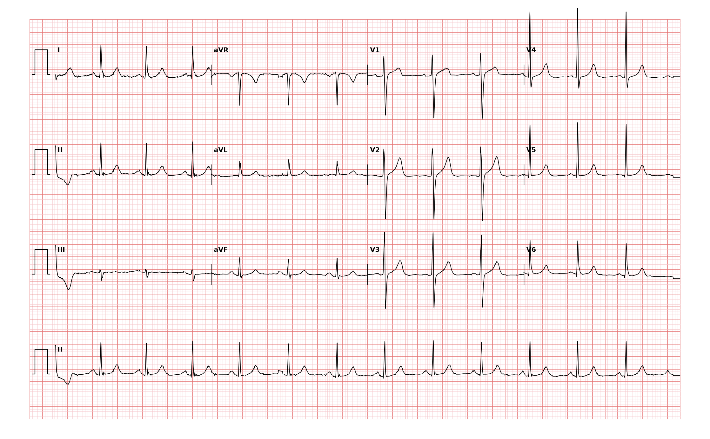

## 문제
59세 여자가 건강검진에서 혈압이 높다는 말을 듣고 왔다. 두통·흉통·호흡곤란은 없고 계단을 오를 때도 불편하지 않다. 복용하는 약은 없다. 키 160 cm, 몸무게 62 kg 이다. 혈압 152/94 mmHg(두 번 잰 평균), 맥박 80회/분이고 규칙적이다. 심잡음은 없고 폐음은 깨끗하다. 혈청 칼륨 4.2 mEq/L, 크레아티닌 0.8 mg/dL 이다. 12유도 심전도는 그림과 같다. 심전도 판독으로 가장 적절한 것은?

- A. 동리듬, 흉부유도 QRS 고전압(좌심실 비대 전압 기준 충족), ST-T 변화 없음
- B. 동리듬, 완전 좌각차단
- C. 동리듬, 전중격 심근경색
- D. 동리듬, 우심실 비대와 우축 편위
- E. 동리듬, 사지유도 저전압

_12유도 심전도, 25 mm/s · 10 mm/mV, 3×4 + II 리듬 스트립 (PTB-XL ECG dataset, PhysioNet, CC BY 4.0 — 원신호 그대로 작도)_

## 정답 및 해설
> 정답: A

- **정답 핵심**: II 유도에서 모든 QRS 앞에 양성 P파와 일정한 PR 이 있는 동리듬 약 80회/분이다. QRS 폭은 정상(0.10 s 미만)이고 V1 의 S파 약 16 mm 와 V5 의 R파 약 20 mm 를 더하면 약 36 mm 로 Sokolow-Lyon 기준(35 mm 초과)을 넘는다. 그러나 V5·V6 의 ST 하강·비대칭 T 역전(긴장형 변화)이나 좌심방 확대는 없고, V1~V3 에 r파가 있어 경색의 Q파도 없다. 따라서 판독은 「QRS 고전압, 좌심실 비대 전압 기준만 충족」이다. 전압 기준은 민감도가 낮고 마른 사람·젊은 사람에서 위양성이 많아, 고혈압 환자에서는 심장초음파로 실제 좌심실 비대를 확인한다.
- **원리**: <b>왜 진폭이 커지나</b>: QRS 진폭은 탈분극하는 심근의 양과 전극까지의 거리로 정해진다. 좌심실 벽이 두꺼워지면 왼쪽·뒤쪽을 향하는 힘이 커져 왼쪽을 보는 V5·V6 의 R파와 반대쪽인 V1·V2 의 S파가 함께 깊어진다. 그래서 Sokolow-Lyon(S V1 + R V5 또는 V6 > 35 mm)과 Cornell(R aVL + S V3, 여자 > 20 mm, 남자 > 28 mm)은 「한쪽의 R + 반대쪽의 S」를 더한다.  <b>왜 전압만으로는 비대라 하지 않나</b>: 가슴벽이 얇거나(마른 체형, 젊은 사람) 유방 조직이 적으면 전극이 심장에 가까워져 진폭만 커진다. 반대로 비만·폐기종·심막삼출은 진폭을 줄인다. 그래서 전압 기준은 특이도는 높지만 민감도가 낮고, 심초음파가 확인 검사다.  <b>무엇이 「진짜 비대」를 더하나</b>: 두꺼운 벽은 재분극 순서도 바꿔 V5·V6 에 내려가는 ST 하강과 비대칭 T 역전(긴장형)을 만들고, 좌심방 확대(V1 P파 후반 음성 성분)와 좌측 축을 동반한다. 이 소견이 함께 있으면 예후도 나쁘다.
- **비교**: <table><thead><tr><th style="width:24%">항목</th><th style="width:38%">고전압만(정답)</th><th>완전 좌각차단(가장 가까운 오답)</th></tr></thead><tbody> <tr><td>QRS 폭</td><td><b>정상(0.10 s 미만)</b></td><td>0.12 s 이상</td></tr> <tr><td>V6·I 모양</td><td>날카로운 큰 R, 작은 중격 q</td><td>넓고 끝이 갈라진 R, 중격 q 없음</td></tr> <tr><td>ST-T</td><td>정상</td><td>QRS 와 반대 방향의 2차성 ST-T 변화</td></tr> </tbody></table> 두 경우 모두 V1 의 S파가 깊지만, QRS 폭과 V6 의 q파가 「크기만 큰 정상 전도」와 「늦게 퍼지는 비정상 전도」를 가른다.
- **오답 이유**:
  - ② 완전 좌각차단은 QRS 가 0.12 s 이상 넓고 I·V6 에 중격 q 없이 끝이 갈라진 R파, 반대 방향 ST-T 변화가 있을 때 정답이 된다.
  - ③ 전중격 심근경색은 V1~V3 에 r파 없이 QS 가 있거나 Q파와 함께 ST 상승·T 역전이 남아 있을 때 정답이 된다.
  - ④ 우심실 비대는 V1 에 R/S 비가 1 이상인 큰 R파, 우축 편위(+110° 이상), V1~V3 의 ST 하강·T 역전이 있을 때 정답이 된다.
  - ⑤ 사지유도 저전압은 모든 사지유도의 QRS 진폭이 5 mm 미만일 때 정답이며, 비만·폐기종·심막삼출·갑상샘저하증에서 본다.
- **함정**: V1 의 깊은 S파를 보고 좌각차단이나 경색으로 읽는 것 — QRS 폭이 정상이고 V1 에 r파가 있으면 진폭만 큰 것이다.
- **학습목표**: 흉부유도의 QRS 진폭을 재어 좌심실 비대 전압 기준(Sokolow-Lyon)만 충족하고 ST-T 변화가 없음을 판독하고, 각차단·경색·우심실 비대와 가른다
- **근거·출처**: Loscalzo J, Fauci AS, Kasper DL, et al., eds. Harrison's Principles of Internal Medicine, 22nd ed. McGraw Hill; 2025. Chapter 247: Electrocardiography · Loscalzo J, Fauci AS, Kasper DL, et al., eds. Harrison's Principles of Internal Medicine, 22nd ed. McGraw Hill; 2025. Chapter 288: Hypertension

## 출처
- PTB-XL ECG dataset v1.0.3 (PhysioNet, CC BY 4.0) · record 6388 · Creative Commons Attribution 4.0 International · https://physionet.org/content/ptb-xl/1.0.3/LICENSE.txt
