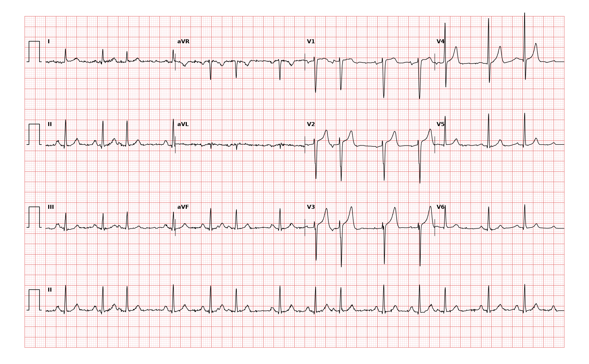

## 문제
75세 여자가 두 달 전부터 가끔 심장이 「한 번씩 건너뛰는」 느낌이 들어 왔다. 어지럼·실신·흉통·호흡곤란은 없고 하루 30분씩 걷는다. 하루 커피 4잔을 마시고, 최근 잠을 잘 못 잔다. 복용하는 약은 없다. 혈압 134/82 mmHg, 맥박 84회/분이고 불규칙하다. 심잡음은 없다. 갑상샘자극호르몬·혈청 칼륨·마그네슘은 정상이다. 심장초음파에서 좌심실 박출률 62 % 이고 판막 이상·좌심방 확대는 없다. 12유도 심전도는 그림과 같다. 처치로 가장 적절한 것은?

- A. 영구 심박동기를 삽입한다
- B. 카페인을 줄이게 하고 경과를 관찰한다
- C. 와파린으로 항응고를 시작한다
- D. 아미오다론을 투여한다
- E. 동기화 전기 심율동전환을 한다

_12유도 심전도, 25 mm/s · 10 mm/mV, 3×4 + II 리듬 스트립 (PTB-XL ECG dataset, PhysioNet, CC BY 4.0 — 원신호 그대로 작도)_

## 정답 및 해설
> 정답: B

- **정답 핵심**: II 리듬 스트립에서 동박동 두 번 뒤마다 일찍 오는 박동이 규칙적으로 반복되는 삼단맥이다. 끼어드는 박동의 QRS 는 동박동과 같은 모양으로 좁고, 뒤따르는 휴지는 보상성이 불완전하다 — 심방(상심실) 기외수축이다. 심방세동처럼 RR 이 완전히 불규칙하지 않고 기저 P파가 있으며, 넓은 QRS 의 심실 기외수축도 아니다. 구조적 심질환이 없고 증상이 가볍고 전해질·갑상샘 기능이 정상이므로 치료는 카페인·수면 부족 같은 유발 요인을 줄이고 안심시키는 것이다. 증상이 견디기 어려우면 베타차단제를 쓴다.
- **원리**: <b>왜 좁은 QRS 인가</b>: 심방 기외수축은 동결절이 아닌 심방의 다른 자리에서 일찍 생긴 흥분이 정상 방실결절-히스-푸르키니에 경로로 내려가므로 QRS 모양이 동박동과 같다(아주 일찍 오면 변행전도로 넓어지거나 전도되지 않을 수 있다). P파는 일찍 오고 모양이 다르며 앞 박동의 T파에 묻히기도 한다. 심실 기외수축은 심실에서 시작해 근육을 타고 퍼지므로 넓고 이상한 QRS 를 만든다.  <b>왜 휴지가 불완전한가</b>: 심방 기외수축은 동결절까지 거꾸로 들어가 동결절 주기를 다시 맞춘다. 그래서 기외수축 앞뒤 RR 을 더하면 정상 RR 두 개보다 짧다(불완전 보상휴지). 심실 기외수축은 대개 동결절을 건드리지 않아 완전 보상휴지가 생긴다.  <b>왜 대개 치료하지 않나</b>: 구조적으로 정상인 심장의 심방 기외수축은 흔하고 양성이다. 카페인·알코올·수면 부족·스트레스·갑상샘항진증·저칼륨혈증이 늘린다. 매우 잦으면 장기적으로 심방세동 위험과 관련되지만, 항부정맥제로 숫자를 줄이는 것이 예후를 바꾼다는 근거는 없다.
- **비교**: <table><thead><tr><th style="width:24%">항목</th><th style="width:38%">심방 기외수축 삼단맥(정답 판독)</th><th>심방세동(와파린 오답의 근거)</th></tr></thead><tbody> <tr><td>RR 간격</td><td><b>규칙적으로 반복되는</b> 짧은-긴 묶음</td><td>완전히 불규칙(불규칙하게 불규칙)</td></tr> <tr><td>P파</td><td>동박동마다 일정한 P파, 기외수축 앞 다른 모양 P</td><td>P파 없음, 잔물결 같은 f파</td></tr> <tr><td>처치</td><td>유발 요인 교정·안심, 증상 시 베타차단제</td><td>CHA₂DS₂-VASc 로 항응고 판단, 박동수 조절</td></tr> </tbody></table> 「불규칙한 맥」이라는 같은 진찰 소견이라도 묶음이 규칙적으로 반복되고 P파가 있으면 기외수축이다 — 항응고는 심방세동에서 결정한다.
- **오답 이유**:
  - ① 영구 심박동기는 증상이 있는 동기능부전이나 2도 Mobitz 2형·3도 방실차단처럼 박동이 느려지거나 끊길 때 정답이 된다.
  - ③ 와파린 항응고는 P파 없이 RR 이 완전히 불규칙한 심방세동이 기록되고 CHA₂DS₂-VASc 점수가 높을 때 정답이 된다(이 나이와 성별이면 대개 해당).
  - ④ 아미오다론은 구조적 심질환이 있는 환자의 지속성 심실빈맥이나 다른 약이 듣지 않는 심방세동의 리듬 조절에서 정답이 된다.
  - ⑤ 동기화 전기 심율동전환은 혈역학이 불안정한 빈맥(심방세동·조동·심실빈맥)에서 정답이 되며, 기외수축은 지속 리듬이 아니라 대상이 아니다.
- **함정**: 불규칙한 맥과 75세 여자라는 정보로 심방세동이라 보고 항응고를 고르는 것 — 리듬 스트립의 반복되는 묶음과 P파가 기외수축을 말한다.
- **학습목표**: 리듬 스트립에서 두 동박동 뒤마다 일찍 오는 좁은 QRS 를 심방 기외수축 삼단맥으로 판독하고, 구조적 심질환 없이 증상이 가벼우면 유발 요인 교정과 안심으로 처치한다
- **근거·출처**: Loscalzo J, Fauci AS, Kasper DL, et al., eds. Harrison's Principles of Internal Medicine, 22nd ed. McGraw Hill; 2025. Chapter 253: Approach to Supraventricular Arrhythmias · Loscalzo J, Fauci AS, Kasper DL, et al., eds. Harrison's Principles of Internal Medicine, 22nd ed. McGraw Hill; 2025. Chapter 247: Electrocardiography

## 출처
- PTB-XL ECG dataset v1.0.3 (PhysioNet, CC BY 4.0) · record 16425 · Creative Commons Attribution 4.0 International · https://physionet.org/content/ptb-xl/1.0.3/LICENSE.txt
