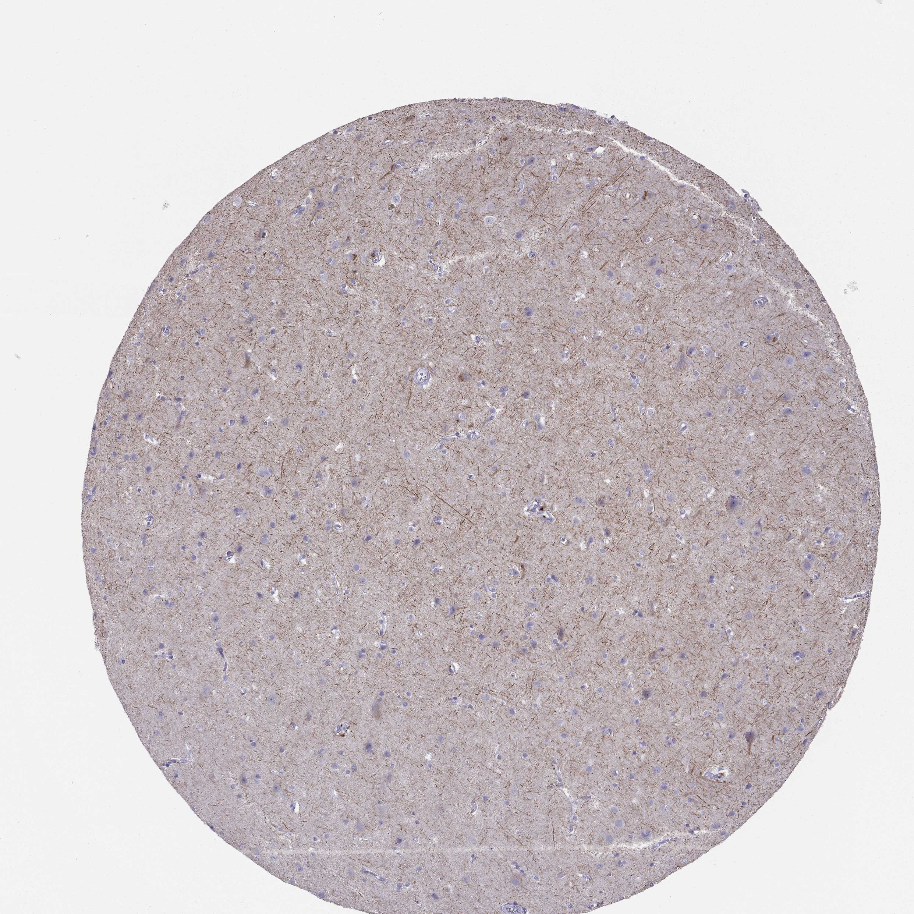

## 문제
37세 남자가 10년 동안 약으로 조절되지 않는 측두엽 뇌전증으로 앞쪽 측두엽 절제술을 받았다. 수술 전 자기공명영상에서 종괴는 없었다. 절제 검체 가운데 병변이 없는 대뇌피질 조직에 한 가지 단백질에 대한 면역조직화학염색을 하였고, 결과는 그림과 같다. 갈색으로 염색된 가는 섬유 구조물로 가장 적절한 것은?

- A. 미세아교세포의 돌기
- B. 모세혈관 내피세포
- C. 신경세포의 축삭
- D. 별아교세포의 돌기
- E. 희소돌기아교세포가 만든 수초

_조직미세배열 코어의 면역조직화학염색(DAB 갈색 발색, 헤마톡실린 대조염색), 원 배율 (Human Protein Atlas, CC BY 4.0 — 크롭·보정 없음)_

## 정답 및 해설
> 정답: C

- **정답 핵심**: 회색질의 신경그물 전체에 가늘고 긴 갈색 섬유가 여러 방향으로 곧게 지나가지만, 섬유가 어느 세포체에서 별 모양으로 뻗어 나오지 않고, 작은 아교세포 핵 주위와 혈관벽은 염색되지 않았다. 신경세포체 자체도 거의 비어 있다. 이 분포는 신경세포의 중간섬유인 신경미세섬유(neurofilament)가 축삭에 모여 있는 모습과 맞는다. 별아교세포 표지(GFAP)라면 세포체에서 굵은 돌기가 사방으로 뻗고 혈관 주위 발돌기가 진하게 물든다.
- **원리**: <b>왜 축삭에만 모이나</b>: 세포마다 고유한 중간섬유가 있다 — 상피는 케라틴, 간엽은 비멘틴, 근육은 데스민, 별아교세포는 GFAP, 신경세포는 신경미세섬유(경쇄·중간쇄·중쇄 — NEFL·NEFM·NEFH)다. 신경미세섬유는 세포체에서 만들어진 뒤 느린 축삭 수송으로 축삭에 쌓이며, 축삭의 굵기(따라서 전도 속도)를 정한다. 그래서 염색하면 세포체보다 <b>가늘고 긴 축삭</b>이 두드러진다.  <b>왜 진단에 쓰이나</b>: 중간섬유 면역염색은 미분화 종양의 기원 세포를 가르는 도구다(신경모세포종·신경내분비종양의 신경 분화). 또 축삭이 손상되면 신경미세섬유 경쇄가 뇌척수액·혈액으로 새어 나와, 다발경화증·외상성 뇌손상·근위축측삭경화증에서 축삭 손상 표지자로 측정한다.
- **비교**: <table><thead><tr><th style="width:24%">항목</th><th style="width:38%">신경세포 축삭(정답)</th><th>별아교세포 돌기(가장 가까운 오답)</th></tr></thead><tbody> <tr><td>중간섬유</td><td>신경미세섬유</td><td>GFAP</td></tr> <tr><td>염색 모양</td><td><b>세포체와 떨어져 길게 곧게 지나는 가는 선</b></td><td>작은 세포체에서 사방으로 뻗는 굵은 별 모양 돌기</td></tr> <tr><td>혈관 주위</td><td>염색 없음</td><td>혈관을 감싸는 발돌기가 진하게 염색</td></tr> </tbody></table> 둘 다 신경그물의 「섬유」로 보이지만, 섬유가 세포체에서 별처럼 퍼지는지, 혈관을 감싸는지가 둘을 가른다.
- **오답 이유**:
  - ① 미세아교세포의 돌기는 작고 길쭉한 핵 주위에 가지가 많은 짧은 돌기가 물드는 Iba1·CD68 염색일 때 정답이 된다.
  - ② 모세혈관 내피세포는 관 모양 구조의 안쪽 벽만 선형으로 물드는 CD31·CD34 염색일 때 정답이 된다.
  - ④ 별아교세포의 돌기는 작은 세포체에서 굵은 돌기가 별 모양으로 퍼지고 혈관 주위 발돌기가 진하게 물드는 GFAP 염색일 때 정답이 된다.
  - ⑤ 수초는 백질에서 축삭을 둘러싼 고리·관 모양으로 염색되는 수초 염색(LFB, MBP 면역염색)일 때 정답이 된다.
- **함정**: 신경그물의 섬유라면 모두 아교세포 돌기라고 보는 것 — 세포체에서 별처럼 퍼지지 않고 혈관을 감싸지 않는 긴 선은 축삭이다.
- **학습목표**: 대뇌피질 면역조직화학염색에서 신경그물을 가로지르는 가는 섬유만 염색되고 세포체·아교세포·혈관이 비어 있음을 읽어 신경세포 축삭(신경미세섬유)으로 판단한다
- **근거·출처**: Kumar V, Abbas AK, Aster JC, eds. Robbins and Cotran Pathologic Basis of Disease, 10th ed. Elsevier; 2020. Chapter 28: The Central Nervous System · Khalil M, Teunissen CE, Otto M, et al. Neurofilaments as biomarkers in neurological disorders. Nat Rev Neurol. 2018;14(10):577-589 · Uhlén M, Fagerberg L, Hallström BM, et al. Tissue-based map of the human proteome. Science. 2015;347(6220):1260419

## 출처
- Human Protein Atlas, NEFL / Cerebral cortex (CC BY 4.0), https://images.proteinatlas.org/14850/165171_B_9_5.jpg · Creative Commons Attribution 4.0 International · https://www.proteinatlas.org/about/licence
