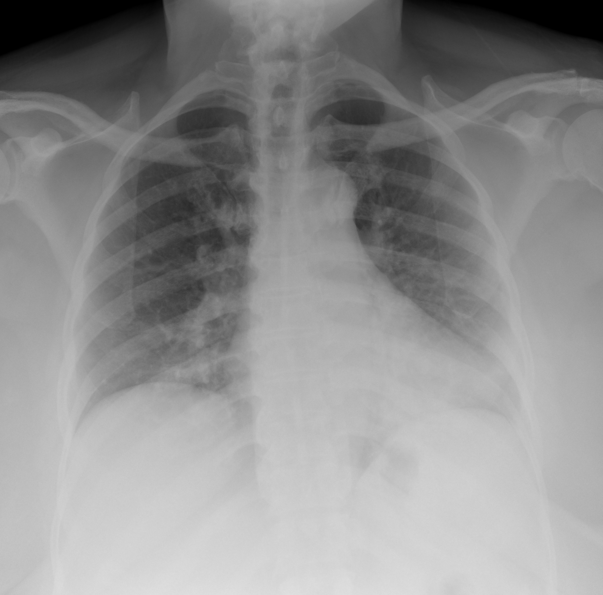

## 문제
A 61-year-old woman comes to the emergency department because of fever, dry cough, and increasing shortness of breath for 8 days. She noticed loss of smell on the second day of illness. Her husband had similar symptoms 2 weeks ago. She has type 2 diabetes mellitus treated with metformin. Her temperature is 38.3°C (100.9°F), pulse is 98/min, respirations are 24/min, and blood pressure is 132/78 mm Hg. Pulse oximetry on room air shows an oxygen saturation of 92%. Fine crackles are heard at both lung bases. Leukocyte count is 5,200/mm3 with a lymphocyte count of 650/mm3, and serum sodium is 138 mEq/L. A chest radiograph is shown. Which of the following is the most appropriate test to confirm the diagnosis?

- A. Serum (1→3)-β-D-glucan assay
- B. Sputum Gram stain and culture
- C. CT pulmonary angiography
- D. Nucleic acid amplification test of a nasopharyngeal swab for SARS-CoV-2
- E. Urinary antigen test for Legionella pneumophila

_Frontal chest radiograph, unaltered apart from scaling (The Cancer Imaging Archive, CC BY 4.0; no cropping or window adjustment)_

## 정답 및 해설
> 정답: D

- **정답 핵심**: The radiograph shows ill-defined opacities in both lower lung zones with low lung volumes and no lobar consolidation, cavity, or effusion. Together with early loss of smell, a household contact with a similar illness, lymphopenia, and hypoxemia in the second week of illness, this pattern indicates COVID-19 pneumonia. A nucleic acid amplification test (RT-PCR) of a nasopharyngeal swab is the reference test for confirming SARS-CoV-2 infection; a negative result with high suspicion is repeated or a lower respiratory sample is tested.
- **원리**: <b>Why the lower zones of both lungs</b>: SARS-CoV-2 enters type II pneumocytes through ACE2, which is abundant in the peripheral, dependent alveoli. Injury produces patchy ground-glass and reticular opacities that are bilateral, peripheral, and lower-zone predominant, unlike the single dense lobe of pneumococcal pneumonia.  <b>Why lymphopenia and anosmia point to it</b>: The virus causes lymphocyte redistribution and apoptosis, so an absolute lymphocyte count below 1,000/mm3 is common and correlates with severity. Infection of the olfactory epithelium's supporting cells causes sudden smell loss, a symptom far less typical of other viral or bacterial pneumonias.  <b>Why a nucleic acid test</b>: Viral RNA is most abundant in the upper airway during the first two weeks. NAAT has the highest sensitivity and specificity; antigen tests are faster but less sensitive, and antibody tests reflect past infection and are not used for acute diagnosis.
- **비교**: <table><thead><tr><th style="width:24%">Feature</th><th style="width:38%">COVID-19 pneumonia (answer)</th><th>Legionella pneumonia (closest distractor)</th></tr></thead><tbody> <tr><td>Clues</td><td>Anosmia, household contact, lymphopenia</td><td>Diarrhea, confusion, high fever, water-system exposure</td></tr> <tr><td>Laboratory</td><td>Normal sodium, normal leukocyte count</td><td><b>Hyponatremia</b>, elevated liver enzymes, leukocytosis</td></tr> <tr><td>Confirming test</td><td>Nasopharyngeal NAAT</td><td>Urinary antigen (serogroup 1)</td></tr> </tbody></table> Both can give bilateral opacities with a dry cough; the sodium level, diarrhea, and smell loss decide which test is ordered.
- **오답 이유**:
  - (A) Serum β-D-glucan would be correct for suspected Pneumocystis pneumonia in a patient with HIV (CD4 below 200/mm3) or chronic glucocorticoid use.
  - (B) Sputum Gram stain and culture would be correct for a lobar consolidation with purulent sputum, suggesting bacterial community-acquired pneumonia.
  - (C) CT pulmonary angiography would be correct for sudden dyspnea with pleuritic pain, tachycardia, and a clear radiograph suggesting pulmonary embolism.
  - (E) A Legionella urinary antigen test would be correct for pneumonia with hyponatremia, diarrhea, confusion, and exposure to contaminated water systems.
- **함정**: Ordering a bacterial or Legionella test because the radiograph shows bilateral opacities — anosmia, lymphopenia, and normal sodium point to SARS-CoV-2.
- **학습목표**: 후각 소실·림프구감소·양측 하폐야 음영으로 코로나19 폐렴을 의심하고 비인두 핵산증폭검사로 확진하며, 레지오넬라·주폐포자충 폐렴과 가른다
- **근거·출처**: Loscalzo J, Fauci AS, Kasper DL, et al., eds. Harrison's Principles of Internal Medicine, 22nd ed. McGraw Hill; 2025. Chapter 205: SARS-CoV-2 and COVID-19

## 출처
- COVID-19-AR, The Cancer Imaging Archive (CC BY 4.0) · series …23610568 · Creative Commons Attribution 4.0 International · https://www.cancerimagingarchive.net/data-usage-policies-and-restrictions/
