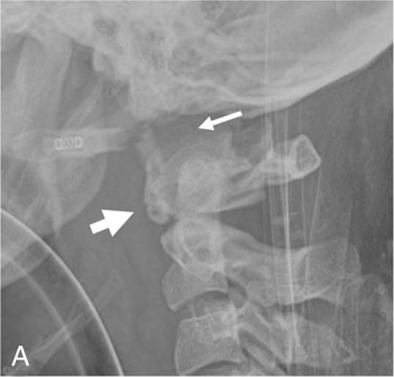

## 문제
21세 여자가 승용차 조수석에 타고 있다가 정면 충돌 사고를 당해 응급실로 이송되었다. 경추 보호대를 한 상태이며 목 뒤쪽이 아프다고 한다. 의식은 명료하고, 혈압 118/72 mmHg, 맥박 92회/분, 호흡 18회/분이다. 사지의 근력과 감각은 정상이고 항문 괄약근 긴장도도 정상이다. 복부와 흉부 진찰에서 이상은 없다. 경추 측면 단순 X선은 그림과 같다. 가장 적절한 처치는?

- A. 두개골 집게로 경추 견인을 시작한다
- B. 도수 정복 후 연성 경추 보호대로 바꾼다
- C. 보호대를 풀고 굴곡·신전 X선을 찍는다
- D. 고용량 메틸프레드니솔론을 정맥 투여한다
- E. 경추를 엄격히 고정한 채 후두골-경추 유합술을 준비한다

_경추 측면 단순 X선, 화살표·패널 글자는 원 논문 그림의 것 — 한 패널만 잘라냄, 그 밖의 변경 없음 (PMC Open Access Subset, CC BY)_

## 정답 및 해설
> 정답: E

- **정답 핵심**: 측면 X선에서 머리뼈 기저(basion)가 치돌기 끝보다 훨씬 위에 떨어져 있어 기저-치돌기 간격이 크게 넓어졌고(가는 화살표), 고리뼈 앞고리에 골절 조각(굵은 화살표)과 척추앞 연부조직 부종이 있다. 두개골과 위쪽 경추를 잇는 인대(덮개막·날개인대)가 끊어진 두개경추(고리뒤통수) 탈구다. 이 손상은 인대성이라 저절로 붙지 않으며, 견인을 하면 수직 분리가 더 벌어져 뇌간·척수가 늘어난다. 신경학적 결손이 없어도 모래주머니·테이프로 머리를 엄격히 고정하고 견인 없이 후두골-경추 내고정 유합술을 한다.
- **원리**: <b>왜 인대가 생명선인가</b>: 후두골-고리뼈-중쇠뼈 이음부의 안정성은 뼈가 아니라 인대(덮개막, 날개인대, 가로인대)가 만든다. 고속 감속 손상에서 머리가 몸통보다 늦게 멈추며 이 인대가 끊어지면 머리뼈가 경추에서 위로·앞으로 분리되고, 그 사이를 지나는 연수·위쪽 척수와 척추동맥이 늘어난다. 그래서 많은 환자가 현장에서 사망하고, 살아서 온 환자도 작은 움직임에 사지마비·호흡정지가 올 수 있다.  <b>왜 견인이 금기인가</b>: 다른 경추 탈구(예: 아래 경추 관절돌기 탈구)는 견인으로 정복하지만, 두개경추 탈구는 이미 <b>세로로 벌어진</b> 손상이라 견인이 분리를 더 키운다.  <b>왜 수술인가</b>: 끊어진 인대는 보조기로 고정해도 안정성을 되찾지 못해 할로 단독 치료 후 재탈구가 흔하다. 후두골에서 위쪽 경추까지 내고정해 뼈로 이어 붙이는 것이 확정 치료다.
- **비교**: <table><thead><tr><th style="width:24%">항목</th><th style="width:38%">두개경추 탈구(정답)</th><th>아래 경추 관절돌기 탈구(견인 오답이 정답이 되는 경우)</th></tr></thead><tbody> <tr><td>손상 방향</td><td><b>세로 분리</b> — 기저와 치돌기 사이가 벌어짐</td><td>앞으로 미끄러진 척추체, 관절돌기가 걸림</td></tr> <tr><td>견인</td><td>금기 — 분리를 키운다</td><td>의식 있는 환자에서 정복 방법</td></tr> <tr><td>확정 치료</td><td>후두골-경추 내고정 유합술</td><td>정복 후 경추 고정술</td></tr> </tbody></table> 같은 「경추 탈구」라도 벌어진 방향이 견인의 적응과 금기를 가른다.
- **오답 이유**:
  - ① 두개골 집게 견인은 의식이 명료한 환자의 아래 경추 관절돌기 탈구를 닫힌 정복할 때 정답이 되며, 두개경추 탈구에서는 분리를 키운다.
  - ② 도수 정복과 연성 보호대는 인대 손상이 없는 근육 염좌에서나 적절하고, 불안정 손상에서 보호대를 바꾸면 이차 척수 손상을 부른다.
  - ③ 굴곡·신전 X선은 의식이 명료하고 CT 가 정상인데 목 통증이 남아 숨은 인대 손상을 찾을 때 고려하며, 명백한 탈구에서는 위험하다.
  - ④ 고용량 메틸프레드니솔론은 일부 기관이 급성 척수손상 8시간 안에 선택적으로 쓰지만 근거가 약하고, 신경 결손이 없는 이 환자에게는 해당하지 않는다.
- **함정**: 신경학적으로 정상이니 보호대만으로 충분하다고 보거나 탈구니 견인한다고 보는 것 — 세로 분리 인대 손상은 견인 금기이고 유합술이 필요하다.
- **학습목표**: 경추 측면 X선에서 기저와 치돌기 끝이 크게 떨어진 두개경추 탈구를 읽고, 견인을 금기로 두고 엄격한 고정과 후두-경추 유합술을 준비한다
- **근거·출처**: American College of Surgeons. ATLS Advanced Trauma Life Support, 10th ed. Ch. Spine and Spinal Cord Trauma · Bellabarba C, Mirza SK, West GA, et al. Diagnosis and treatment of craniocervical dislocation in a series of 17 consecutive survivors during an 8-year period. J Neurosurg Spine. 2006;4(6):429-440 · Loscalzo J, Fauci AS, Kasper DL, et al., eds. Harrison's Principles of Internal Medicine, 22nd ed. McGraw Hill; 2025. Chapter 453: Diseases of the Spinal Cord

## 출처
- Traumatic combined vertical atlanto-occipital and atlanto-axial dislocations with 2-part fracture of the atlas: Two case reports. Medicine (Baltimore). 2019 Nov 1;98(44):e17776. doi: 10.1097/MD.0000000000017776 (CC BY) — Figure 2 · CC BY · https://creativecommons.org/licenses/
