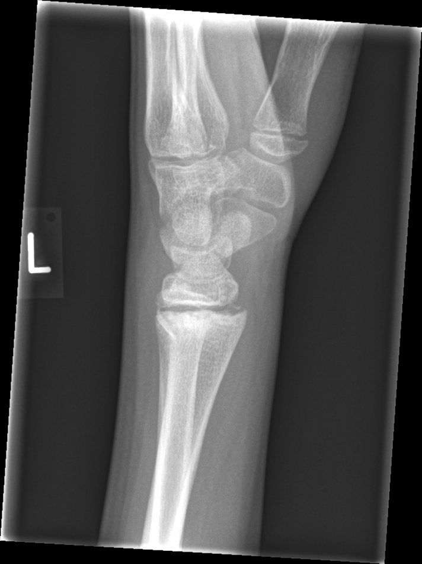

## 문제
A 12-year-old girl is brought to the physician because of persistent pain in her left wrist for 2 weeks. She fell onto her outstretched hand while roller-skating; at an urgent care center that day, she was told her wrist was sprained and was given an elastic bandage. Since then, the pain has decreased but recurs when she pushes up from a chair. She has no fever. Examination shows mild swelling and point tenderness over the dorsal aspect of the distal radius just proximal to the wrist crease. Range of motion is mildly limited by pain, and sensation and capillary refill in the hand are normal. Serum C-reactive protein concentration is within the reference range. A lateral radiograph of the left wrist is shown. Which of the following is the most appropriate next step in management?

- A. Short arm cast immobilization for 3 to 4 weeks
- B. Intravenous cefazolin and bone biopsy
- C. Closed reduction and percutaneous pinning
- D. MRI of the wrist
- E. Skeletal survey for suspected physical abuse

_Lateral radiograph of the left wrist and distal forearm; side marker as in the original, resized only (GRAZPEDWRI-DX, figshare, CC BY 4.0)_

## 정답 및 해설
> 정답: A

- **정답 핵심**: The lateral radiograph shows an open distal radial physis with an oblique fracture line that runs from the physis into the dorsal metaphysis, isolating a small metaphyseal fragment, and a thin layer of periosteal new bone along the dorsal cortex. Displacement and angulation are minimal. This is a Salter-Harris type II fracture of the distal radius that was missed on the day of injury and is now 2 weeks into healing; the periosteal reaction is callus, not infection. A nondisplaced healing type II fracture is treated with cast immobilization for a further 3 to 4 weeks, and growth disturbance is uncommon.
- **원리**: <b>Why the physis breaks first</b>: In children, the cartilaginous growth plate is weaker than the surrounding ligaments and bone, so a fall on an outstretched hand that would sprain an adult wrist instead separates the physis. In type II, the most common pattern, the fracture travels through the hypertrophic zone of the physis and exits through the metaphysis, leaving a triangular metaphyseal (Thurston Holland) fragment attached to the epiphysis.  <b>Why periosteal new bone appears at 2 weeks</b>: Children's periosteum is thick and highly osteogenic. Within 7 to 14 days after a fracture, it lifts and lays down a thin shell of new bone along the cortex. On a delayed radiograph, this callus often makes a subtle fracture visible for the first time.  <b>Why the prognosis is good</b>: In type II injuries, the germinal (resting) layer on the epiphyseal side is usually spared, so growth arrest is rare, unlike types III to V that cross or crush the germinal layer.
- **비교**: <table><thead><tr><th style="width:24%">Feature</th><th style="width:38%">Healing type II fracture (answer)</th><th>Acute osteomyelitis (closest distractor)</th></tr></thead><tbody> <tr><td>History</td><td>Clear fall, pain improving</td><td>No or trivial trauma, pain worsening</td></tr> <tr><td>Systemic signs</td><td>No fever, <b>normal CRP</b></td><td>Fever, elevated CRP and ESR</td></tr> <tr><td>Radiograph</td><td>Fracture line through physis and metaphysis + smooth callus</td><td>Metaphyseal lytic area, permeative destruction</td></tr> </tbody></table> Periosteal new bone is common to both; trauma, a fracture line, and normal inflammatory markers mark healing rather than infection.
- **오답 이유**:
  - (B) Intravenous cefazolin and bone biopsy would be correct for fever, worsening pain, elevated CRP, and a lytic metaphyseal lesion suggesting osteomyelitis.
  - (C) Closed reduction and pinning would be correct for an acute, markedly displaced or angulated physeal fracture, not for a healing nondisplaced one.
  - (D) MRI would be correct when radiographs remain normal despite persistent snuffbox or physeal tenderness, to detect an occult fracture.
  - (E) A skeletal survey would be correct for a child younger than 2 years, an inconsistent history, or multiple fractures at different stages of healing.
- **함정**: Reading periosteal new bone as infection — in a child with a clear fall, normal CRP, and a fracture line through the physis, it is fracture callus.
- **학습목표**: 넘어진 지 2주 된 소아 손목 측면 X선에서 성장판을 지나 골간단으로 이어지는 골절선과 골막 신생골을 치유 중인 Salter-Harris II 골절로 읽고, 골수염과 가른 뒤 석고 고정한다
- **근거·출처**: Salter RB, Harris WR. Injuries involving the epiphyseal plate. J Bone Joint Surg Am. 1963;45(3):587-622 · Waters PM, Skaggs DL, Flynn JM, eds. Rockwood and Wilkins' Fractures in Children, 9th ed. Wolters Kluwer; 2019. Ch. Fractures of the distal radius and ulna

## 출처
- GRAZPEDWRI-DX (figshare, CC BY 4.0) · Creative Commons Attribution 4.0 International · https://creativecommons.org/licenses/by/4.0/
