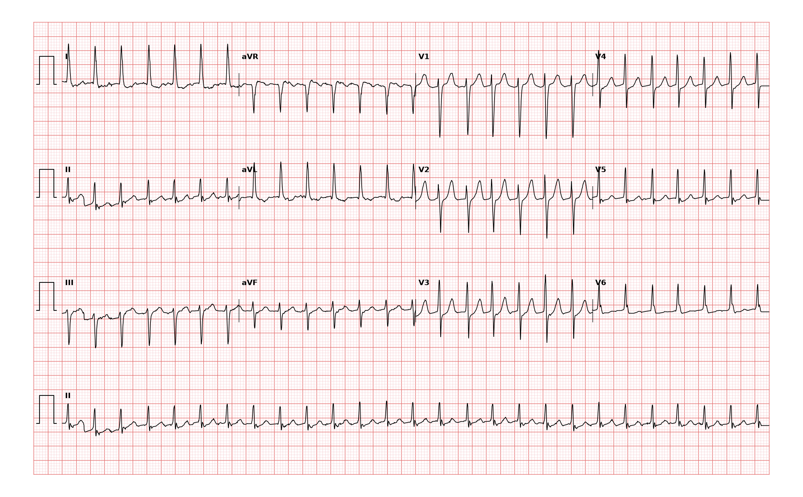

## 문제
74세 여자가 30분 전 텔레비전을 보다가 갑자기 가슴이 빠르게 뛰기 시작해 응급실에 왔다. 비슷한 두근거림이 몇 년에 한 번씩 있었고 저절로 멎었다고 한다. 흉통과 호흡곤란은 없고 어지럼이 약간 있다. 혈압 128/76 mmHg, 호흡 18회/분, 산소포화도 97 % 이다. 맥은 빠르고 규칙적이다. 혈청 칼륨 4.1 mEq/L, 갑상샘자극호르몬은 정상이다. 12유도 심전도는 그림과 같다. 심전도 판독으로 가장 적절한 것은?

- A. 발작성 상심실빈맥
- B. 동빈맥
- C. 2:1 전도의 심방조동
- D. 빠른 심실 반응의 심방세동
- E. 심실빈맥

_12유도 심전도, 25 mm/s · 10 mm/mV, 3×4 + II 리듬 스트립 (PTB-XL ECG dataset, PhysioNet, CC BY 4.0 — 원신호 그대로 작도)_

## 정답 및 해설
> 정답: A

- **정답 핵심**: II 리듬 스트립에서 RR 간격이 일정한 좁은 QRS(0.12 s 미만) 빈맥이 약 170회/분이다. 어느 유도에서도 QRS 앞에 뚜렷한 P파가 없고, II·III·aVF 에 톱니 모양의 조동파가 없으며, 기선이 불규칙하게 흔들리는 세동파도 없다. 갑자기 시작해 갑자기 멎는 병력과 함께 이는 발작성 상심실빈맥(대개 방실결절 재진입 빈맥)이다. 일부 유도의 ST 하강은 빠른 맥에 따른 변화로, 빈맥이 멎으면 사라진다.
- **원리**: <b>왜 P파가 사라지나</b>: 가장 흔한 방실결절 재진입 빈맥은 결절 안의 빠른 길과 느린 길이 고리를 이룬다. 전기가 느린 길로 내려가 빠른 길로 거슬러 올라가므로 심방과 심실이 거의 <b>동시에</b> 탈분극한다. 그래서 역행 P파가 QRS 속에 숨거나 QRS 끝에 작은 패임(V1 의 가성 r′, 하벽 유도의 가성 s)으로만 보인다.  <b>왜 갑자기 시작하고 멎나</b>: 조기 심방 수축이 빠른 길이 아직 불응기일 때 들어오면 느린 길로만 내려가 고리가 시작된다. 고리에 결절이 포함되므로 미주신경 자극이나 아데노신으로 결절 전도를 잠시 막으면 고리가 끊어져 한 박동 만에 멎는다.  <b>왜 좁은가</b>: 심실은 정상 히스-푸르키니에 경로로 탈분극하므로 QRS 가 좁다. 넓다면 변행 전도·부전도로 전도·심실빈맥을 먼저 생각한다.
- **비교**: <table><thead><tr><th style="width:24%">항목</th><th style="width:38%">발작성 상심실빈맥(정답)</th><th>2:1 심방조동(가장 가까운 오답)</th></tr></thead><tbody> <tr><td>심박수</td><td>대개 150~250회/분, 이 기록 약 170</td><td><b>약 150회/분 근처에 고정</b>(심방 300 의 절반)</td></tr> <tr><td>심방 활동</td><td>보이지 않거나 QRS 끝에 숨음</td><td>II·III·aVF 의 톱니 모양 조동파, V1 의 규칙적 F파</td></tr> <tr><td>아데노신</td><td>대개 멎는다</td><td>멎지 않고 전도가 줄어 조동파가 드러난다</td></tr> </tbody></table> 둘 다 규칙적인 좁은 QRS 빈맥이다 — 박동수가 150 에 붙어 있는지, 하벽 유도에 톱니가 있는지를 먼저 본다.
- **오답 이유**:
  - ② 동빈맥은 모든 QRS 앞에 II 유도 양성 P파가 일정한 PR 로 있고, 열·탈수·통증처럼 서서히 빨라지는 원인이 있을 때 정답이 된다.
  - ③ 2:1 심방조동은 심박수가 약 150회/분에 고정되고 II·III·aVF 에 톱니 모양 조동파가 보일 때 정답이 된다.
  - ④ 빠른 심실 반응의 심방세동은 RR 간격이 완전히 불규칙하고 P파 대신 기선이 불규칙하게 흔들릴 때 정답이 된다.
  - ⑤ 심실빈맥은 QRS 가 0.12 s 이상 넓고 방실 해리·포착 박동·융합 박동이 보일 때 정답이 된다.
- **함정**: 빠르고 규칙적인 맥을 모두 동빈맥으로 읽는 것 — 갑작스런 시작과 QRS 앞 P파가 없는 것이 상심실빈맥을 가른다.
- **학습목표**: 규칙적인 좁은 QRS 빈맥(약 170회/분)에서 QRS 앞 P파와 조동파가 없음을 읽어 발작성 상심실빈맥으로 판독하고 동빈맥·심방조동·심방세동·심실빈맥과 가른다
- **근거·출처**: Loscalzo J, Fauci AS, Kasper DL, et al., eds. Harrison's Principles of Internal Medicine, 22nd ed. McGraw Hill; 2025. Chapter 256: Paroxysmal Supraventricular Tachycardias · Loscalzo J, Fauci AS, Kasper DL, et al., eds. Harrison's Principles of Internal Medicine, 22nd ed. McGraw Hill; 2025. Chapter 247: Electrocardiography

## 출처
- PTB-XL ECG dataset v1.0.3 (PhysioNet, CC BY 4.0) · record 7889 · Creative Commons Attribution 4.0 International · https://physionet.org/content/ptb-xl/1.0.3/LICENSE.txt
