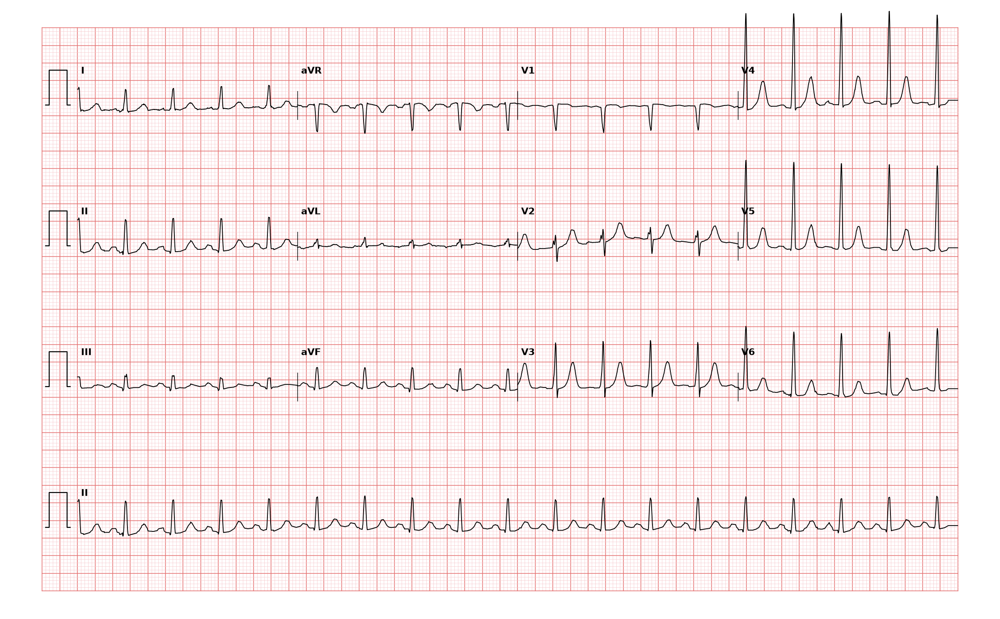

## 문제
68세 남자가 이틀 전부터 하루 10번 넘는 물설사와 구토가 있고 일어서면 어지러워 응급실에 왔다. 고혈압으로 암로디핀을 먹고 있다. 체온 37.6℃, 혈압 102/64 mmHg(일어서면 84/56 mmHg), 맥박 116회/분, 호흡 18회/분이다. 혀와 입안이 말라 있고 피부 긴장도가 떨어져 있다. 혈액요소질소 42 mg/dL, 크레아티닌 1.5 mg/dL(평소 0.9), 나트륨 141 mEq/L, 칼륨 3.6 mEq/L 이다. 12유도 심전도는 그림과 같다. 가장 적절한 처치는?

- A. 동기화 심율동전환
- B. 아미오다론 정맥 주사
- C. 생리식염수 정맥 주입
- D. 아데노신 정맥 주사
- E. 메토프롤롤 정맥 주사

_12유도 심전도, 25 mm/s · 10 mm/mV, 3×4 + II 리듬 스트립 (PTB-XL ECG dataset, PhysioNet, CC BY 4.0 — 원신호 그대로 작도)_

## 정답 및 해설
> 정답: C

- **정답 핵심**: II 리듬 스트립에서 모든 QRS 앞에 양성 P파가 일정한 PR 로 있고, 좁은 QRS 가 규칙적으로 약 115회/분이다 — 동빈맥이다. 동빈맥은 그 자체가 부정맥이 아니라 몸의 요구에 대한 정상 반응이므로, 원인을 고치는 것이 치료다. 이 환자는 설사·구토, 기립성 저혈압, 입마름, BUN/크레아티닌 비 28 의 신전성 급성 신장손상이 있어 체액 소실이 원인이다. 생리식염수로 혈관 내 용적을 채우면 박동수가 저절로 내려간다.
- **원리**: <b>왜 박동수를 낮추면 안 되나</b>: 심박출량 = 일회박출량 × 심박수다. 체액이 빠지면 정맥환류와 일회박출량이 줄고, 압수용체 반사가 교감신경을 올려 심박수를 늘려 심박출량과 혈압을 지킨다. 이때 β차단제로 박동수를 떨어뜨리면 마지막 보상이 사라져 혈압이 무너진다.  <b>왜 동빈맥이라 단정하나</b>: 동방결절에서 시작한 박동은 심방을 위에서 아래·오른쪽에서 왼쪽으로 탈분극해 I·II 에서 양성 P파를 만든다. 모든 QRS 앞에 같은 모양의 P파가 일정한 PR 로 있으면 동결절 기원이다. 박동수는 원인에 따라 서서히 오르내리고, 아데노신을 주면 잠시 느려질 뿐 멎지 않는다.  <b>원인 찾기</b>: 열·통증·불안·빈혈·저혈량·저산소증·갑상샘항진증·폐색전증·약물(β작용제·카페인)·금단이 흔하다. 원인을 못 찾고 지속되면 부적절 동빈맥·동결절 재진입을 생각한다.
- **비교**: <table><thead><tr><th style="width:24%">항목</th><th style="width:38%">원인이 있는 동빈맥(정답)</th><th>박동수 조절이 맞는 경우(메토프롤롤 오답)</th></tr></thead><tbody> <tr><td>리듬</td><td>정상 P파가 모든 QRS 앞에</td><td>심방세동·조동처럼 심방 리듬이 비정상</td></tr> <tr><td>혈역학</td><td><b>저혈량·기립성 저혈압</b> — 빈맥이 보상</td><td>혈압 유지, 빈맥 자체가 증상의 원인</td></tr> <tr><td>치료</td><td>수액 등 원인 교정</td><td>β차단제·칼슘통로차단제</td></tr> </tbody></table> 빈맥이 원인인지 결과인지를 먼저 묻는다 — 결과라면 박동수를 직접 낮추는 약은 보상을 빼앗는다.
- **오답 이유**:
  - ① 동기화 심율동전환은 쇼크·의식 저하·허혈성 흉통이 있는 불안정한 재진입 빈맥(상심실빈맥·조동·맥박 있는 심실빈맥)에서 정답이 된다.
  - ② 아미오다론은 혈역학적으로 안정한 단형 심실빈맥이나 심기능이 낮은 환자의 심방세동 박동수·리듬 조절에서 정답이 된다.
  - ④ 아데노신은 P파가 보이지 않는 규칙적인 좁은 QRS 빈맥(발작성 상심실빈맥)에서 미주신경 자극이 실패했을 때 정답이 된다.
  - ⑤ 메토프롤롤은 혈압이 유지되는 빠른 심실 반응의 심방세동·조동에서 박동수 조절용으로 정답이 된다.
- **함정**: 빠른 맥을 부정맥으로 보고 박동수를 낮추는 약을 고르는 것 — 정상 P파가 앞선 동빈맥은 저혈량의 보상이며 수액이 치료다.
- **학습목표**: 모든 QRS 앞에 정상 P파가 있는 동빈맥을 읽고, 체액 소실이라는 원인을 찾아 박동수 조절이 아니라 수액으로 교정한다
- **근거·출처**: Loscalzo J, Fauci AS, Kasper DL, et al., eds. Harrison's Principles of Internal Medicine, 22nd ed. McGraw Hill; 2025. Chapter 253: Approach to Supraventricular Arrhythmias · Loscalzo J, Fauci AS, Kasper DL, et al., eds. Harrison's Principles of Internal Medicine, 22nd ed. McGraw Hill; 2025. Chapter 247: Electrocardiography

## 출처
- PTB-XL ECG dataset v1.0.3 (PhysioNet, CC BY 4.0) · record 17848 · Creative Commons Attribution 4.0 International · https://physionet.org/content/ptb-xl/1.0.3/LICENSE.txt
