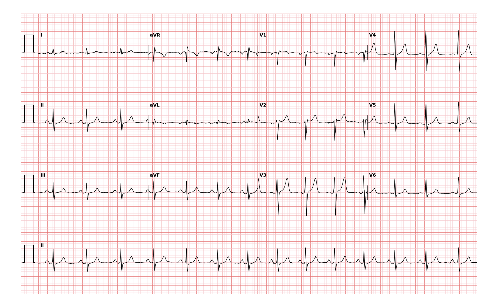

## 문제
A 37-year-old man undergoes a preemployment medical examination. He has no symptoms and runs 5 km three times a week without difficulty. He has never had palpitations or syncope, and there is no family history of sudden cardiac death. He takes no medications. His pulse is 80/min, and blood pressure is 124/78 mm Hg. Cardiac examination shows a normal first heart sound and physiologic splitting of the second heart sound without murmurs. Serum electrolyte concentrations are within the reference ranges. A 12-lead ECG is shown. Which of the following is the most likely interpretation of this ECG?

- A. Left anterior fascicular block
- B. Sinus rhythm with incomplete RBBB
- C. Sinus rhythm with complete RBBB
- D. Type 1 Brugada pattern
- E. Wolff-Parkinson-White pattern

_12-lead ECG, 25 mm/s, 10 mm/mV, 3×4 + lead II rhythm strip (PTB-XL, PhysioNet, CC BY 4.0; raw signal, no filtering)_

## 정답 및 해설
> 정답: B

- **정답 핵심**: The rhythm strip shows sinus rhythm at about 80/min with an upright P wave before every QRS in lead II and a normal PR interval. In V1, the QRS has an rSr′ shape, and there is a terminal positive deflection in aVR, but the QRS duration is less than 0.12 seconds, and the terminal S waves in I and V6 are small and not broad. The axis is normal (positive QRS in I, II, and aVF), there is no delta wave or short PR, and there is no coved ST elevation in V1 and V2. This is incomplete right bundle branch block, a common finding in healthy young adults; in the absence of a fixed split S2 or murmur, no further testing is needed.
- **원리**: <b>Why the terminal r′ appears in V1</b>: Normally the right and left ventricles depolarize together, and the larger left ventricle dominates, giving V1 an rS complex. When conduction in the right bundle is slowed, the right ventricle is activated slightly late, after the left has finished. That late rightward, anterior force produces a second positive wave (r′) in V1, a terminal R in aVR, and a terminal s in I and V6.  <b>Why width decides complete versus incomplete</b>: If the right bundle is fully blocked, the right ventricle is activated slowly through muscle from the left side, and the QRS widens to 0.12 seconds or more with a broad, slurred S in I and V6. If conduction is only delayed, the late force is brief, and the QRS stays between 0.10 and 0.12 seconds.  <b>When it matters</b>: Isolated incomplete RBBB in a healthy person carries no prognostic weight. It becomes a clue when combined with a fixed split S2 and a systolic flow murmur (secundum atrial septal defect causing right ventricular volume overload), or with right ventricular hypertrophy.
- **비교**: <table><thead><tr><th style="width:24%">Feature</th><th style="width:38%">Incomplete RBBB (answer)</th><th>Complete RBBB (closest distractor)</th></tr></thead><tbody> <tr><td>QRS duration</td><td><b>Less than 0.12 s</b></td><td>0.12 s or more</td></tr> <tr><td>V1</td><td>rSr′ with a small r′</td><td>rsR′ with a tall, broad R′ ("M" shape)</td></tr> <tr><td>I and V6</td><td>Small terminal s</td><td>Wide, slurred S wave</td></tr> <tr><td>ST-T in V1</td><td>Usually normal</td><td>Secondary T-wave inversion</td></tr> </tbody></table> The same rSr′ shape is read differently by width: measure the QRS before naming the block.
- **오답 이유**:
  - (A) Left anterior fascicular block would be correct for left axis deviation beyond −45° with qR in I and aVL and rS in II, III, and aVF.
  - (C) Complete RBBB would be correct if the QRS were 0.12 s or wider with a tall, broad R′ in V1 and wide, slurred S waves in I and V6.
  - (D) A type 1 Brugada pattern would be correct for coved ST elevation of 2 mm or more with T-wave inversion in V1 and V2, often with syncope or a family history of sudden death.
  - (E) A Wolff-Parkinson-White pattern would be correct for a PR interval under 0.12 s with a slurred delta wave at the start of a widened QRS.
- **함정**: Calling any rSr′ in V1 a complete bundle branch block or Brugada pattern — a QRS under 0.12 s without coved ST elevation is incomplete RBBB.
- **학습목표**: V1 의 rSr′ 과 0.12 s 미만의 QRS 폭으로 불완전 우각차단을 판독하고, 완전 우각차단·Brugada 양상·WPW·좌전섬유속차단과 가른다
- **근거·출처**: Loscalzo J, Fauci AS, Kasper DL, et al., eds. Harrison's Principles of Internal Medicine, 22nd ed. McGraw Hill; 2025. Chapter 247: Electrocardiography · Surawicz B, Childers R, Deal BJ, Gettes LS. AHA/ACCF/HRS recommendations for the standardization and interpretation of the electrocardiogram: part III: intraventricular conduction disturbances. J Am Coll Cardiol. 2009;53(11):976-981

## 출처
- PTB-XL ECG dataset v1.0.3 (PhysioNet, CC BY 4.0) · record 5455 · Creative Commons Attribution 4.0 International · https://physionet.org/content/ptb-xl/1.0.3/LICENSE.txt
