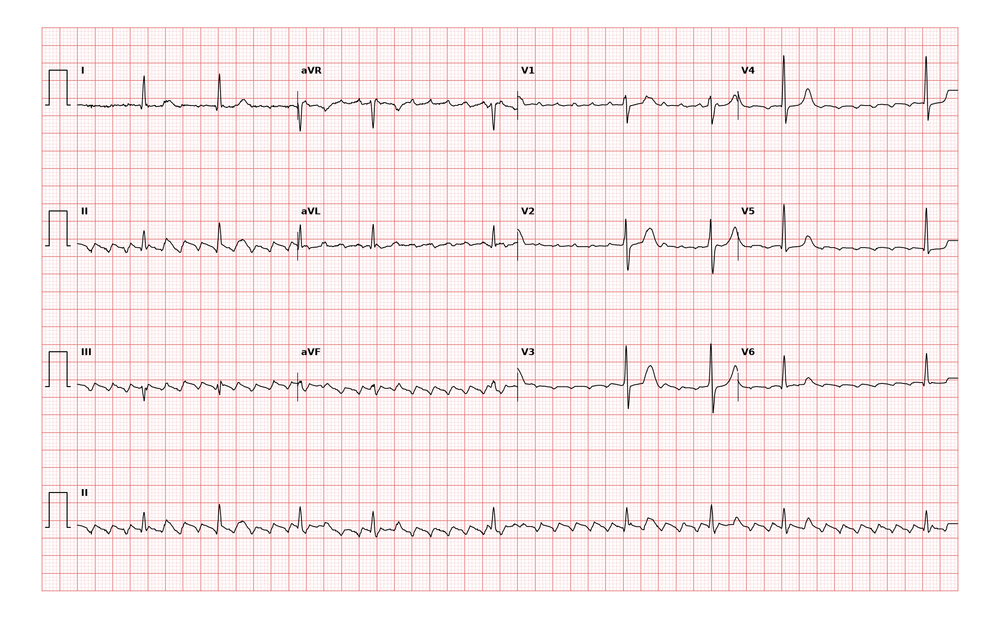

## 문제
65세 남자가 사흘 전부터 두근거림과 계단을 오를 때 숨이 차서 왔다. 고혈압과 만성폐쇄폐질환으로 약을 먹고 있다. 흉통과 실신은 없었다. 혈압 134/82 mmHg, 맥박 76회/분(불규칙), 호흡 18회/분, 산소포화도 95 % 이다. 혈청 칼륨 4.3 mEq/L, 갑상샘자극호르몬은 정상이다. 12유도 심전도는 그림과 같다. 심전도 판독으로 가장 적절한 것은?

- A. 다소성 심방빈맥
- B. 동부정맥
- C. 가속 접합부 리듬
- D. 심방조동
- E. 심방세동

_12유도 심전도, 25 mm/s · 10 mm/mV, 3×4 + II 리듬 스트립 (PTB-XL ECG dataset, PhysioNet, CC BY 4.0 — 원신호 그대로 작도)_

## 정답 및 해설
> 정답: D

- **정답 핵심**: II·III·aVF 의 기저선이 평탄한 곳 없이 일정한 간격의 톱니 모양 음성 파(조동파)로 채워져 있고, 리듬 스트립에서도 조동파는 규칙적인데 QRS 만 2:1·3:1·4:1 로 바뀌며 불규칙하게 따라온다. QRS 는 좁다. 규칙적인 심방 활동과 변동 방실전도의 조합은 심방조동이다. 심방세동이라면 기저선이 불규칙한 잔물결이고 일정한 주기의 파가 없다.
- **원리**: <b>왜 톱니 모양인가</b>: 전형적 심방조동은 우심방 안에서 삼첨판륜을 따라 도는 큰 재진입 회로다. 회로가 하대정맥과 삼첨판 사이의 협부(cavotricuspid isthmus)를 지나므로 흥분이 심방중격을 아래에서 위로 올라가고, 그래서 하벽 유도(II·III·aVF)에 <b>음성 톱니 파</b>가 분당 약 300회로 끊임없이 나타난다. 등전위 기저선이 없는 것이 특징이다.  <b>왜 맥이 불규칙할 수 있나</b>: 방실결절은 300회/분을 다 통과시키지 못해 보통 2:1(심실 약 150회/분)로 전도한다. 전도비가 2:1·4:1 사이에서 바뀌면(변동 전도) 맥이 불규칙해져 진찰로는 심방세동처럼 느껴진다. 규칙적인 150회/분 좁은 QRS 빈맥을 보면 늘 2:1 조동을 의심하는 이유이기도 하다.  <b>왜 구분이 중요한가</b>: 혈전색전 위험과 항응고 기준은 심방세동과 같지만, 협부를 끊는 도자절제술의 성공률이 90 % 이상으로 높아 재발하면 약보다 절제를 우선 고려한다.
- **비교**: <table><thead><tr><th style="width:24%">항목</th><th style="width:38%">심방조동(정답)</th><th>심방세동(가장 가까운 오답)</th></tr></thead><tbody> <tr><td>심방 활동</td><td><b>규칙적인 톱니 파 약 300회/분</b>, II·III·aVF 에서 뚜렷</td><td>불규칙한 잔물결(f파) 350~600회/분, 일정한 주기 없음</td></tr> <tr><td>QRS 간격</td><td>전도비가 일정하면 규칙, 변동하면 몇 가지 간격이 반복</td><td>완전히 불규칙(irregularly irregular)</td></tr> <tr><td>근치 치료</td><td>삼첨판-하대정맥 협부 절제(성공률 높음)</td><td>폐정맥 격리</td></tr> </tbody></table> 맥이 불규칙해도 심방 파가 일정한 주기로 반복되면 조동이다. 기저선에 일정한 간격의 파가 보이는지를 먼저 본다.
- **오답 이유**:
  - ① 다소성 심방빈맥은 한 유도에서 모양이 다른 P파가 3가지 이상 보이고 그 사이에 등전위 기저선이 있으며 심박수 100회/분 이상일 때 정답이 된다.
  - ② 동부정맥은 모든 QRS 앞에 같은 모양의 양성 P파가 일정한 PR 로 있고 호흡에 따라 PP 간격만 바뀔 때 정답이 된다.
  - ③ 가속 접합부 리듬은 P파가 없거나 역행성이고 좁은 QRS 가 60~100회/분으로 규칙적일 때 정답이 된다.
  - ⑤ 심방세동은 기저선이 주기 없는 잔물결이고 QRS 간격이 완전히 불규칙하며 반복되는 톱니 파가 없을 때 정답이 된다.
- **함정**: 맥이 불규칙하니 심방세동으로 읽는 것 — 하벽 유도의 기저선이 일정한 주기의 톱니 파로 채워져 있으면 변동 전도의 심방조동이다.
- **학습목표**: 하벽 유도의 톱니 모양 조동파와 변동 방실전도를 읽어 심방조동으로 판독하고 심방세동·다소성 심방빈맥·동리듬과 가른다
- **근거·출처**: Loscalzo J, Fauci AS, Kasper DL, et al., eds. Harrison's Principles of Internal Medicine, 22nd ed. McGraw Hill; 2025. Chapter 257: Common Atrial Flutter and Macroreentrant and Multifocal Atrial Tachycardias · Loscalzo J, Fauci AS, Kasper DL, et al., eds. Harrison's Principles of Internal Medicine, 22nd ed. McGraw Hill; 2025. Chapter 247: Electrocardiography

## 출처
- PTB-XL ECG dataset v1.0.3 (PhysioNet, CC BY 4.0) · record 1773 · Creative Commons Attribution 4.0 International · https://physionet.org/content/ptb-xl/1.0.3/LICENSE.txt
