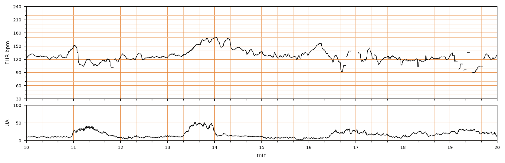

## 문제
A 23-year-old woman, gravida 1, para 0, at 40 weeks' gestation is admitted in active labor. Her pregnancy has been uncomplicated. The membranes ruptured spontaneously 3 hours ago, and the amniotic fluid is clear. Her temperature is 36.9°C (98.4°F), pulse is 88/min, and blood pressure is 118/72 mm Hg. The cervix is 6 cm dilated. Continuous external fetal heart rate and uterine activity monitoring is started; a 10-minute segment is shown. Which of the following is the most likely cause of the fetal heart rate change that begins at 11 minutes?

- A. Maternal hypotension from regional anesthesia
- B. Fetal anemia
- C. Umbilical cord compression
- D. Fetal head compression
- E. Uteroplacental insufficiency

_Fetal heart rate (top) and uterine activity (bottom) during labor, a 10-minute segment, bold vertical lines = 1 min (PhysioNet CTU-UHB, ODC-BY 1.0; 4 Hz raw data, no smoothing; gaps are signal loss)_

## 정답 및 해설
> 정답: C

- **정답 핵심**: The baseline is about 125/min with moderate variability. At 11 minutes, with the onset of a contraction, the fetal heart rate falls abruptly from about 150/min to 105/min, reaching the nadir within 30 seconds, and recovers about a minute later. An abrupt decrease of at least 15/min lasting 15 seconds to 2 minutes is a variable deceleration, which reflects umbilical cord compression. Ruptured membranes, which reduce the fluid cushion around the cord, make cord compression more likely.
- **원리**: <b>Why cord compression gives an abrupt drop</b>: Squeezing the umbilical cord first occludes the thin-walled vein (reducing return and causing a brief acceleration, the "shoulder") and then the arteries. Sudden arterial occlusion raises fetal systemic resistance and blood pressure, triggering a baroreceptor-mediated vagal reflex that slows the heart within seconds. When the cord is released the rate returns just as fast. The speed of onset — less than 30 seconds to the nadir — is the defining feature.  <b>Why the other decelerations look different</b>: Head compression raises intracranial pressure and causes a gradual, vagally mediated decrease that mirrors the contraction (early deceleration). Uteroplacental insufficiency lowers fetal oxygen tension only after the contraction has reduced intervillous flow, so the gradual decrease begins late and its nadir follows the contraction peak (late deceleration).  <b>Why it matters</b>: Occasional variable decelerations with moderate variability are common and are managed with maternal repositioning; recurrent ones, especially with lost variability, warrant amnioinfusion or expedited delivery.
- **비교**: <table><thead><tr><th style="width:22%">Feature</th><th style="width:39%">Variable deceleration (answer)</th><th>Early deceleration (closest distractor)</th></tr></thead><tbody> <tr><td>Onset to nadir</td><td><b>Abrupt, under 30 seconds</b></td><td>Gradual, 30 seconds or longer</td></tr> <tr><td>Timing</td><td>Variable relation to contractions</td><td>Nadir coincides with the contraction peak (mirror image)</td></tr> <tr><td>Mechanism</td><td>Umbilical cord compression</td><td>Fetal head compression</td></tr> <tr><td>Significance</td><td>Benign if occasional with moderate variability</td><td>Benign, no intervention</td></tr> </tbody></table> Both occur with contractions; the shape of the descent — a sharp V or U versus a smooth mirror of the contraction — separates them.
- **오답 이유**:
  - (A) Maternal hypotension would be correct if a prolonged deceleration followed epidural placement with a fall in maternal blood pressure.
  - (B) Fetal anemia would be correct if the tracing showed a sinusoidal pattern of smooth undulations at 3 to 5 cycles per minute.
  - (D) Fetal head compression would be correct if the decrease were gradual and mirrored the contraction, with its nadir at the contraction peak.
  - (E) Uteroplacental insufficiency would be correct if a gradual decrease began after the contraction started and its nadir came after the contraction peak.
- **함정**: Calling any contraction-associated deceleration early or late — the abrupt fall to the nadir within 30 seconds makes it variable, from cord compression.
- **학습목표**: 자궁수축과 함께 30초 안에 급히 떨어졌다가 빠르게 회복하는 태아심박동 감속을 변동성 감속으로 읽고 제대 압박을 원인으로 판단한다
- **근거·출처**: Macones GA, Hankins GD, Spong CY, et al. The 2008 National Institute of Child Health and Human Development workshop report on electronic fetal monitoring. Obstet Gynecol. 2008;112(3):661-666 · Cunningham FG, Leveno KJ, Dashe JS, et al., eds. Williams Obstetrics, 26th ed. McGraw Hill; 2022. Chapter 24: Intrapartum Assessment

## 출처
- CTU-UHB Intrapartum Cardiotocography Database (PhysioNet, ODC-BY 1.0) · record 1466 · Open Data Commons Attribution License v1.0 · https://opendatacommons.org/licenses/by/1-0/
