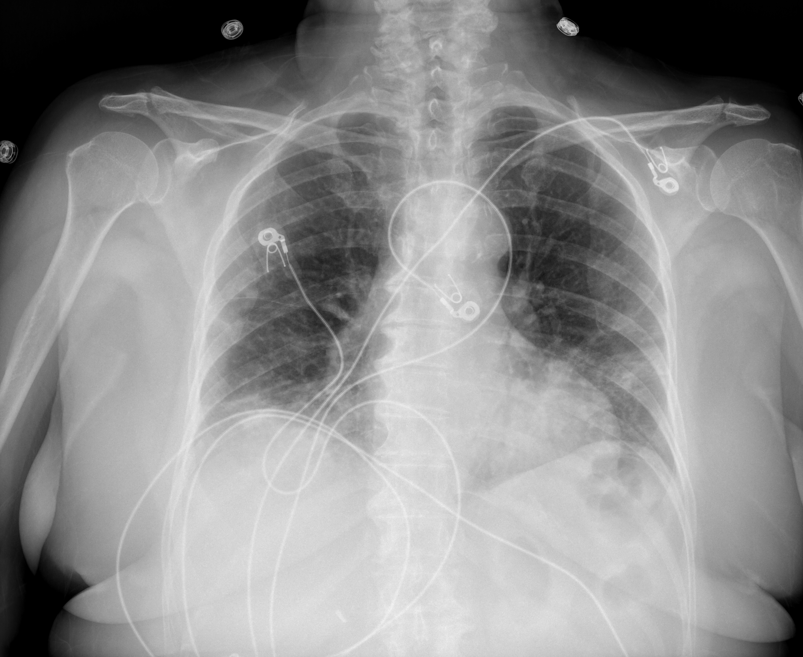

## 문제
67세 여자가 9일 전부터 열·마른기침이 있다가 이틀 전부터 숨이 차서 응급실에 왔다. 증상 첫날 시행한 신속항원검사에서 코로나19 양성이었다. 고혈압과 비만이 있다. 체온 38.1 ℃, 맥박 104회/분, 호흡 26회/분, 혈압 128/74 mmHg 이고, 실내 공기에서 산소포화도 89 % 이다. 양쪽 폐 아래쪽에서 수포음이 들린다. 백혈구 6,100/mm³(림프구 9 %), 프로칼시토닌 0.08 ng/mL, 사구체여과율 72 mL/min/1.73 m² 이다. 비강 캐뉼라 4 L/분으로 산소포화도가 94 % 가 되었다. 흉부 X선은 그림과 같다. 산소 치료와 함께 가장 적절한 약물 치료는?

- A. 반코마이신과 피페라실린-타조박탐을 정맥 투여한다
- B. 하이드록시클로로퀸을 5일 동안 복용시킨다
- C. 메틸프레드니솔론 1 g 을 사흘 동안 정맥 투여한다
- D. 덱사메타손 6 mg 을 하루 한 번 투여한다
- E. 니르마트렐비르-리토나비르를 5일 동안 복용시킨다

_이동식 전후면 흉부 X선, 원본 그대로 크기 조정만 (The Cancer Imaging Archive, CC BY 4.0 — 크롭·윈도우 조정 없음)_

## 정답 및 해설
> 정답: D

- **정답 핵심**: 흉부 X선에서 왼쪽 중·하폐야가 우세한 경계 불분명한 음영과 오른쪽 폐기저부의 옅은 음영이 보이고 엽성 경화·흉수는 없다. 증상 9일째에 실내 공기 산소포화도 89 % 로 산소가 필요한 코로나19 폐렴이다. 이 시기는 바이러스 증식보다 염증 반응이 폐 손상을 이끄므로, 산소가 필요한 입원 환자에게는 덱사메타손 6 mg 을 하루 한 번(최대 10일) 투여하면 사망률이 줄어든다. 프로칼시토닌이 낮아 세균 중복감염 근거는 약하다.
- **원리**: <b>왜 시기에 따라 약이 다른가</b>: 코로나19는 첫 주에 상기도·폐에서 바이러스가 많이 증식하고(이때 항바이러스제가 듣는다), 둘째 주에는 바이러스량이 줄면서 사이토카인·보체·응고 활성이 폐포 손상을 이끈다. <b>산소가 필요해지는 때</b>가 대개 이 염증기이므로, 면역을 누르는 치료가 이득이 된다.  <b>왜 덱사메타손 6 mg 인가</b>: 대규모 무작위 시험(RECOVERY)에서 덱사메타손 6 mg 10일은 산소 보충·기계환기 환자의 28일 사망률을 낮췄지만, 산소가 필요 없는 환자에서는 이득이 없고 해로울 수 있었다. 효과는 용량보다 「산소가 필요한 염증기」라는 조건에 달려 있다.  <b>왜 경구 항바이러스제가 아닌가</b>: 니르마트렐비르-리토나비르는 증상 5일 안에 시작한 <b>산소가 필요 없는 외래 고위험군</b>에서 입원을 줄이는 약이다. 이미 저산소증으로 입원한 증상 9일째 환자에게는 적응이 아니다.
- **비교**: <table><thead><tr><th style="width:24%">항목</th><th style="width:38%">덱사메타손(정답)</th><th>니르마트렐비르-리토나비르(가장 가까운 오답)</th></tr></thead><tbody> <tr><td>대상</td><td><b>산소가 필요한 입원 환자</b></td><td>산소가 필요 없는 외래 고위험군</td></tr> <tr><td>시기</td><td>염증기(대개 증상 둘째 주)</td><td>증상 5일 안</td></tr> <tr><td>목표</td><td>염증성 폐 손상 억제 → 사망 감소</td><td>바이러스 증식 억제 → 입원 예방</td></tr> </tbody></table> 같은 코로나19라도 산소포화도(94 % 이하로 산소 필요 여부)와 증상 일수가 약을 정한다.
- **오답 이유**:
  - ① 반코마이신과 피페라실린-타조박탐은 엽성 경화·화농성 객담·프로칼시토닌 상승으로 세균성 원내 폐렴이나 패혈쇼크가 의심될 때 정답이 된다.
  - ② 하이드록시클로로퀸은 코로나19에서 이득이 없어 쓰지 않고, 전신홍반루푸스·류마티스관절염을 치료할 때 정답이 된다.
  - ③ 메틸프레드니솔론 1 g 사흘 정맥 투여(펄스)는 루푸스신염이나 혈관염의 급성 악화처럼 고용량 펄스가 필요한 질환일 때 정답이 된다.
  - ⑤ 니르마트렐비르-리토나비르는 증상 5일 안이고 산소가 필요 없는 고위험 외래 환자(고령·비만 등)일 때 정답이 된다.
- **함정**: 코로나19 양성이면 항바이러스제부터 떠올리는 것 — 증상 9일째 산소가 필요한 염증기에는 덱사메타손이 사망을 줄인다.
- **학습목표**: 산소 보충이 필요한 코로나19 폐렴에서 덱사메타손을 투여하고, 외래 고위험군의 경구 항바이러스제 적응과 가른다
- **근거·출처**: Loscalzo J, Fauci AS, Kasper DL, et al., eds. Harrison's Principles of Internal Medicine, 22nd ed. McGraw Hill; 2025. Chapter 205: SARS-CoV-2 and COVID-19 · RECOVERY Collaborative Group. Dexamethasone in hospitalized patients with Covid-19. N Engl J Med. 2021;384(8):693-704

## 출처
- COVID-19-AR, The Cancer Imaging Archive (CC BY 4.0) · series …94387055 · Creative Commons Attribution 4.0 International · https://www.cancerimagingarchive.net/data-usage-policies-and-restrictions/
