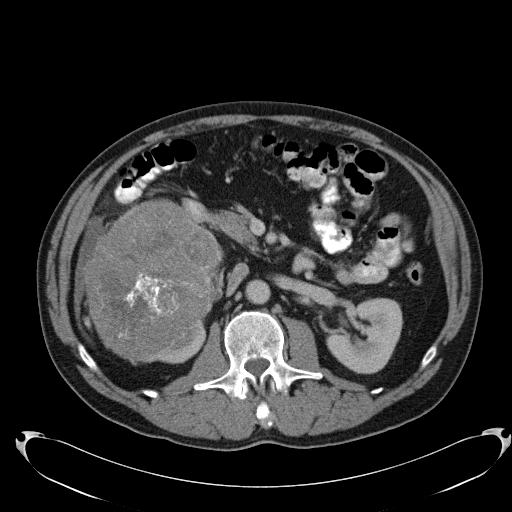

## 문제
A 58-year-old man comes to the physician because of a dull right flank ache and a 5-kg (11-lb) weight loss over 3 months. He has smoked one pack of cigarettes daily for 35 years. His blood pressure is 142/86 mm Hg. A firm mass is palpable in the right upper quadrant. Hemoglobin is 11.9 g/dL, and serum creatinine is 0.9 mg/dL. Urinalysis shows 5 to 9 erythrocytes per high-power field. A contrast-enhanced CT scan of the abdomen is shown; the left kidney is normal, and a CT scan of the chest shows no metastases. Which of the following is the most appropriate next step in management?

- A. Radical nephrectomy
- B. Partial nephrectomy
- C. Percutaneous biopsy of the mass
- D. Active surveillance with repeat imaging in 3 months
- E. Percutaneous radiofrequency ablation

_Contrast-enhanced abdominal CT, arterial phase, single axial image, soft-tissue window, standard display orientation (TCIA, CC BY 3.0; no cropping, adjustment, or segmentation overlay)_

## 정답 및 해설
> 정답: A

- **정답 핵심**: The CT shows a large (about 13 cm), heterogeneously enhancing solid mass arising from the right kidney, with central calcification and no macroscopic fat. An enhancing solid renal mass without fat in a smoker with flank pain, hematuria, and weight loss is renal cell carcinoma until proven otherwise. Because the tumor is far larger than 7 cm, the contralateral kidney is normal, and no metastases are seen, radical nephrectomy is the treatment of choice. Biopsy rarely changes management when imaging is this typical and the patient is a surgical candidate.
- **원리**: <b>Why imaging is enough</b>: More than 85% of solid, enhancing renal masses without macroscopic fat are renal cell carcinoma. Enhancement on contrast CT (an increase of more than 15–20 HU) indicates vascular tissue rather than cyst fluid, and the absence of fat argues against angiomyolipoma. In a fit patient with a typical mass, surgery provides both diagnosis and treatment, so biopsy is reserved for when the result would change management (suspected lymphoma, metastasis, or before ablation or surveillance).  <b>Why size decides radical versus partial</b>: Partial nephrectomy preserves nephrons and is preferred for T1a tumors (up to 4 cm) and often T1b (4–7 cm) when technically feasible, because chronic kidney disease raises cardiovascular mortality. Tumors larger than 7 cm (T2 or beyond) usually replace much of the kidney and abut the hilum, so partial resection risks positive margins without saving meaningful function; with a normal opposite kidney, radical nephrectomy is standard.  <b>Why ablation and surveillance are not used here</b>: They are options for small (under 3–4 cm) masses in elderly or frail patients, not for a symptomatic 13-cm tumor.
- **비교**: <table><thead><tr><th style="width:24%">Feature</th><th style="width:38%">Radical nephrectomy (answer)</th><th>Partial nephrectomy (closest distractor)</th></tr></thead><tbody> <tr><td>Tumor size</td><td><b>Larger than 7 cm</b> (T2) or central/hilar</td><td>T1a (up to 4 cm), often T1b (4–7 cm)</td></tr> <tr><td>Contralateral kidney</td><td>Normal</td><td>Absent, diseased, or bilateral tumors (imperative indication)</td></tr> <tr><td>Goal</td><td>Complete oncologic removal</td><td>Cancer control while preserving nephrons</td></tr> </tbody></table> Both remove the tumor; size, location, and the function of the other kidney decide how much kidney is taken.
- **오답 이유**:
  - (B) Partial nephrectomy would be correct for a tumor of 4 cm or less, or for a larger tumor in a solitary kidney or with bilateral tumors.
  - (C) Percutaneous biopsy would be correct if lymphoma or metastasis were suspected, or before ablation or surveillance of a small renal mass.
  - (D) Active surveillance would be correct for a small renal mass under 3 cm in an elderly patient with major comorbidities and limited life expectancy.
  - (E) Radiofrequency ablation would be correct for a mass under 3 cm in a patient who is a poor surgical candidate, after biopsy confirmation.
- **함정**: Choosing partial nephrectomy because nephron sparing is generally preferred — at 13 cm with a normal opposite kidney, the kidney is removed whole.
- **학습목표**: 7 cm 를 크게 넘는 신장 고형 종괴는 신세포암으로 보고 근치적 신장절제술을 하며, 부분절제·생검·감시의 적응과 가른다
- **근거·출처**: Loscalzo J, Fauci AS, Kasper DL, et al., eds. Harrison's Principles of Internal Medicine, 22nd ed. McGraw Hill; 2025. Chapter 90: Renal Cell Carcinoma · Campbell SC, Clark PE, Chang SS, et al. Renal mass and localized renal cancer: evaluation, management, and follow-up: AUA guideline: part I. J Urol. 2021;206(2):199-208

## 출처
- The Cancer Imaging Archive (CC BY 3.0) · KiTS-00139 · Creative Commons Attribution 3.0 Unported · https://www.cancerimagingarchive.net/data-usage-policies-and-restrictions/
