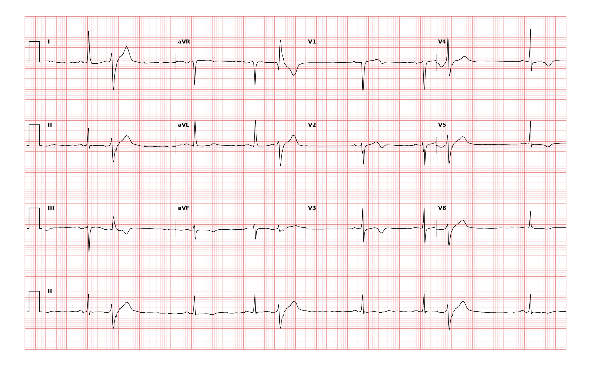

## 문제
63세 여자가 2시간 전 집에서 쉬던 중 가슴이 조이는 통증이 20분 동안 생겼다가 지금은 약하게 남아 있어 응급실에 왔다. 고혈압과 2형 당뇨병이 있고 체질량지수는 30 kg/m² 이다. 혈압 148/88 mmHg, 맥박 72회/분(가끔 건너뜀), 산소포화도 97 % 이다. 폐는 깨끗하고 심잡음은 없다. 혈청 칼륨 4.2 mEq/L 이며, 고감도 트로포닌 I 는 결과를 기다리고 있다. 12유도 심전도는 그림과 같다. 심전도 판독으로 가장 적절한 것은?

- A. 급성 섬유소성 심낭염
- B. 심내막하 허혈
- C. 전벽 ST 분절 상승 심근경색
- D. 완전 좌각차단
- E. 좌심실비대의 재분극 이상

_12유도 심전도, 25 mm/s · 10 mm/mV, 3×4 + II 리듬 스트립 (PTB-XL ECG dataset, PhysioNet, CC BY 4.0 — 원신호 그대로 작도)_

## 정답 및 해설
> 정답: B

- **정답 핵심**: 동리듬 약 70회/분 사이에 넓은 QRS 의 심실조기수축이 산발적으로 끼어 있다(맥이 가끔 건너뛰는 이유). 조기수축이 아닌 동박동에서 QRS 폭은 정상이고, V2~V6 에서 ST 분절이 기저선 아래로 내려가며 T파가 역위되어 있다. 어느 유도에도 ST 분절 상승은 없고 R파 전압이 비대 기준에 이르지 않는다. 휴식 흉통과 함께 여러 유도의 ST 하강·T파 역위는 심내막하 허혈 — 비 ST 분절 상승 급성 관동맥 증후군 — 의 변화이며, 트로포닌으로 불안정협심증과 심근경색을 가른다.
- **원리**: <b>왜 심내막하 허혈은 ST 가 내려가나</b>: 관상동맥은 심외막에서 들어와 심내막 쪽으로 가므로, 혈류가 줄면 가장 먼저 <b>심내막하층</b>이 허혈에 빠진다. 허혈 부위는 휴지기 막전위가 덜 음성이 되어 정상 부위와 전위차(손상 전류)가 생기는데, 이 전류가 심내막에서 심외막 방향의 반대로 흘러 그 부위를 바라보는 유도에서 ST 분절이 <b>내려간다</b>. 심근 전층이 막히면(경벽 허혈) 손상 전류가 바깥을 향해 ST 가 올라간다.  <b>왜 위치를 정하기 어렵나</b>: ST 상승은 막힌 혈관의 영역을 비교적 정확히 가리키지만, ST 하강은 넓은 심내막하가 동시에 허혈에 빠져 여러 유도에 퍼지므로 막힌 혈관을 정하지 못한다. 그래서 판독은 「어느 유도에서 얼마나」를 적고, 위험도는 트로포닌·GRACE 점수로 나눈다.  <b>왜 조기수축 박동에서는 판독하지 않나</b>: 심실조기수축은 탈분극 순서가 달라 원래 ST-T 가 반대 방향으로 기울어진다. ST 변화는 정상 전도된 동박동에서만 읽는다.
- **비교**: <table><thead><tr><th style="width:24%">항목</th><th style="width:38%">심내막하 허혈(정답)</th><th>ST 분절 상승 심근경색(가장 가까운 오답)</th></tr></thead><tbody> <tr><td>ST 분절</td><td><b>하강</b>(수평·하향 경사), T파 역위</td><td>J점에서 이웃한 두 유도 이상 상승</td></tr> <tr><td>위치</td><td>여러 유도에 넓게 — 혈관 영역 특정이 어렵다</td><td>막힌 혈관 영역에 국한, 반대편 거울상 하강</td></tr> <tr><td>처치</td><td>항혈소판·항응고 후 위험도에 따라 조기 침습</td><td>즉시 재관류(일차 관상동맥중재술)</td></tr> </tbody></table> 같은 허혈이라도 ST 가 올라가는지 내려가는지가 재관류를 서두를지를 정한다. 단 V1~V3 만의 ST 하강은 후벽 ST 상승의 거울상일 수 있어 V7~V9 를 확인한다.
- **오답 이유**:
  - ① 급성 심낭염은 자세에 따라 달라지는 흉통과 함께 여러 유도의 오목한 ST 상승과 PR 하강이 있을 때 정답이 된다.
  - ③ 전벽 ST 분절 상승 심근경색은 V1~V4 중 이웃한 두 유도 이상에서 J점 ST 가 기준 이상 올라가고 하벽에 거울상 하강이 있을 때 정답이 된다.
  - ④ 좌각차단은 동박동의 QRS 폭이 0.12초 이상이고 V1 깊은 QS·I·V6 넓고 끝이 갈라진 R파가 모든 박동에 있을 때 정답이 된다.
  - ⑤ 좌심실비대의 strain 은 SV1+RV5(V6) 가 35 mm 이상처럼 전압 기준을 넘고 높은 R파 유도(V5·V6)에서 비대칭 ST 하강이 있을 때 정답이 된다.
- **함정**: ST 상승이 없으니 정상이라고 넘기는 것 — 휴식 흉통과 함께 전흉부 유도에서 ST 가 내려가고 T파가 뒤집히면 심내막하 허혈이다.
- **학습목표**: 흉통 환자의 전흉부 유도 ST 하강·T파 역위와 산발 심실조기수축을 읽어 심내막하 허혈로 판독하고 ST 분절 상승 심근경색·좌각차단과 가른다
- **근거·출처**: Loscalzo J, Fauci AS, Kasper DL, et al., eds. Harrison's Principles of Internal Medicine, 22nd ed. McGraw Hill; 2025. Chapter 285: Non-ST-Segment Elevation Acute Coronary Syndrome (Non-ST-Segment Elevation Myocardial Infarction and Unstable Angina) · Loscalzo J, Fauci AS, Kasper DL, et al., eds. Harrison's Principles of Internal Medicine, 22nd ed. McGraw Hill; 2025. Chapter 247: Electrocardiography

## 출처
- PTB-XL ECG dataset v1.0.3 (PhysioNet, CC BY 4.0) · record 16641 · Creative Commons Attribution 4.0 International · https://physionet.org/content/ptb-xl/1.0.3/LICENSE.txt
