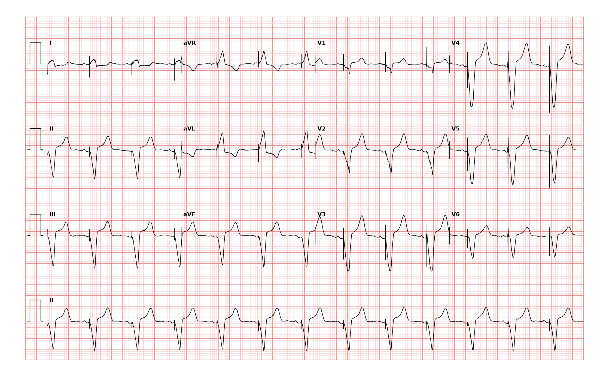

## 문제
87세 남자가 심박동기 정기 점검을 위해 순환기내과 외래에 왔다. 4년 전 실신과 완전방실차단으로 단방 심실 심박동기(VVI, 하한 심박수 70회/분)를 삽입하였다. 그 뒤 실신·어지럼은 없었고 일상생활에서 숨이 차지 않는다. 혈압 128/70 mmHg, 맥박 70회/분(규칙적) 이다. 심박동기 주머니 부위는 깨끗하고 다리 부종은 없다. 혈청 칼륨 4.4 mEq/L, 크레아티닌 1.1 mg/dL 이다. 12유도 심전도는 그림과 같다. 다음 처치로 가장 적절한 것은?

- A. 관상동맥조영술을 한다
- B. 경피적 체외 심박조율을 시작한다
- C. 현재 설정을 유지하고 정기 추적한다
- D. 아트로핀을 정맥 주사한다
- E. 심박동기 발생기를 교체한다

_12유도 심전도, 25 mm/s · 10 mm/mV, 3×4 + II 리듬 스트립 (PTB-XL ECG dataset, PhysioNet, CC BY 4.0 — 원신호 그대로 작도)_

## 정답 및 해설
> 정답: C

- **정답 핵심**: 모든 QRS 앞에 좁은 조율 스파이크가 있고 바로 뒤에 넓은 QRS 가 따라오며(포착 성공), QRS 는 V1~V4 에서 깊은 음성, II·III·aVF 에서도 음성이다. 우심실 첨부에서 시작된 탈분극이 좌각차단 모양과 상방 축을 만드는 전형적인 우심실 조율이다. 심박수 약 70회/분으로 설정한 하한과 같고 규칙적이며, 스파이크 뒤 QRS 가 빠지거나(포착 실패) 자기 박동 직후 엉뚱한 스파이크(감지 실패)가 없다. 증상이 없으므로 심박동기는 정상 작동 중이고 처치 없이 정기 추적한다.
- **원리**: <b>왜 조율 박동은 좌각차단 모양인가</b>: 리드 끝은 우심실 첨부에 있다. 흥분이 히스-퍼킨예 전도계를 타지 않고 심근을 세포에서 세포로 천천히 퍼져 QRS 가 넓어진다. 오른쪽에서 왼쪽으로, 첨부에서 기저부로 퍼지므로 V1 은 깊은 음성(좌각차단 모양), 하벽 유도는 음성(상방 축)이 된다. 이 모양은 <b>리드 위치가 맞다는 증거</b>이기도 하다 — 우각차단 모양이 나오면 리드가 좌심실 쪽(관상정맥동·중격 천공)에 있는지 의심한다.  <b>왜 정상 작동이라 하나</b>: 심박동기 심전도는 세 가지를 본다. ① 포착 — 스파이크마다 QRS 가 따라오는가 ② 감지 — 자기 박동이 있으면 조율을 멈추는가(엉뚱한 자리 스파이크가 없는가) ③ 심박수 — 설정 하한과 맞는가. 셋 다 맞고 증상이 없으면 이상이 없다.  <b>왜 조율 박동에서 허혈을 판독하지 않나</b>: 조율 QRS 는 원래 ST-T 가 QRS 반대 방향으로 기운 이차 변화를 보여, 일반 허혈 기준을 쓸 수 없다(급성 흉통이 있을 때만 변형 Sgarbossa 기준을 쓴다).
- **비교**: <table><thead><tr><th style="width:24%">항목</th><th style="width:38%">정상 작동(정답)</th><th>발생기 교체가 필요한 경우(가장 가까운 오답)</th></tr></thead><tbody> <tr><td>스파이크와 QRS</td><td><b>스파이크마다 넓은 QRS</b>가 따라옴</td><td>스파이크 뒤 QRS 가 빠짐(포착 실패)</td></tr> <tr><td>심박수</td><td>설정 하한(70회/분)과 같음</td><td>설정보다 느려짐 — 배터리 교체 지시(ERI) 시 심박수 저하</td></tr> <tr><td>증상</td><td>없음</td><td>어지럼·실신·피로</td></tr> </tbody></table> 배터리 고갈·리드 문제는 심전도에서 포착 실패나 심박수 저하로 드러나고, 기기 점검(프로그래머)으로 확인한 뒤 교체한다.
- **오답 이유**:
  - ① 관상동맥조영술은 급성 흉통과 함께 조율 리듬에서 변형 Sgarbossa 기준(QRS 와 같은 방향의 ST 상승 1 mm 이상 등)을 만족할 때 정답이 된다.
  - ② 경피적 체외 심박조율은 심박동기가 포착에 실패해 심한 서맥과 저혈압·실신이 생긴 응급 상황일 때 정답이 된다.
  - ④ 아트로핀 정맥 주사는 심박동기가 없는 환자의 증상 있는 동서맥이나 결절 수준 방실차단일 때 정답이 되며, 조율 리듬에는 쓸 일이 없다.
  - ⑤ 발생기 교체는 점검에서 배터리가 교체 지시 수준에 이르렀거나, 심전도에서 심박수가 설정보다 느려지고 포착 실패가 보일 때 정답이 된다.
- **함정**: 넓은 QRS 와 하벽 음성 QRS 를 보고 각차단·경색으로 놀라는 것 — 모든 QRS 앞에 스파이크가 있고 설정 심박수로 규칙적이면 정상 작동하는 우심실 조율이다.
- **학습목표**: 모든 QRS 앞의 조율 스파이크와 넓은 QRS·상방 축을 우심실 조율로 읽고, 포착·감지 실패가 없으면 정상 작동으로 판단해 처치 없이 추적한다
- **근거·출처**: Loscalzo J, Fauci AS, Kasper DL, et al., eds. Harrison's Principles of Internal Medicine, 22nd ed. McGraw Hill; 2025. Chapter 252: The Bradyarrhythmias: Disorders of the Atrioventricular Node · Loscalzo J, Fauci AS, Kasper DL, et al., eds. Harrison's Principles of Internal Medicine, 22nd ed. McGraw Hill; 2025. Chapter 247: Electrocardiography

## 출처
- PTB-XL ECG dataset v1.0.3 (PhysioNet, CC BY 4.0) · record 21572 · Creative Commons Attribution 4.0 International · https://physionet.org/content/ptb-xl/1.0.3/LICENSE.txt
