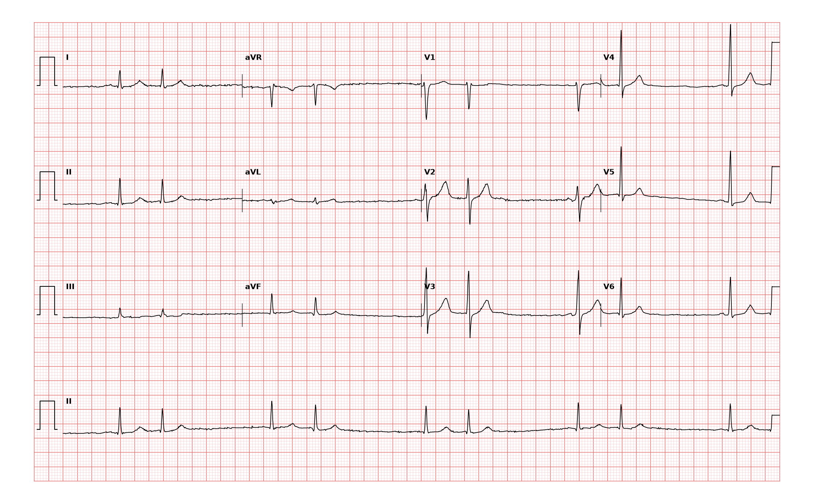

## 문제
A 63-year-old man comes to the physician because of a sensation that his heart is skipping beats for 2 weeks. He has had no chest pain, dyspnea, or syncope. He drinks 3 to 4 cups of coffee daily and recently started a decongestant for a cold. He takes no other medications. His pulse is 70/min and irregular, and blood pressure is 134/80 mm Hg. Cardiac examination shows no murmurs. Serum electrolyte concentrations and thyroid-stimulating hormone level are within the reference ranges. A 12-lead ECG is shown. Which of the following is the most likely diagnosis?

- A. Atrial bigeminy from premature atrial contractions
- B. Second-degree atrioventricular block, Mobitz type I
- C. Ventricular bigeminy
- D. Atrial fibrillation
- E. Sinus arrhythmia

_12-lead ECG, 25 mm/s, 10 mm/mV, 3×4 + lead II rhythm strip (PTB-XL, PhysioNet, CC BY 4.0; raw signal, no filtering)_

## 정답 및 해설
> 정답: A

- **정답 핵심**: The rhythm strip shows beats in pairs: a sinus beat followed by an early beat, then a pause, repeating. The early beats have narrow QRS complexes identical to the sinus beats, so they are conducted through the normal His-Purkinje system and arise above the ventricles. The pause after each early beat is less than compensatory, as expected when a premature atrial beat resets the sinus node. This alternating pattern of normal and premature atrial beats is atrial bigeminy. Caffeine and sympathomimetic decongestants are common triggers.
- **원리**: <b>Why the early beat is narrow</b>: A premature atrial contraction arises from an ectopic atrial focus, so its impulse still passes through the AV node and the bundle branches, producing a QRS identical to sinus beats (unless it arrives so early that a bundle branch is refractory, causing aberrancy). A premature ventricular contraction bypasses the conduction system and spreads cell to cell, producing a wide, bizarre QRS with discordant ST-T.  <b>Why the pause is noncompensatory</b>: The ectopic atrial impulse enters and resets the sinus node, so the next sinus beat comes one sinus cycle after the premature beat. The interval surrounding the PAC is therefore shorter than two sinus cycles. A PVC usually does not reach the sinus node, so the sinus rhythm continues on schedule and the pause is fully compensatory.  <b>Why it is not Mobitz I</b>: Grouped beating also occurs in Wenckebach block, but there the PR interval lengthens progressively until a P wave is not conducted; every P wave is on time. In atrial bigeminy, the second beat of each pair is early, and no P wave is dropped.
- **비교**: <table><thead><tr><th style="width:24%">Feature</th><th style="width:38%">Atrial bigeminy (answer)</th><th>Mobitz I AV block (closest distractor)</th></tr></thead><tbody> <tr><td>Grouping</td><td>Pairs: sinus beat + early beat</td><td>Groups ending in a nonconducted P wave</td></tr> <tr><td>P waves</td><td><b>Second P wave of the pair is premature</b> (often different shape)</td><td>All P waves on time at a regular PP interval</td></tr> <tr><td>PR interval</td><td>Roughly constant</td><td>Progressively lengthens before the dropped beat</td></tr> <tr><td>Pause</td><td>Less than compensatory, no dropped P</td><td>Contains a P wave not followed by QRS</td></tr> </tbody></table> Both produce grouped beating with pauses; look in the pause for a nonconducted P wave and check whether the second beat came early.
- **오답 이유**:
  - (B) Mobitz type I block would be correct if the PR interval lengthened beat by beat until a regularly timed P wave failed to conduct.
  - (C) Ventricular bigeminy would be correct if every other beat were a wide, bizarre QRS without a preceding P wave, followed by a fully compensatory pause.
  - (D) Atrial fibrillation would be correct if the baseline showed fibrillatory waves with no discrete P waves and the RR intervals were irregularly irregular without pairing.
  - (E) Sinus arrhythmia would be correct if every QRS were preceded by an identical sinus P wave and the RR intervals varied gradually with respiration.
- **함정**: Calling grouped beating Wenckebach — when the second beat of each pair comes early with a narrow QRS and no P wave is dropped, it is atrial bigeminy.
- **학습목표**: 동박동과 좁은 QRS 조기수축이 하나 걸러 반복되는 묶음 박동을 심방 이단맥으로 판독하고 Mobitz I 방실차단·심실 이단맥과 가른다
- **근거·출처**: Loscalzo J, Fauci AS, Kasper DL, et al., eds. Harrison's Principles of Internal Medicine, 22nd ed. McGraw Hill; 2025. Chapter 253: Approach to Supraventricular Arrhythmias · Loscalzo J, Fauci AS, Kasper DL, et al., eds. Harrison's Principles of Internal Medicine, 22nd ed. McGraw Hill; 2025. Chapter 247: Electrocardiography

## 출처
- PTB-XL ECG dataset v1.0.3 (PhysioNet, CC BY 4.0) · record 2204 · Creative Commons Attribution 4.0 International · https://physionet.org/content/ptb-xl/1.0.3/LICENSE.txt
