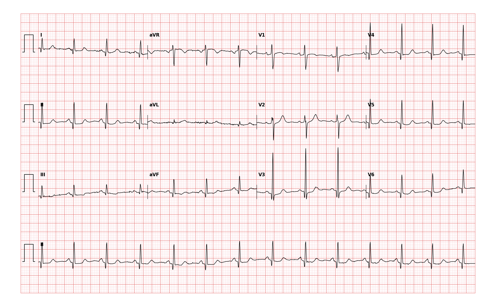

## 문제
56세 여자가 담석증으로 복강경 담낭절제술을 받기 전에 검사를 받았다. 흉통·호흡곤란·실신은 없고 계단 두 층을 쉬지 않고 오른다. 고혈압·당뇨병은 없다. 혈압 124/78 mmHg, 맥박 80회/분, 심음은 정상이고 잡음은 없다. 혈청 칼륨 4.1 mEq/L 이다. 12유도 심전도는 그림과 같다. 심전도 판독으로 가장 적절한 것은?

- A. 오래된 측벽 심근경색
- B. 좌심실비대
- C. 좌각차단
- D. 정상 심전도
- E. 오래된 하벽 심근경색

_12유도 심전도, 25 mm/s · 10 mm/mV, 3×4 + II 리듬 스트립 (PTB-XL ECG dataset, PhysioNet, CC BY 4.0 — 원신호 그대로 작도)_

## 정답 및 해설
> 정답: D

- **정답 핵심**: 동리듬 약 80회/분, PR 과 QRS 가 정상 범위이고 축도 정상이다. I·II·aVF·V4~V6 에 q파가 있지만 폭이 1 mm(40 ms) 미만이고 깊이도 뒤따르는 R파의 1/4 에 못 미친다. 이런 좁고 작은 q파는 심실중격이 왼쪽에서 오른쪽으로 먼저 흥분하면서 생기는 정상 중격 q파다. ST 분절과 T파도 정상이어서 판독은 정상 심전도다. 판독 전문의의 판독도 「중격 활성화를 반영하는 작은 q파, 그 밖에 정상」이었다.
- **원리**: <b>왜 정상에서도 q파가 있는가</b>: 심실 흥분은 왼쪽 각지에서 먼저 심실중격으로 퍼지므로, 중격은 <b>왼쪽에서 오른쪽으로</b> 먼저 탈분극한다. 이 첫 0.02~0.03초의 벡터는 왼쪽을 보는 유도(I·aVL·V5·V6)와 아래를 보는 유도(II·aVF) 에서 멀어지는 방향이라 작고 좁은 음성 파, 즉 <b>중격 q파</b>로 기록된다. 그래서 좌각차단에서는 중격이 오른쪽에서 왼쪽으로 흥분해 이 q파가 오히려 사라진다.  <b>병적 q파는 왜 넓고 깊은가</b>: 경색으로 심근이 전기적으로 죽으면 그 자리를 보는 유도는 반대편 벽의 흥분이 멀어지는 것을 그대로 「창문」처럼 보게 된다. 그 벽 전체의 흥분 시간만큼 음성 파가 이어지므로 폭 40 ms 이상, 깊이 R파의 1/4 이상이 되고, 서로 이웃한 두 유도 이상에서 함께 보인다.  <b>왜 구분이 중요한가</b>: 정상 q파를 경색으로 읽으면 증상 없는 수술 전 환자에게 불필요한 부하검사와 수술 지연이 생긴다. 기능 용량이 4 METs 이상이고 증상이 없으면 저위험 수술 전에 추가 심장 검사가 필요 없다.
- **비교**: <table><thead><tr><th style="width:24%">항목</th><th style="width:38%">중격 q파(정답 — 정상)</th><th>오래된 심근경색의 병적 q파(가장 가까운 오답)</th></tr></thead><tbody> <tr><td>폭</td><td><b>40 ms(1 mm) 미만</b> — 중격 흥분 시간만</td><td>40 ms 이상 — 반대 벽 흥분 시간 전체</td></tr> <tr><td>깊이</td><td>R파의 1/4 미만</td><td>R파의 1/4 이상, R파가 작아지거나 QS</td></tr> <tr><td>분포</td><td>I·aVL·II·aVF·V5·V6 에 흔함, V1~V3 에는 없음</td><td>관상동맥 영역에 맞는 이웃한 유도 묶음</td></tr> <tr><td>동반 소견</td><td>ST-T 정상</td><td>T파 역위·R파 소실이 흔히 동반</td></tr> </tbody></table> q파의 「있음」이 아니라 폭·깊이·분포로 판단한다. V1~V3 에 q파가 있으면 그것은 정상에서 보이지 않는다.
- **오답 이유**:
  - ① 오래된 측벽 심근경색은 I·aVL·V5·V6 에 넓고 깊은 q파와 R파 감소가 함께 있을 때 정답이 된다.
  - ② 좌심실비대는 V1 의 S파와 V5·V6 의 R파 합이 35 mm 를 넘거나 좌측 흉부 유도의 스트레인형 ST-T 변화가 있을 때 정답이 된다.
  - ③ 좌각차단은 QRS 가 120 ms 이상으로 넓고 I·V6 의 중격 q파가 사라지며 넓고 패인 R파가 보일 때 정답이 된다.
  - ⑤ 오래된 하벽 심근경색은 II·III·aVF 에 폭 40 ms 이상이거나 R파 1/4 이상 깊은 q파가 함께 있을 때 정답이 된다.
- **함정**: q파가 여러 유도에 보인다고 오래된 경색으로 읽는 것 — 폭 40 ms 미만·깊이 R파 1/4 미만의 q파는 중격 활성화의 정상 소견이다.
- **학습목표**: I·II·aVF·V4~V6 의 좁고 작은 q파를 중격 활성화의 정상 q파로 읽고, 병적 q파(오래된 심근경색)·좌심실비대와 가른다
- **근거·출처**: Loscalzo J, Fauci AS, Kasper DL, et al., eds. Harrison's Principles of Internal Medicine, 22nd ed. McGraw Hill; 2025. Chapter 247: Electrocardiography · Thygesen K, Alpert JS, Jaffe AS, et al. Fourth universal definition of myocardial infarction (2018). Circulation. 2018;138(20):e618-e651

## 출처
- PTB-XL ECG dataset v1.0.3 (PhysioNet, CC BY 4.0) · record 5105 · Creative Commons Attribution 4.0 International · https://physionet.org/content/ptb-xl/1.0.3/LICENSE.txt
