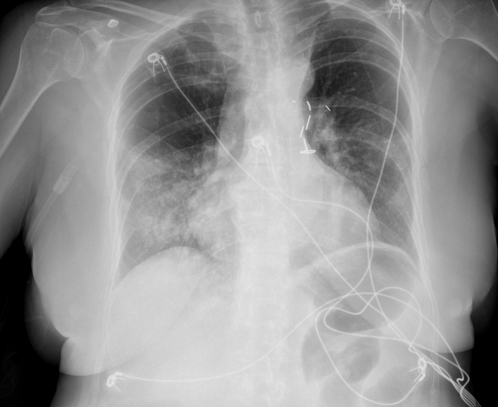

## 문제
A 72-year-old woman is brought to the emergency department because of worsening shortness of breath. Eight days ago she developed fever and cough, and a nasal swab was positive for SARS-CoV-2. Despite high-flow nasal oxygen, her oxygen saturation falls to 82%, and she is intubated. She is 160 cm (5 ft 3 in) tall and weighs 78 kg (172 lb). Arterial blood gas analysis on an FiO2 of 0.8 and PEEP of 10 cm H2O shows a PaO2 of 72 mm Hg. Bedside echocardiography shows normal left ventricular function. A portable chest x-ray is shown. Which of the following is the most appropriate ventilator strategy?

- A. Tidal volume of 6 mL/kg of predicted body weight with plateau pressure 30 cm H2O or less
- B. Tidal volume of 10 mL/kg of actual body weight to normalize arterial PCO2
- C. Tidal volume of 6 mL/kg of actual body weight with PEEP reduced to zero
- D. Tidal volume of 12 mL/kg of predicted body weight with plateau pressure 40 cm H2O or less
- E. Tidal volume of 8 mL/kg of actual body weight with daily paralysis for 7 days

_Portable anteroposterior chest radiograph, unaltered apart from scaling (The Cancer Imaging Archive, CC BY 4.0; no cropping or window adjustment; ECG electrodes visible)_

## 정답 및 해설
> 정답: A

- **정답 핵심**: The radiograph shows bilateral patchy consolidation and ground-glass opacities, worse in the right mid and lower zones, without a large effusion. With acute onset within a week, bilateral opacities, normal left ventricular function, and a PaO2/FiO2 ratio of 90 on PEEP 10, she meets criteria for severe ARDS. Lung-protective ventilation uses a tidal volume of about 6 mL/kg of predicted body weight (about 52 kg for a 160-cm woman, so roughly 315 mL) while keeping plateau pressure at 30 cm H2O or less; this strategy lowered mortality in randomized trials.
- **원리**: <b>Why predicted, not actual, body weight</b>: Lung size is set by height and sex, not by fat mass. A 160-cm woman has the lungs of a 52-kg person whether she weighs 52 or 78 kg. Calculating tidal volume from actual weight would deliver about 470 mL at 6 mL/kg — 9 mL/kg of her real lung — and overdistend it.  <b>Why small breaths protect the ARDS lung</b>: In ARDS, large dependent regions are flooded or collapsed, so the aerated "baby lung" may be only a third of normal. A conventional breath delivered into that small volume overstretches the open alveoli (volutrauma), and repeated opening and closing of unstable units adds shear injury (atelectrauma). This injury releases cytokines that spread to other organs. Limiting tidal volume and plateau pressure reduces this ventilator-induced lung injury; PEEP keeps recruited units open.  <b>What is accepted in exchange</b>: Smaller breaths raise PaCO2 (permissive hypercapnia), which is tolerated if the pH stays above about 7.20, and oxygenation targets are a PaO2 of 55-80 mm Hg rather than normal values.
- **비교**: <table><thead><tr><th style="width:24%">Setting</th><th style="width:38%">Lung-protective ventilation (answer)</th><th>Conventional ventilation by actual weight (closest distractor)</th></tr></thead><tbody> <tr><td>Tidal volume</td><td><b>6 mL/kg predicted body weight</b> (about 315 mL here)</td><td>10 mL/kg actual body weight (780 mL here)</td></tr> <tr><td>Plateau pressure</td><td>30 cm H2O or less</td><td>Often above 30 cm H2O in stiff lungs</td></tr> <tr><td>PaCO2</td><td>Allowed to rise (pH above 7.20)</td><td>Normalized</td></tr> <tr><td>Outcome</td><td>Lower mortality (ARDS Network)</td><td>More ventilator-induced lung injury</td></tr> </tbody></table> The goal in ARDS is to limit stretch of the remaining aerated lung, not to normalize blood gases; using height-based predicted weight is what makes the number meaningful.
- **오답 이유**:
  - (B) A tidal volume of 10 mL/kg of actual body weight was once standard and would only be acceptable in a patient with normal lungs, and even then predicted weight is preferred.
  - (C) Removing PEEP would be wrong in ARDS; low PEEP is chosen only when hypoxemia is mild and the lung is not recruitable, never zero in severe ARDS.
  - (D) A tidal volume of 12 mL/kg with plateau pressure up to 40 cm H2O was the control arm that increased mortality, so it would never be the correct choice in ARDS.
  - (E) Neuromuscular blockade is reserved for refractory dyssynchrony or severe hypoxemia for up to 48 hours, not for 7 days, and still uses predicted-weight tidal volumes.
- **함정**: Calculating tidal volume from actual body weight in an obese patient — lung size follows height and sex, so predicted body weight sets the 6 mL/kg target.
- **학습목표**: 양쪽 음영과 심한 저산소증을 보이는 코로나19 ARDS 에서 예측 체중 기준 저일회호흡량 환기를 고르고 실제 체중 기준 큰 일회호흡량과 가른다
- **근거·출처**: Loscalzo J, Fauci AS, Kasper DL, et al., eds. Harrison's Principles of Internal Medicine, 22nd ed. McGraw Hill; 2025. Chapter 312: Acute Respiratory Distress Syndrome · Acute Respiratory Distress Syndrome Network. Ventilation with lower tidal volumes as compared with traditional tidal volumes for acute lung injury and the acute respiratory distress syndrome. N Engl J Med. 2000;342(18):1301-1308

## 출처
- COVID-19-AR, The Cancer Imaging Archive (CC BY 4.0) · series …63861413 · Creative Commons Attribution 4.0 International · https://www.cancerimagingarchive.net/data-usage-policies-and-restrictions/
