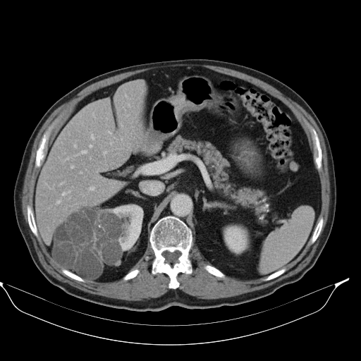

## 문제
75세 남자가 건강검진 복부 초음파에서 오른쪽 신장 종괴가 발견되어 왔다. 옆구리 통증·혈뇨·체중 감소는 없다. 고혈압으로 약을 먹고 있고 40갑년 흡연자이다. 혈압 136/80 mmHg 이다. 혈색소 13.8 g/dL, 혈청 크레아티닌 1.0 mg/dL 이고 소변검사에서 적혈구는 보이지 않는다. 조영증강 복부 CT 는 그림과 같다. 왼쪽 신장은 정상이고 흉부 CT 에서 전이는 없다. 가장 적절한 처치는?

- A. 오른쪽 근치 신장절제술
- B. 6개월 뒤 복부 CT 로 추적
- C. 초음파 유도 낭종 흡인
- D. 에탄올 경화요법
- E. 항생제 투여와 경피 배액

_조영증강 복부 CT, 동맥기 축상 단면 1장, 연부조직 창, 표준 표시 방향 (TCIA, CC BY 3.0 — 크롭·보정·분할 표시 없음)_

## 정답 및 해설
> 정답: A

- **정답 핵심**: CT 에서 오른쪽 신장 뒤쪽으로 크게 튀어나온 다방성 종괴가 보이고, 두꺼운 격막으로 나뉜 여러 방의 감쇠가 서로 다르며 지방은 없다. 얇은 벽·물 감쇠의 단순 낭종이 아니라 두꺼운 격막과 고형 성분이 있는 복잡 낭성 종괴로, 낭성 신세포암의 가능성이 높아 수술로 떼어 낸다. 종괴가 크고(약 9 cm) 신장 상당 부분을 차지하며 반대쪽 신장과 신기능이 정상이므로 근치 신장절제술이 적절하다. 이 증례의 수술 병리는 유두상 신세포암이었다.
- **원리**: <b>왜 낭종의 「벽과 격막」이 결정하는가</b>: 단순 신낭종은 세뇨관에서 생긴 얇은 상피 주머니라 벽이 머리카락처럼 얇고 안이 물(0~20 HU)이며 조영증강되지 않는다. 암은 혈관을 가진 <b>살아 있는 조직</b>이므로 두꺼워진 벽·격막·결절로 나타나고 그 부분이 조영증강된다. 그래서 Bosniak 분류는 크기가 아니라 벽·격막의 두께와 조영증강, 고형 결절의 유무로 악성 가능성을 매긴다(I·II 는 거의 0 %, IIF 는 추적, III 는 약 50 %, IV 는 약 90 %).  <b>왜 흡인·경화가 답이 아닌가</b>: 복잡 낭성 종괴를 바늘로 찌르면 진단 정확도가 낮고(낭액 세포검사는 위음성이 많다) 종양을 퍼뜨릴 위험이 있다. 경화요법은 증상 있는 단순 낭종의 치료다.  <b>왜 근치 절제인가</b>: 7 cm 이하이고 위치가 좋으면 신장 기능을 지키는 부분 절제가 우선이지만, 신장 대부분을 차지하는 큰 종괴는 신장과 주위 지방을 함께 떼어 내는 근치 절제가 표준이다.
- **비교**: <table><thead><tr><th style="width:22%">항목</th><th style="width:39%">복잡 낭성 종괴(정답 — 절제)</th><th>단순 신낭종(가장 가까운 오답 — 추적·흡인)</th></tr></thead><tbody> <tr><td>벽·격막</td><td><b>두껍고 불규칙, 여러 방</b></td><td>머리카락처럼 얇고 격막 없음</td></tr> <tr><td>내용물</td><td>방마다 감쇠가 다름(출혈·단백질·고형 성분)</td><td>균일한 물 감쇠(0~20 HU)</td></tr> <tr><td>조영증강</td><td>벽·격막·결절이 증강</td><td>증강 없음</td></tr> <tr><td>처치</td><td>수술 절제</td><td>무증상이면 추적 불필요, 증상 있으면 흡인·경화</td></tr> </tbody></table> 「낭종」이라는 말에 끌리지 말고 벽과 격막을 본다. 두꺼운 격막과 고형 성분이 보이면 악성으로 보고 절제한다.
- **오답 이유**:
  - ② 6개월 뒤 CT 추적은 얇은 격막이 몇 개 있거나 벽이 약간 두꺼운 Bosniak IIF 낭종처럼 악성 가능성이 낮을 때 정답이 된다.
  - ③ 초음파 유도 낭종 흡인은 얇은 벽·물 감쇠의 단순 낭종이 커서 옆구리 통증이나 요관 압박을 일으킬 때 정답이 된다.
  - ④ 에탄올 경화요법은 증상 있는 단순 신낭종이 흡인 뒤에도 다시 차오를 때 재발을 막는 치료로 정답이 된다.
  - ⑤ 항생제와 경피 배액은 열·옆구리 압통·농뇨가 있고 CT 에서 벽이 증강되는 액체 저류(신농양)가 보일 때 정답이 된다.
- **함정**: 낭성 병변이니 흡인이나 추적을 고르는 것 — 두꺼운 격막과 감쇠가 다른 여러 방은 복잡 낭성 종괴로 절제한다.
- **학습목표**: 두꺼운 격막으로 나뉜 큰 다방성 신장 종괴를 낭성 신세포암 가능성이 높은 병변으로 보고 수술적 절제를 고르며, 단순 낭종의 추적·흡인과 가른다
- **근거·출처**: Loscalzo J, Fauci AS, Kasper DL, et al., eds. Harrison's Principles of Internal Medicine, 22nd ed. McGraw Hill; 2025. Chapter 90: Renal Cell Carcinoma · Silverman SG, Pedrosa I, Ellis JH, et al. Bosniak classification of cystic renal masses, version 2019: an update proposal and needs assessment. Radiology. 2019;292(2):475-488

## 출처
- The Cancer Imaging Archive (CC BY 3.0) · KiTS-00028 · Creative Commons Attribution 3.0 Unported · https://www.cancerimagingarchive.net/data-usage-policies-and-restrictions/
