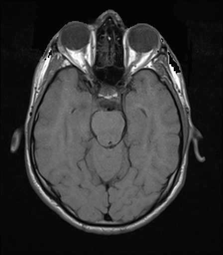

## 문제
A 29-year-old man comes to the physician because of headaches that have worsened over 6 weeks and are most severe on awakening. He has no fever or history of head trauma. Neurologic examination shows mild weakness of the left hand. Fundoscopic examination shows no papilledema. MRI of the brain with several sequences is ordered. One axial image at the level of the orbits and midbrain is shown. Which of the following sequences is most likely shown?

- A. Fluid-attenuated inversion recovery (FLAIR)
- B. Diffusion-weighted imaging
- C. Susceptibility-weighted imaging
- D. T1-weighted
- E. T2-weighted

_Axial brain MRI, single image from a standard clinical protocol, DICOM converted without cropping (The Cancer Imaging Archive, CC BY 4.0; no window adjustment beyond default)_

## 정답 및 해설
> 정답: D

- **정답 핵심**: The CSF around the midbrain and in the sulci is dark, the orbital and subcutaneous fat is bright, the vitreous is dark, and the white matter is slightly brighter than the gray matter. Dark fluid with bright fat and white matter brighter than cortex is the contrast of a T1-weighted image. On FLAIR the CSF is also dark, but gray matter is brighter than white matter; on T2-weighted images the CSF and vitreous are bright.
- **원리**: <b>Why fat is bright and water is dark on T1</b>: T1 is the time protons take to realign with the magnet after a pulse. Protons in fat realign quickly (short T1) and give strong signal on a short-repetition-time sequence; free water in CSF and vitreous realigns slowly (long T1) and stays dark.  <b>Why white matter is brighter than gray matter on T1</b>: Myelin is lipid-rich and has less free water, so white matter has a shorter T1 than cortex. The result is an image that "looks like anatomy" — white matter bright, cortex gray, fluid black.  <b>Why FLAIR also has dark CSF but different tissue contrast</b>: FLAIR is a T2-weighted sequence with an inversion pulse timed to null the signal of free water. CSF is suppressed, but the tissues keep T2 contrast: gray matter (more water) is brighter than white matter, and edema or demyelination near the ventricles stands out. Thus dark CSF alone does not identify T1; the gray-white relationship and the bright fat do.
- **비교**: <table><thead><tr><th style="width:22%">Structure</th><th style="width:39%">T1-weighted (answer)</th><th>FLAIR (closest distractor)</th></tr></thead><tbody> <tr><td>CSF</td><td>Dark</td><td>Dark (nulled by inversion)</td></tr> <tr><td>Gray vs white matter</td><td><b>White brighter than gray</b></td><td>Gray brighter than white</td></tr> <tr><td>Edema</td><td>Slightly dark, inconspicuous</td><td>Bright, conspicuous</td></tr> <tr><td>Main use</td><td>Anatomy; with gadolinium, enhancement</td><td>Periventricular and cortical lesions</td></tr> </tbody></table> Both darken fluid, so look at the brain itself: if white matter is brighter than cortex, it is T1.
- **오답 이유**:
  - (A) FLAIR would be correct if the CSF were dark but the gray matter were brighter than the white matter and edema appeared bright.
  - (B) Diffusion-weighted imaging would be correct if the image were low-resolution with dark CSF and bright regions of restricted diffusion such as acute infarction.
  - (C) Susceptibility-weighted imaging would be correct if veins and blood products appeared as prominent dark foci and signal loss near the skull base were exaggerated.
  - (E) T2-weighted imaging would be correct if the CSF, vitreous, and edema were bright and the gray matter were brighter than the white matter.
- **함정**: Choosing FLAIR because the CSF is dark — FLAIR keeps T2 tissue contrast with gray brighter than white, whereas here white matter is brighter and fat is bright.
- **학습목표**: 뇌척수액 저신호·지방 고신호·백질이 회백질보다 밝은 대조로 T1 강조 영상을 판별하고 FLAIR·T2 강조 영상과 가른다
- **근거·출처**: Loscalzo J, Fauci AS, Kasper DL, et al., eds. Harrison's Principles of Internal Medicine, 22nd ed. McGraw Hill; 2025. Chapter 434: Neuroimaging in Neurologic Disorders

## 출처
- The Cancer Imaging Archive (CC BY 4.0) · series …22648522 · Creative Commons Attribution 4.0 International · https://www.cancerimagingarchive.net/data-usage-policies-and-restrictions/
