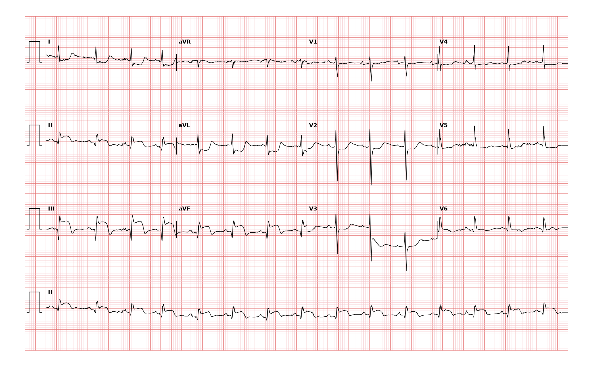

## 문제
87세 여자가 두 시간 전부터 가슴 한가운데가 짓눌리듯 아프고 식은땀이 나서 응급실에 왔다. 통증은 숨을 쉬거나 자세를 바꿔도 달라지지 않는다. 고혈압과 이상지질혈증으로 약을 먹고 있다. 혈압 104/66 mmHg, 맥박 90회/분, 호흡 20회/분, 산소포화도 95 % 이다. 심낭 마찰음은 들리지 않는다. 12유도 심전도는 그림과 같다. 심전도 판독으로 가장 적절한 것은?

- A. 비ST분절 상승 심근경색
- B. 조기 재분극
- C. 하벽 ST분절 상승 심근경색
- D. 전벽 ST분절 상승 심근경색
- E. 급성 심낭염

_12유도 심전도, 25 mm/s · 10 mm/mV, 3×4 + II 리듬 스트립 (PTB-XL ECG dataset, PhysioNet, CC BY 4.0 — 원신호 그대로 작도)_

## 정답 및 해설
> 정답: C

- **정답 핵심**: II·III·aVF 에서 ST 분절이 볼록하게 올라가 있고 III 의 상승이 II 보다 크다. 같은 순간 I·aVL 에서는 ST 가 내려가 있다(거울상 변화). V1~V4 에는 의미 있는 ST 상승이 없고 V5·V6 에 경미한 상승만 있다. 이웃한 하벽 유도 묶음의 ST 상승과 반대쪽 고측벽 유도의 거울상 하강은 하벽 ST분절 상승 심근경색이다. 전형적 흉통 두 시간째이므로 즉시 재관류 치료가 필요하다.
- **원리**: <b>왜 하벽 유도에서 오르고 aVL 에서 내려가는가</b>: 관상동맥이 막혀 심근 전층이 손상되면 손상 부위는 정상 심근과 전위 차이(손상 전류)를 만들어 ST 벡터가 <b>손상 부위 쪽</b>을 향한다. 하벽은 II·III·aVF 가 바라보므로 이 유도에서 ST 가 올라가고, 하벽과 정반대 방향을 보는 aVL·I 에서는 같은 벡터가 멀어지는 방향이라 ST 가 내려간다. 이 거울상 하강이 있으면 경색일 가능성이 크게 높아진다.  <b>왜 III 이 II 보다 높은가</b>: III 은 오른쪽 아래(+120°)를 본다. ST 벡터가 오른쪽으로 치우치면(우관상동맥 폐쇄) III 의 상승이 II 보다 커진다. 그래서 III > II 이면 우관상동맥, 그리고 우심실 경색 동반 가능성을 생각해 V4R 을 찍고 질산염을 조심한다.  <b>왜 심낭염이 아닌가</b>: 심낭염은 심외막 전체에 염증이 있어 ST 벡터가 특정 영역이 아니라 심첨 방향으로 향하므로 aVR·V1 을 뺀 대부분의 유도에서 오목하게 오르고 거울상 하강이 없다(aVR 에서만 하강).
- **비교**: <table><thead><tr><th style="width:22%">항목</th><th style="width:39%">하벽 STEMI(정답)</th><th>급성 심낭염(가장 가까운 오답)</th></tr></thead><tbody> <tr><td>ST 상승 분포</td><td><b>II·III·aVF 한 영역</b>, III > II</td><td>여러 영역에 걸쳐 광범위</td></tr> <tr><td>거울상 하강</td><td><b>I·aVL 에서 하강</b></td><td>aVR·V1 에서만</td></tr> <tr><td>ST 모양</td><td>볼록·수평</td><td>오목(안장 모양)</td></tr> <tr><td>PR 분절</td><td>변화 없음</td><td>하강(aVR 에서 상승)</td></tr> <tr><td>흉통</td><td>호흡·자세와 무관</td><td>숨 들이쉴 때·누우면 심해짐</td></tr> </tbody></table> ST 상승이 한 관상동맥 영역에 모이고 반대편에 거울상 하강이 있으면 경색으로 읽는다.
- **오답 이유**:
  - ① 비ST분절 상승 심근경색은 ST 상승 없이 ST 하강이나 T파 역위만 있고 트로포닌이 올라갈 때 정답이 된다.
  - ② 조기 재분극은 증상 없는 젊은이에게서 J점이 올라간 오목한 ST 상승이 전흉부 유도에 보이고 거울상 하강이 없을 때 정답이 된다.
  - ④ 전벽 ST분절 상승 심근경색은 V1~V4 에서 ST 가 볼록하게 올라가고 하벽 유도에 거울상 하강이 있을 때 정답이 된다.
  - ⑤ 급성 심낭염은 거울상 하강 없이 여러 영역에서 오목한 ST 상승과 PR 하강이 보이고 흉통이 자세·호흡에 따라 변할 때 정답이 된다.
- **함정**: 고령이라 증상이 모호하다고 비ST분절 상승 경색으로 읽는 것 — II·III·aVF 의 ST 상승과 I·aVL 의 거울상 하강이 있으면 하벽 STEMI 이다.
- **학습목표**: II·III·aVF 의 ST 상승과 I·aVL 의 거울상 ST 하강을 하벽 ST분절 상승 심근경색으로 판독하고 심낭염·전벽 경색과 가른다
- **근거·출처**: Loscalzo J, Fauci AS, Kasper DL, et al., eds. Harrison's Principles of Internal Medicine, 22nd ed. McGraw Hill; 2025. Chapter 247: Electrocardiography · Thygesen K, Alpert JS, Jaffe AS, et al. Fourth universal definition of myocardial infarction (2018). Circulation. 2018;138(20):e618-e651

## 출처
- PTB-XL ECG dataset v1.0.3 (PhysioNet, CC BY 4.0) · record 19269 · Creative Commons Attribution 4.0 International · https://physionet.org/content/ptb-xl/1.0.3/LICENSE.txt
