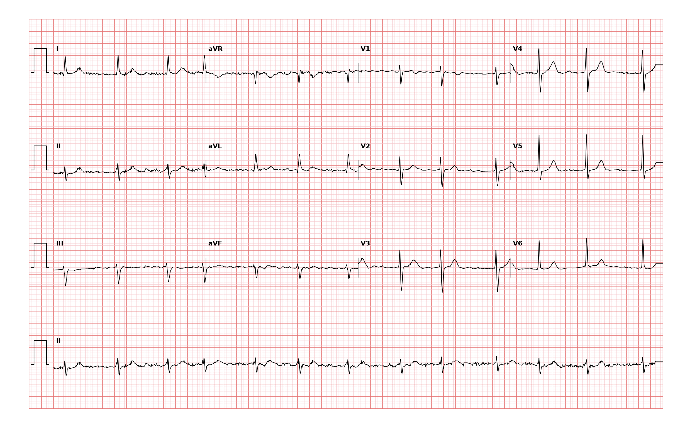

## 문제
73세 남자가 고혈압 정기 진료 때 맥박이 불규칙하다는 말을 듣고 심전도를 찍었다. 가끔 두근거리지만 흉통·호흡곤란·어지럼은 없고, 증상이 언제 시작되었는지 모른다. 고혈압으로 암로디핀을 먹고 있고 당뇨병·심부전·뇌졸중 병력은 없다. 혈압 132/80 mmHg, 맥박 76회/분(불규칙)이다. 심초음파에서 좌심실 박출률 60 %, 승모판 협착이나 인공판막은 없다. 혈청 크레아티닌 1.0 mg/dL, 혈색소 14.2 g/dL 이다. 12유도 심전도는 그림과 같다. 가장 적절한 처치는?

- A. 아픽사반 경구 투여를 시작한다
- B. 아스피린 경구 투여를 시작한다
- C. 즉시 전기 율동전환을 한다
- D. 항응고 없이 1년 뒤 다시 평가한다
- E. 와파린과 아스피린을 함께 시작한다

_12유도 심전도, 25 mm/s · 10 mm/mV, 3×4 + II 리듬 스트립 (PTB-XL ECG dataset, PhysioNet, CC BY 4.0 — 원신호 그대로 작도)_

## 정답 및 해설
> 정답: A

- **정답 핵심**: P파가 없고 기저선이 잔물결이며 RR 간격이 완전히 불규칙한 좁은 QRS 리듬으로 심방세동이다(I 양성·II·III 음성의 좌축 편위 동반). 심박수는 76회/분으로 조절되어 있고 혈역학적으로 안정하다. 승모판 협착·인공판막이 없는 비판막성 심방세동이고 CHA₂DS₂-VASc 점수는 나이 65~74세 1점 + 고혈압 1점 = 2점이다. 남자에서 2점 이상이면 경구 항응고제가 권고되며, 와파린보다 두개내출혈이 적은 직접 경구 항응고제(아픽사반)가 우선이다.
- **원리**: <b>왜 심방세동이 뇌졸중을 일으키나</b>: 심방이 1분에 400회 넘게 잔떨림만 하면 실제로 수축하지 못해 좌심방이, 특히 막다른 주머니인 <b>좌심방이(left atrial appendage)</b>에 피가 고인다. 정체·내피 손상·과응고(Virchow 세 요소)가 겹쳐 혈전이 생기고, 떨어져 나가면 뇌동맥을 막는다. 그래서 항혈소판제가 아니라 응고 연쇄를 막는 항응고제가 필요하다 — 정체 혈전은 피브린이 주성분인 「붉은 혈전」이기 때문이다.  <b>왜 점수를 매기나</b>: 뇌졸중 위험은 사람마다 연 1 % 미만에서 10 % 넘게까지 다르고, 항응고에는 출혈 위험이 따른다. CHA₂DS₂-VASc(심부전·고혈압·75세 이상 2점·당뇨·뇌졸중 2점·혈관질환·65~74세·여성)는 이득이 출혈을 넘는 사람을 고르는 도구다. 남자 2점 이상(여자 3점 이상)이면 항응고를 권한다.  <b>왜 아스피린이 아닌가</b>: 아스피린의 뇌졸중 예방 효과는 미미한데 대출혈은 항응고제와 비슷하게 늘어 심방세동 뇌졸중 예방에는 쓰지 않는다.
- **비교**: <table><thead><tr><th style="width:24%">항목</th><th style="width:38%">직접 경구 항응고제(정답)</th><th>아스피린(가장 가까운 오답)</th></tr></thead><tbody> <tr><td>작용</td><td><b>Xa 인자·트롬빈 억제 → 피브린 혈전 차단</b></td><td>혈소판 COX-1 억제</td></tr> <tr><td>심방세동 뇌졸중 감소</td><td>약 2/3 감소(와파린과 같거나 더 좋음)</td><td>미미함</td></tr> <tr><td>출혈</td><td>와파린보다 두개내출혈 적음</td><td>대출혈이 적지 않음</td></tr> <tr><td>적응</td><td>남자 CHA₂DS₂-VASc ≥ 2</td><td>심방세동 단독 적응 없음</td></tr> </tbody></table> 점수가 2점인 이 남자는 항응고 대상이고, 약은 혈소판이 아니라 응고 연쇄를 겨냥해야 한다.
- **오답 이유**:
  - ② 아스피린은 심방세동이 아니라 안정 협심증이나 심근경색 뒤 관상동맥질환의 이차 예방이 목적일 때 정답이 된다.
  - ③ 즉시 전기 율동전환은 심방세동으로 저혈압·쇼크·폐부종·진행 중인 허혈처럼 혈역학적으로 불안정할 때 정답이 된다.
  - ④ 항응고 없이 재평가는 65세 미만이고 위험인자가 없어 CHA₂DS₂-VASc 가 남자 0점(여자 1점)일 때 정답이 된다.
  - ⑤ 와파린과 아스피린 병용은 출혈만 늘어 권하지 않으며, 최근 관상동맥 스텐트를 넣어 짧게 병용이 필요한 경우처럼 따로 적응이 있을 때만 정답이 된다.
- **함정**: 증상이 거의 없고 심박수가 정상이니 지켜보는 것 — 심방세동의 뇌졸중 위험은 증상과 무관하고, 남자 CHA₂DS₂-VASc 2점이면 항응고를 시작한다.
- **학습목표**: 심박수가 조절된 비판막성 심방세동에서 CHA₂DS₂-VASc 점수로 뇌졸중 위험을 매겨 직접 경구 항응고제를 고르고 아스피린·즉시 율동전환과 가른다
- **근거·출처**: Loscalzo J, Fauci AS, Kasper DL, et al., eds. Harrison's Principles of Internal Medicine, 22nd ed. McGraw Hill; 2025. Chapter 258: Atrial Fibrillation · Joglar JA, Chung MK, Armbruster AL, et al. 2023 ACC/AHA/ACCP/HRS guideline for the diagnosis and management of atrial fibrillation. Circulation. 2024;149(1):e1-e156

## 출처
- PTB-XL ECG dataset v1.0.3 (PhysioNet, CC BY 4.0) · record 17794 · Creative Commons Attribution 4.0 International · https://physionet.org/content/ptb-xl/1.0.3/LICENSE.txt
