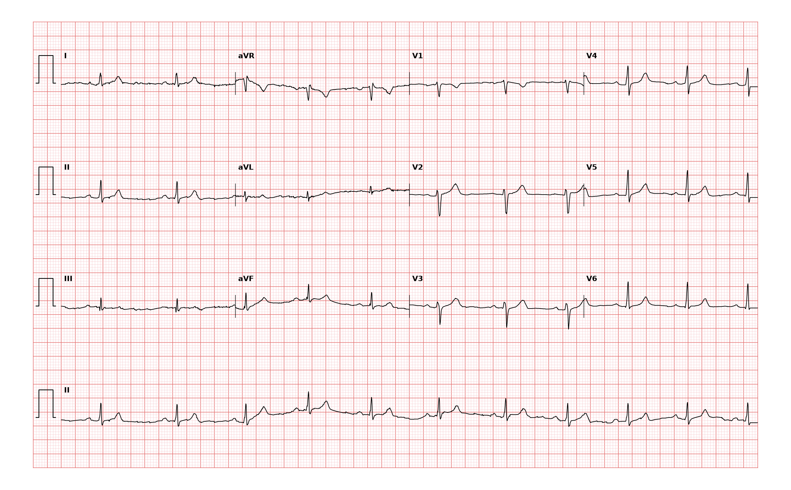

## 문제
A 28-year-old woman comes to the physician because she has noticed that her pulse seems irregular when she checks it during yoga breathing exercises. She has no palpitations, chest pain, dyspnea, or syncope. She runs 5 km three times weekly and takes no medications. She drinks one cup of coffee daily. Her pulse is 64/min and irregular, and blood pressure is 108/68 mm Hg. Cardiac examination shows no murmurs. Serum electrolyte concentrations and thyroid-stimulating hormone level are within the reference ranges. A 12-lead ECG is shown. Which of the following is the most likely diagnosis?

- A. Atrial fibrillation
- B. Sinus arrhythmia
- C. Premature atrial contractions
- D. Second-degree atrioventricular block, Mobitz type I
- E. Wandering atrial pacemaker

_12-lead ECG, 25 mm/s, 10 mm/mV, 3×4 + lead II rhythm strip (PTB-XL, PhysioNet, CC BY 4.0; raw signal, no filtering)_

## 정답 및 해설
> 정답: B

- **정답 핵심**: Every QRS complex is preceded by an upright P wave of the same shape in lead II with a constant PR interval, and the QRS complexes and ST-T waves are normal. The P-P intervals lengthen and shorten gradually, from about 0.84 to 1.1 seconds, without early beats or dropped P waves. A gradual, cyclic variation in sinus rate with identical P waves is sinus arrhythmia, a normal finding in young, fit people that follows breathing.
- **원리**: <b>Why the sinus rate changes with breathing</b>: During inspiration, intrathoracic pressure falls, venous return to the right heart rises, and stretch receptors and baroreflex input transiently reduce vagal outflow to the sinus node, so the rate speeds up. During expiration, vagal tone returns and the rate slows. The sinus node is still the only pacemaker, so the P-wave shape and the PR interval stay the same; only the timing changes, gradually and cyclically.  <b>Why it is common in young, fit people</b>: Endurance training raises resting vagal tone, which amplifies the respiratory swing. The variation diminishes with age and with autonomic neuropathy, so its presence is a sign of a healthy autonomic system rather than disease.  <b>How to separate it from other irregular rhythms</b>: Premature atrial contractions are sudden early beats, usually with a differently shaped P wave. Mobitz I block lengthens the PR interval until a P wave is not conducted. Wandering atrial pacemaker changes the P-wave shape among at least three forms. Atrial fibrillation has no organized P waves.
- **비교**: <table><thead><tr><th style="width:22%">Feature</th><th style="width:39%">Sinus arrhythmia (answer)</th><th>Premature atrial contractions (closest distractor)</th></tr></thead><tbody> <tr><td>P-wave shape</td><td><b>Identical in every beat</b></td><td>Early beat has a different P wave</td></tr> <tr><td>Change in R-R</td><td>Gradual, cyclic with breathing</td><td>Abrupt early beat followed by a pause</td></tr> <tr><td>PR interval</td><td>Constant</td><td>Often different in the early beat</td></tr> <tr><td>Significance</td><td>Normal, especially in the young</td><td>Usually benign; triggers include caffeine and stimulants</td></tr> </tbody></table> Ask whether any single beat is premature: if the intervals drift smoothly with the same P wave, the sinus node is simply changing its rate.
- **오답 이유**:
  - (A) Atrial fibrillation would be correct if no discrete P waves were visible and the R-R intervals were irregularly irregular without a cyclic pattern.
  - (C) Premature atrial contractions would be correct if isolated beats came abruptly early with a differently shaped P wave and were followed by a pause.
  - (D) Mobitz type I block would be correct if the PR interval progressively lengthened until a P wave failed to conduct, producing grouped beating.
  - (E) Wandering atrial pacemaker would be correct if the P-wave morphology varied among at least three shapes with changing PR intervals at a rate under 100/min.
- **함정**: Calling an irregular pulse an arrhythmia needing evaluation — identical P waves with a constant PR and smoothly varying P-P intervals in a fit young woman are sinus arrhythmia.
- **학습목표**: 모든 QRS 앞에 같은 P파와 일정한 PR 이 있으면서 PP 간격만 서서히 변하는 리듬을 동부정맥으로 판독하고 심방조기수축·Mobitz I 차단·이소성 심방 리듬과 가른다
- **근거·출처**: Loscalzo J, Fauci AS, Kasper DL, et al., eds. Harrison's Principles of Internal Medicine, 22nd ed. McGraw Hill; 2025. Chapter 247: Electrocardiography · Loscalzo J, Fauci AS, Kasper DL, et al., eds. Harrison's Principles of Internal Medicine, 22nd ed. McGraw Hill; 2025. Chapter 251: The Bradyarrhythmias: Disorders of the Sinoatrial Node

## 출처
- PTB-XL ECG dataset v1.0.3 (PhysioNet, CC BY 4.0) · record 2325 · Creative Commons Attribution 4.0 International · https://physionet.org/content/ptb-xl/1.0.3/LICENSE.txt
