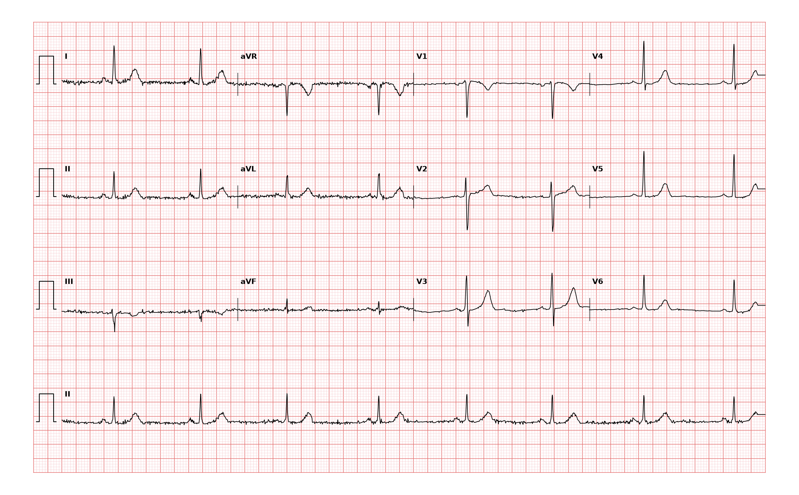

## 문제
53세 여자가 2주 전부터 쉽게 피곤하고 계단을 오를 때 숨이 차서 외래에 왔다. 실신이나 흉통은 없다. 3주 전 고혈압과 두근거림으로 메토프롤롤 용량을 하루 50 mg 에서 200 mg 으로 올렸다. 혈압 118/74 mmHg, 맥박 48회/분, 호흡 16회/분이다. 의식은 명료하고 폐음은 깨끗하며 다리 부종은 없다. 혈청 칼륨 4.2 mEq/L 이고 갑상샘자극호르몬은 정상이다. 12유도 심전도는 그림과 같다. 가장 적절한 처치는?

- A. 경피 심박조율
- B. 이소프로테레놀 지속 정맥 주입
- C. 메토프롤롤 감량
- D. 영구 심박동기 삽입
- E. 아트로핀 정맥 주사

_12유도 심전도, 25 mm/s · 10 mm/mV, 3×4 + II 리듬 스트립 (PTB-XL ECG dataset, PhysioNet, CC BY 4.0 — 원신호 그대로 작도)_

## 정답 및 해설
> 정답: C

- **정답 핵심**: 모든 QRS 앞에 같은 모양의 양성 P파가 있고 PR 간격이 일정하며 RR 간격은 약 1.25초(약 48회/분)다. 방실 전도는 보존된 동서맥이다. 증상은 피로와 운동 시 호흡곤란으로 가볍고 혈압이 유지되어 혈역학적으로 안정하다. 서맥이 메토프롤롤을 네 배로 올린 뒤 시작됐고 칼륨·갑상샘 기능은 정상이므로 가장 그럴듯한 원인은 약물이다. 가역적 원인이 있는 증상성 동서맥은 원인을 먼저 없앤다 — 메토프롤롤을 줄이고 맥박과 증상을 다시 본다.
- **원리**: <b>왜 베타차단제가 동결절을 느리게 하는가</b>: 동결절 세포의 자동능은 4기 탈분극의 기울기로 정해지고, 이 기울기는 과분극 활성 전류(If)와 L형 칼슘 전류가 만든다. 교감신경의 β1 자극은 cAMP 를 올려 두 전류를 키우므로, 베타차단제는 기울기를 낮춰 박동수를 줄인다. 용량이 오를수록 이 효과가 커져 안정 시 50회/분 아래로 떨어질 수 있다.  <b>왜 원인 제거가 먼저인가</b>: 동결절 질환이 아니라 약물에 의한 것이면 약을 줄이면 며칠 안에 회복된다. 영구 심박동기는 가역적 원인을 없앤 뒤에도 증상성 서맥이 남거나, 그 약을 꼭 계속 써야 할 때 고려한다.  <b>언제 응급 처치로 넘어가는가</b>: 저혈압·의식 변화·쇼크·급성 심부전 같은 불안정 징후가 있으면 아트로핀 → 경피 심박조율·도파민/에피네프린 주입 순으로 즉시 박동수를 올린다. 이 환자는 안정하므로 해당하지 않는다.
- **비교**: <table><thead><tr><th style="width:24%">항목</th><th style="width:38%">원인 약물 감량(정답)</th><th>영구 심박동기 삽입(가장 가까운 오답)</th></tr></thead><tbody> <tr><td>서맥의 원인</td><td><b>가역적</b> — 약물·전해질·갑상샘저하증</td><td>비가역적 동결절 기능부전·고도 방실차단</td></tr> <tr><td>혈역학</td><td>안정, 경한 증상</td><td>원인 교정 뒤에도 증상 지속</td></tr> <tr><td>시점</td><td>먼저 시도하고 재평가</td><td>교정 뒤 재평가에서 결정</td></tr> <tr><td>예외</td><td>—</td><td>그 약이 꼭 필요하면(예: 빈맥-서맥 증후군의 심박수 조절) 처음부터 고려</td></tr> </tbody></table> 서맥의 처치는 「안정한가」와 「되돌릴 수 있는가」 두 질문으로 정한다. 불안정하면 아트로핀·조율, 안정하고 가역적이면 원인 제거다.
- **오답 이유**:
  - ① 경피 심박조율은 아트로핀에 반응하지 않는 불안정 서맥이나 고도 방실차단에서 임시 처치로 정답이 된다.
  - ② 이소프로테레놀 지속 정맥 주입은 불안정 서맥에서 조율을 기다리는 동안 쓰는 가교 약물로 정답이 될 수 있다.
  - ④ 영구 심박동기 삽입은 약을 줄인 뒤에도 증상성 서맥이 남거나 베타차단제를 반드시 유지해야 할 때 정답이 된다.
  - ⑤ 아트로핀 정맥 주사는 저혈압·의식 저하 같은 불안정 징후를 동반한 서맥의 첫 약물로 정답이 된다.
- **함정**: 맥박 48회/분과 증상만 보고 심박동기로 가는 것 — 혈역학이 안정하고 약물이라는 가역적 원인이 있으면 원인 제거가 먼저다.
- **학습목표**: 베타차단제 증량 뒤 생긴 증상성 동서맥을 가역적 원인으로 보고 원인 약물 감량을 고르며 영구 심박동기 삽입과 가른다
- **근거·출처**: Loscalzo J, Fauci AS, Kasper DL, et al., eds. Harrison's Principles of Internal Medicine, 22nd ed. McGraw Hill; 2025. Chapter 251: The Bradyarrhythmias: Disorders of the Sinoatrial Node · Kusumoto FM, Schoenfeld MH, Barrett C, et al. 2018 ACC/AHA/HRS guideline on the evaluation and management of patients with bradycardia and cardiac conduction delay. Circulation. 2019;140(8):e382-e482

## 출처
- PTB-XL ECG dataset v1.0.3 (PhysioNet, CC BY 4.0) · record 19310 · Creative Commons Attribution 4.0 International · https://physionet.org/content/ptb-xl/1.0.3/LICENSE.txt
