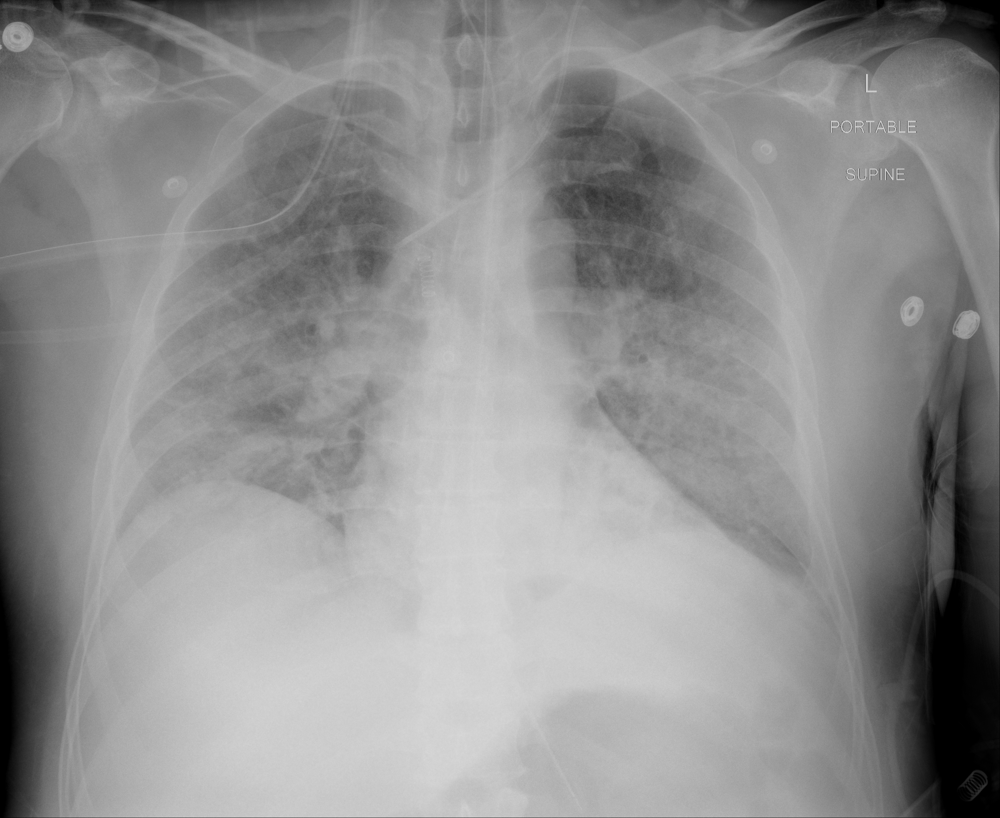

## 문제
A 56-year-old man with COVID-19 pneumonia was intubated in the intensive care unit 14 hours ago for worsening hypoxemia. He is receiving volume-controlled ventilation with a tidal volume of 6 mL/kg of predicted body weight, PEEP of 14 cm H2O, and FiO2 of 0.9; plateau pressure is 28 cm H2O. He is sedated and synchronous with the ventilator. Blood pressure is 112/68 mm Hg on a low dose of norepinephrine. Arterial blood gas analysis shows a PaO2 of 72 mm Hg. Bedside echocardiography shows normal left ventricular function. A portable chest x-ray is shown. Which of the following is the most appropriate next step in management?

- A. Prone positioning for at least 16 hours per day
- B. Inhaled nitric oxide at 20 parts per million
- C. High-frequency oscillatory ventilation
- D. Intravenous furosemide bolus
- E. Increase tidal volume to 10 mL/kg of predicted body weight

_Portable supine anteroposterior chest radiograph; text and side markers as in the original, resized only (The Cancer Imaging Archive, CC BY 4.0; no cropping or window adjustment)_

## 정답 및 해설
> 정답: A

- **정답 핵심**: The radiograph shows bilateral diffuse ground-glass and patchy consolidative opacities, worse in the lower zones, with an endotracheal tube, nasogastric tube, and central venous catheter in place. With normal left ventricular function, the opacities are not cardiogenic. His PaO2/FiO2 ratio is 72/0.9 = 80 despite lung-protective settings and PEEP 14, which is severe ARDS. When the ratio stays below 150 after initial stabilization, prone positioning for at least 16 hours a day lowers mortality and should be started early, within the first 36 hours of ventilation.
- **원리**: <b>Why turning the patient over helps</b>: In the supine position, the weight of the heart and the edematous lung compresses the dorsal regions, which contain most of the lung tissue. These collapsed dorsal units still receive most of the blood flow, so shunt is large. Prone positioning makes the pleural pressure gradient more uniform from front to back, reopens the dorsal lung, and keeps perfusion largely dorsal, so ventilation and perfusion match better.  <b>Why it also protects the lung</b>: Because aeration becomes more even, the same tidal volume is spread over more open alveoli. Regional overdistension and cyclic opening and closing fall, which reduces ventilator-induced lung injury. This explains why proning lowered mortality, while drugs that only raise PaO2 did not.  <b>Why duration matters</b>: The benefit was shown with long sessions of at least 16 hours a day started early in severe ARDS; short sessions in older trials did not change survival.
- **비교**: <table><thead><tr><th style="width:24%">Feature</th><th style="width:38%">Prone positioning (answer)</th><th>Inhaled nitric oxide (closest distractor)</th></tr></thead><tbody> <tr><td>Mechanism</td><td>Recruits dorsal lung, more uniform aeration</td><td>Selective pulmonary vasodilation in ventilated units</td></tr> <tr><td>Effect on PaO2</td><td>Improves, often sustained</td><td>Improves transiently (24-48 h)</td></tr> <tr><td>Mortality</td><td><b>Lower</b> in severe ARDS (PaO2/FiO2 below 150)</td><td>No reduction; possible kidney injury</td></tr> <tr><td>Role</td><td>Standard step after lung-protective ventilation</td><td>Rescue only when other measures fail</td></tr> </tbody></table> A treatment that raises PaO2 is not the same as a treatment that saves lives; in severe ARDS, the measures that reduce lung stretch (low tidal volume, proning) are the ones with mortality benefit.
- **오답 이유**:
  - (B) Inhaled nitric oxide could be chosen only as a short rescue for refractory hypoxemia after proning has failed, because it raises PaO2 without lowering mortality.
  - (C) High-frequency oscillatory ventilation would only be considered in a specialized center when conventional strategies fail; trials showed no benefit or harm in early ARDS.
  - (D) Intravenous furosemide would be the answer if the opacities were from cardiogenic pulmonary edema or clear volume overload, which the normal echocardiogram argues against.
  - (E) A tidal volume of 10 mL/kg would be acceptable only in a patient without lung injury; in ARDS it overstretches the small aerated lung and increases mortality.
- **함정**: Choosing the therapy that raises PaO2 fastest (inhaled nitric oxide) — in severe ARDS the step with proven mortality benefit after low tidal volume ventilation is prone positioning.
- **학습목표**: 저일회호흡량·적정 PEEP 에도 PaO2/FiO2 150 미만이 지속되는 중증 ARDS 에서 복와위 환기를 고르고 흡입 산화질소와 가른다
- **근거·출처**: Loscalzo J, Fauci AS, Kasper DL, et al., eds. Harrison's Principles of Internal Medicine, 22nd ed. McGraw Hill; 2025. Chapter 312: Acute Respiratory Distress Syndrome · Guérin C, Reignier J, Richard JC, et al. Prone positioning in severe acute respiratory distress syndrome. N Engl J Med. 2013;368(23):2159-2168

## 출처
- COVID-19-AR, The Cancer Imaging Archive (CC BY 4.0) · series …17995007 · Creative Commons Attribution 4.0 International · https://www.cancerimagingarchive.net/data-usage-policies-and-restrictions/
