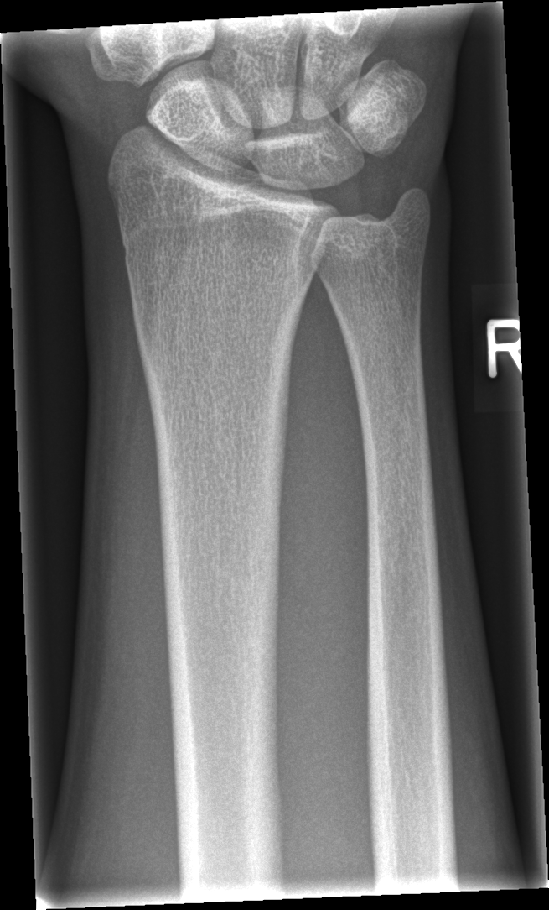

## 문제
A 17-year-old boy comes to the emergency department 3 hours after falling onto his outstretched right hand while playing basketball. He has pain on the radial side of the wrist. Examination shows mild swelling and tenderness to palpation in the anatomic snuffbox; there is pain with axial loading of the thumb. There is no deformity, and distal sensation and capillary refill are normal. The distal radius and ulna are not tender. A radiograph of the right wrist is shown. Which of the following is the most appropriate next step in management?

- A. Closed reduction and sugar-tong splint of the distal radius
- B. Open reduction and internal fixation of the wrist
- C. Short arm cast for 3 weeks for a buckle fracture
- D. Thumb spica immobilization with repeat imaging in 10 to 14 days
- E. Reassurance with an elastic bandage and return to sports

_Frontal radiograph of the right wrist and distal forearm; side marker as in the original, resized only (GRAZPEDWRI-DX, figshare, CC BY 4.0)_

## 정답 및 해설
> 정답: D

- **정답 핵심**: The radiograph shows intact cortices of the distal radius and ulna with no fracture line, displacement, or periosteal reaction; the physes are nearly closed. Tenderness in the anatomic snuffbox and pain on axial loading of the thumb after a fall on an outstretched hand strongly suggest a scaphoid fracture, which is often invisible on initial radiographs. Such a clinically suspected fracture is immobilized in a thumb spica splint and re-imaged in 10 to 14 days (or evaluated earlier with MRI or CT if available).
- **원리**: <b>Why the first radiograph can be normal</b>: Scaphoid fractures are often nondisplaced and run in a plane oblique to the x-ray beam. In the first days, the fracture line is a hairline crack that only becomes visible after bone resorption along it in 1-2 weeks. Up to about a fifth of scaphoid fractures are missed on initial views.  <b>Why missing it matters — the blood supply</b>: The scaphoid is supplied mainly by branches of the radial artery that enter the dorsal ridge distally and flow <b>retrograde</b> to the proximal pole. A waist fracture cuts the proximal pole off from this supply, leading to nonunion and avascular necrosis, and eventually wrist arthritis (scaphoid nonunion advanced collapse).  <b>Why immobilize before proof</b>: Treating every suspected case with a thumb spica for 10-14 days costs little, whereas an untreated fracture risks permanent disability. Repeat radiographs, or MRI as the most sensitive early test, then confirm or exclude the fracture.
- **비교**: <table><thead><tr><th style="width:24%">Feature</th><th style="width:38%">Suspected scaphoid fracture (answer)</th><th>Wrist sprain (closest distractor)</th></tr></thead><tbody> <tr><td>Point tenderness</td><td><b>Anatomic snuffbox</b>, scaphoid tubercle</td><td>Diffuse or ligament line without snuffbox pain</td></tr> <tr><td>Axial thumb loading</td><td>Painful</td><td>Usually painless</td></tr> <tr><td>Initial radiograph</td><td>Often normal</td><td>Normal</td></tr> <tr><td>Management</td><td>Thumb spica, re-image in 10-14 days or MRI</td><td>Brief support and early motion</td></tr> </tbody></table> A normal radiograph does not exclude a scaphoid fracture; the decision is driven by snuffbox findings, not by the film.
- **오답 이유**:
  - (A) Closed reduction and a sugar-tong splint would be correct for a displaced distal radius fracture with deformity, which the radiograph does not show.
  - (B) Open reduction and internal fixation would be chosen for a displaced or proximal pole scaphoid fracture confirmed on imaging, not for a normal radiograph.
  - (C) A short arm cast would treat a buckle fracture of the distal radius metaphysis, which would show cortical bulging that is absent here.
  - (E) Reassurance and return to sports would be appropriate only if there were no snuffbox tenderness and no pain with thumb loading, that is, a simple sprain.
- **함정**: Sending the patient home because the radiograph is normal — snuffbox tenderness after a fall on an outstretched hand means a scaphoid fracture until proven otherwise.
- **학습목표**: 손을 짚고 넘어진 뒤 해부학적 코담배갑 압통이 있으나 첫 X선이 정상일 때 주상골 골절 의증으로 엄지 고정과 추적 영상을 고른다
- **근거·출처**: Clementson M, Björkman A, Thomsen NOB. Acute scaphoid fractures: guidelines for diagnosis and treatment. EFORT Open Rev. 2020;5(2):96-103 · Mallee WH, Wang J, Poolman RW, et al. Computed tomography versus magnetic resonance imaging versus bone scintigraphy for clinically suspected scaphoid fractures in patients with negative plain radiographs. Cochrane Database Syst Rev. 2015;(6):CD010023

## 출처
- GRAZPEDWRI-DX (figshare, CC BY 4.0) · Creative Commons Attribution 4.0 International · https://creativecommons.org/licenses/by/4.0/
