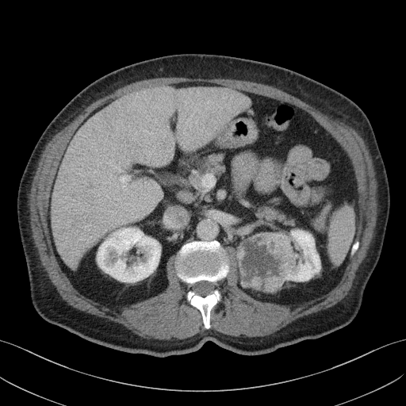

## 문제
75세 남자가 건강검진 소변검사에서 현미경적 혈뇨가 나와 비뇨의학과에 왔다. 육안적 혈뇨·옆구리 통증·체중 감소는 없다. 흡연력은 40갑년이고 고혈압으로 약을 먹고 있다. 혈압 136/82 mmHg 이고 옆구리에 만져지는 종괴는 없다. 혈색소 13.8 g/dL, 혈청 크레아티닌 1.0 mg/dL 이고 소변 세포검사는 음성이다. 복부 조영증강 CT 는 그림과 같다. 가장 가능성이 높은 진단은?

- A. 신세포암
- B. 혈관근지방종
- C. 단순 신낭종
- D. 신우 요로상피암
- E. 신장 농양

_조영증강 복부 CT, 축상 단면 1장, 연부조직 창, 표준 표시 방향 (TCIA, CC BY 3.0 — 크롭·보정·분할 표시 없음)_

## 정답 및 해설
> 정답: A

- **정답 핵심**: CT 에서 왼쪽 신장 앞안쪽에 약 4~5 cm 의 불균질하게 조영증강되는 고형 종괴가 있고, 가운데는 괴사로 보이는 저음영이며 거시적 지방이나 석회화는 없다. 오른쪽 신장은 정상이다. 조영증강되는 고형 신장 종괴에서 지방이 보이지 않으면 신세포암을 가장 먼저 생각한다. 고령 남성·중증 흡연·현미경적 혈뇨도 위험 요인과 증상으로 맞고, 열·백혈구 증가가 없어 농양은 가능성이 낮다.
- **원리**: <b>CT 로 신장 종괴를 가르는 두 질문</b>: 첫째, <b>조영증강이 되는가</b> — 조영제 전후 감쇠가 15~20 HU 넘게 오르면 혈관이 있는 살아 있는 조직이다. 액체만 든 단순 낭종은 증강되지 않고 벽이 얇고 매끈하다. 둘째, <b>거시적 지방이 있는가</b> — −10 HU 이하의 지방이 보이면 혈관근지방종으로 진단할 수 있다. 지방 없이 증강되는 고형 종괴는 80 % 이상이 신세포암이다.  <b>왜 투명세포 신세포암은 불균질한가</b>: VHL 유전자 소실로 HIF 가 쌓여 VEGF 가 많이 만들어지므로 종양은 혈관이 풍부해 동맥기에 강하게 증강된다. 그러나 혈관 성장이 종양 성장을 따라가지 못하는 중심부는 괴사·출혈이 생겨 저음영으로 남는다.  <b>요로상피암과의 위치 차이</b>: 신우 요로상피암은 집합관계 점막에서 생겨 신동 안쪽에서 신우를 채우는 결손으로 보이고, 신실질 종괴보다 증강이 약하다. 소변 세포검사가 양성인 경우가 많다.
- **비교**: <table><thead><tr><th style="width:24%">CT 소견</th><th style="width:38%">신세포암(정답)</th><th>혈관근지방종(가장 가까운 오답)</th></tr></thead><tbody> <tr><td>지방</td><td>거시적 지방 없음(드물게 예외)</td><td><b>−10 HU 이하 거시적 지방</b></td></tr> <tr><td>조영증강</td><td>강하고 불균질, 중심 괴사</td><td>혈관 성분은 증강, 지방은 증강 없음</td></tr> <tr><td>석회화</td><td>있을 수 있음</td><td>거의 없음</td></tr> <tr><td>호발</td><td>고령 남성·흡연·비만</td><td>중년 여성, 결절성 경화증</td></tr> </tbody></table> 지방이 보이면 혈관근지방종, 지방 없이 증강되면 신세포암으로 다룬다. 지방이 적은 혈관근지방종은 영상만으로 가려지지 않아 수술 후 병리로 확정된다.
- **오답 이유**:
  - ② 혈관근지방종은 종괴 안에 −10 HU 이하의 거시적 지방 음영이 뚜렷이 보일 때 정답이 된다.
  - ③ 단순 신낭종은 물과 같은 감쇠에 조영증강이 없고 벽이 얇고 매끈한 둥근 병변일 때 정답이 된다.
  - ④ 신우 요로상피암은 신동 안쪽 집합관계를 채우는 약하게 증강되는 결손과 양성 소변 세포검사가 있을 때 정답이 된다.
  - ⑤ 신장 농양은 열·옆구리 압통·백혈구 증가와 함께 테두리만 증강되는 액체 저류가 보일 때 정답이 된다.
- **함정**: 가운데 저음영을 보고 낭종이나 농양으로 읽는 것 — 테두리가 아니라 두꺼운 고형 부분이 불균질하게 증강되면 괴사를 동반한 신세포암이다.
- **학습목표**: 거시적 지방이 없는 불균질 조영증강 고형 신장 종괴를 신세포암으로 진단하고 혈관근지방종·단순 신낭종과 가른다
- **근거·출처**: Loscalzo J, Fauci AS, Kasper DL, et al., eds. Harrison's Principles of Internal Medicine, 22nd ed. McGraw Hill; 2025. Chapter 90: Renal Cell Carcinoma · Campbell SC, Clark PE, Chang SS, et al. Renal mass and localized renal cancer: evaluation, management, and follow-up: AUA guideline: part I. J Urol. 2021;206(2):199-208

## 출처
- The Cancer Imaging Archive (CC BY 3.0) · KiTS-00200 · Creative Commons Attribution 3.0 Unported · https://www.cancerimagingarchive.net/data-usage-policies-and-restrictions/
