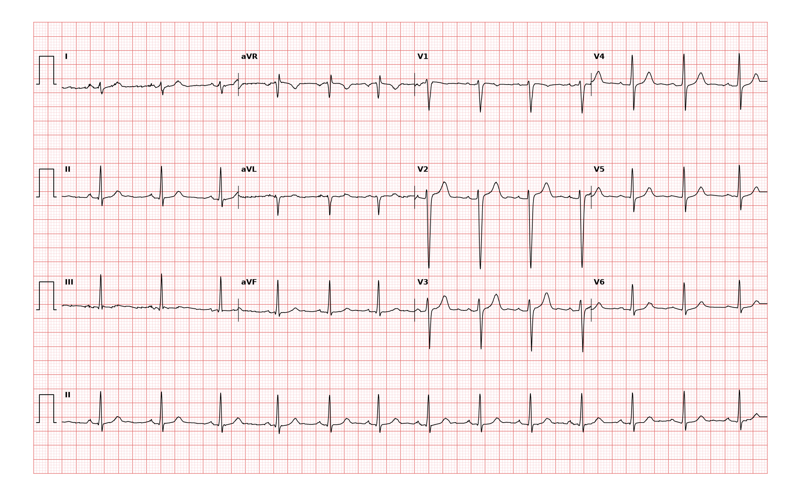

## 문제
18세 여자가 대학 입학 건강검진에서 심전도 이상이 있다고 하여 왔다. 증상은 없고 운동할 때 숨이 차지 않는다. 키 163 cm, 체중 56 kg 이다. 혈압 112/70 mmHg, 맥박 75회/분이다. 심음은 정상이고 잡음은 없으며 폐음은 깨끗하다. 흉부 X선과 심장초음파에서 우심실 크기·벽 두께와 추정 폐동맥압은 정상이다. 12유도 심전도는 그림과 같다. 심전도 판독으로 가장 적절한 것은?

- A. 좌후속지차단
- B. 좌전속지차단
- C. 우심실비대
- D. 우각차단
- E. 좌각차단

_12유도 심전도, 25 mm/s · 10 mm/mV, 3×4 + II 리듬 스트립 (PTB-XL ECG dataset, PhysioNet, CC BY 4.0 — 원신호 그대로 작도)_

## 정답 및 해설
> 정답: A

- **정답 핵심**: 동리듬 약 75회/분이고 QRS 폭은 좁다. I 유도는 작은 r 뒤 그보다 깊은 S(rS)로 음성 우세이고, II·III·aVF 에서는 큰 R 파가 보이며 III 이 가장 크다 — 축이 +90° 를 넘는 우축 편위다. V1 은 rS 로 우측 흉부 유도의 큰 R 이 없고 V5·V6 의 깊은 S 도 없어 우심실비대 근거가 없으며, 심장초음파도 우심실이 정상이다. 우심실비대·폐질환·측벽 경색 같은 다른 우축 원인이 없는 좁은 QRS 의 우축 편위이므로 좌후속지차단이다. 판독 전문의의 판독도 「동리듬, 우축, 좌후속지차단」이었다.
- **원리**: <b>왜 속지차단은 축을 바꾸는가</b>: 좌각은 앞위쪽으로 가는 <b>좌전속지</b>와 뒤아래쪽으로 가는 <b>좌후속지</b>로 나뉜다. 좌후속지가 막히면 흥분은 좌전속지를 따라 앞위쪽 벽부터 시작해, 늦게 흥분하는 뒤아래쪽 벽으로 퍼진다. QRS 후반의 주 벡터가 아래·오른쪽을 향하므로 III·aVF 에서 큰 R, I·aVL 에서 깊은 S 가 생기고 축이 +90~+180° 로 옮겨 간다. 두 속지는 같은 좌각 안의 가지라 전체 전도 시간은 거의 늘지 않아 QRS 는 120 ms 미만이다.  <b>왜 배제 진단인가</b>: 좌후속지는 짧고 굵으며 두 관상동맥에서 혈액을 받아 단독으로 막히는 일이 드물다. 그래서 우축 편위를 보면 먼저 우심실비대·폐성심·측벽 경색·마른 체형의 정상 변이를 찾고, 이런 원인이 없을 때만 좌후속지차단으로 판독한다.  <b>임상적 의미</b>: 단독 좌후속지차단은 대개 무증상이지만 우각차단과 함께 있으면 이속지차단이 되어 고도 방실차단으로 진행할 수 있다.
- **비교**: <table><thead><tr><th style="width:24%">항목</th><th style="width:38%">좌후속지차단(정답)</th><th>우심실비대(가장 가까운 오답)</th></tr></thead><tbody> <tr><td>전두면 축</td><td>우축(+90~+180°)</td><td>우축</td></tr> <tr><td>V1</td><td><b>rS — 큰 R 없음</b></td><td>R/S > 1, 큰 R 또는 qR</td></tr> <tr><td>V5·V6</td><td>정상 R</td><td>깊은 S, R/S < 1</td></tr> <tr><td>동반 소견</td><td>없음</td><td>우심방 확대(II 의 높은 P), 우측 흉부 유도의 ST-T 스트레인</td></tr> <tr><td>심장초음파</td><td>우심실 정상</td><td>우심실 비대·폐동맥압 상승</td></tr> </tbody></table> 두 진단 모두 우축이다. 흉부 유도가 정상이고 우심실 부하 근거가 없을 때만 좌후속지차단으로 남는다.
- **오답 이유**:
  - ② 좌전속지차단은 I·aVL 의 qR 과 II·III·aVF 의 rS 로 축이 −45° 보다 왼쪽인 좌축 편위일 때 정답이 된다.
  - ③ 우심실비대는 우축에 더해 V1 의 큰 R(R/S > 1)이나 V5·V6 의 깊은 S, 심장초음파의 우심실 비대가 있을 때 정답이 된다.
  - ④ 우각차단은 QRS 가 120 ms 이상으로 넓고 V1 의 rsR′ 과 I·V6 의 넓고 끌리는 S 가 있을 때 정답이 된다.
  - ⑤ 좌각차단은 QRS 가 120 ms 이상이고 I·V6 의 중격 q파 소실과 넓고 패인 R 이 있을 때 정답이 된다.
- **함정**: 우축 편위를 보면 바로 우심실비대로 읽는 것 — V1 의 R 파와 심장초음파로 우심실 부하를 먼저 확인하고, 없을 때 좌후속지차단으로 판독한다.
- **학습목표**: 좁은 QRS 의 우축 편위(I 의 rS, III·aVF 의 큰 R)를 우심실비대 근거 없이 좌후속지차단으로 판독하고 좌전속지차단·우심실비대와 가른다
- **근거·출처**: Loscalzo J, Fauci AS, Kasper DL, et al., eds. Harrison's Principles of Internal Medicine, 22nd ed. McGraw Hill; 2025. Chapter 247: Electrocardiography · Surawicz B, Childers R, Deal BJ, Gettes LS. AHA/ACCF/HRS recommendations for the standardization and interpretation of the electrocardiogram: part III: intraventricular conduction disturbances. Circulation. 2009;119(10):e235-e240

## 출처
- PTB-XL ECG dataset v1.0.3 (PhysioNet, CC BY 4.0) · record 7419 · Creative Commons Attribution 4.0 International · https://physionet.org/content/ptb-xl/1.0.3/LICENSE.txt
