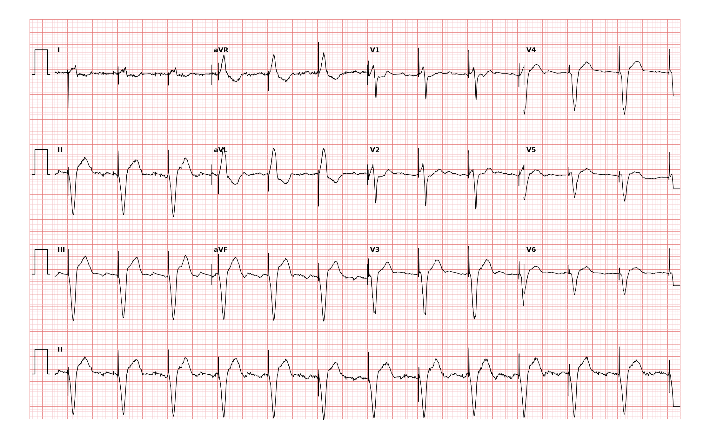

## 문제
75세 남자가 정기 외래 진료를 받으러 왔다. 3년 전 완전 방실차단으로 실신해 오른쪽 심실에 전극을 둔 인공 심박동기를 삽입하였다. 그 뒤 실신·어지럼·두근거림은 없고 일상생활에 불편이 없다. 혈압 128/74 mmHg, 맥박 85회/분이고 규칙적이다. 왼쪽 앞가슴의 기기 삽입 부위는 깨끗하다. 혈청 칼륨 4.3 mEq/L 이다. 12유도 심전도는 그림과 같다. 가장 적절한 처치는?

- A. 임시 경정맥 심박조율기를 삽입한다
- B. 아트로핀을 정맥 투여한다
- C. 현재 설정을 유지하고 정기 기기 점검을 계속한다
- D. 아미오다론을 정맥 투여한다
- E. 동기화 심율동전환을 시행한다

_12유도 심전도, 25 mm/s · 10 mm/mV, 3×4 + II 리듬 스트립 (PTB-XL ECG dataset, PhysioNet, CC BY 4.0 — 원신호 그대로 작도)_

## 정답 및 해설
> 정답: C

- **정답 핵심**: 거의 모든 QRS 바로 앞에 좁고 날카로운 박동기 스파이크가 있고, 스파이크마다 넓은 QRS(약 160 ms)가 바로 따라온다(포획). II·III·aVF 의 QRS 가 음성인 상방 축이고 흉부 유도도 음성 우세여서 오른쪽 심실 첨부에서 시작한 흥분의 모양이다. 박동수는 약 85회/분으로 일정하고, 스파이크 뒤 QRS 가 빠지거나(포획 실패) 자기 박동 뒤에 부적절한 스파이크가 나오는(감지 실패) 곳이 없다. 증상도 없으므로 정상 작동하는 심실 조율이다 — 설정을 유지하고 정기 점검을 계속한다.
- **원리**: <b>왜 조율 박동은 넓은가</b>: 정상 흥분은 히스-푸르키니에 섬유를 타고 1초에 수 m 속도로 양쪽 심실에 동시에 퍼진다. 박동기 전극은 오른쪽 심실 첨부 심근을 직접 자극하므로 흥분이 전도계를 거치지 않고 심근 세포에서 세포로 느리게 퍼진다. 그래서 QRS 가 넓어지고, 오른쪽 심실이 먼저·왼쪽이 나중에 흥분해 <b>좌각차단 모양</b>이 되며, 첨부(아래)에서 위로 퍼지므로 하벽 유도가 음성인 상방 축이 된다. 넓은 QRS 와 반대 방향의 ST-T 도 이 비정상 흥분 순서의 이차 변화다.  <b>정상 작동의 세 확인</b>: ① 스파이크마다 QRS 가 따라오는가(포획), ② 자기 박동이 있을 때 스파이크가 억제되는가(감지), ③ 박동수가 설정 범위인가. 셋 모두 맞으면 기기 문제는 없다.  <b>왜 심실빈맥이 아닌가</b>: 심실빈맥은 스파이크 없이 넓은 QRS 가 빠르게(대개 120회/분 이상) 이어진다. 스파이크가 매번 QRS 를 이끌면 박동기가 만든 리듬이다.
- **비교**: <table><thead><tr><th style="width:24%">항목</th><th style="width:38%">정상 심실 조율(정답)</th><th>심실빈맥(가장 가까운 오답)</th></tr></thead><tbody> <tr><td>QRS 앞</td><td><b>박동기 스파이크</b>가 매번 있음</td><td>스파이크 없음, 방실해리·융합박동</td></tr> <tr><td>박동수</td><td>설정값(대개 60~90회/분)으로 일정</td><td>대개 120회/분 이상</td></tr> <tr><td>QRS 모양</td><td>좌각차단형·상방 축(우심실 첨부)</td><td>다양 — 북서축·흉부 유도 동방향성</td></tr> <tr><td>환자 상태</td><td>무증상</td><td>두근거림·어지럼·저혈압</td></tr> <tr><td>처치</td><td>정기 점검</td><td>안정 시 아미오다론, 불안정 시 심율동전환</td></tr> </tbody></table> 넓은 QRS 리듬을 보면 먼저 QRS 바로 앞의 좁은 스파이크를 찾는다. 있으면 박동기 리듬이고, 포획과 감지를 확인한 뒤 처치를 정한다.
- **오답 이유**:
  - ① 임시 경정맥 심박조율기는 스파이크 뒤 QRS 가 따라오지 않는 포획 실패로 서맥·실신이 생겼다면 정답이 된다.
  - ② 아트로핀 정맥 주사는 박동기가 없는 환자의 불안정 동서맥이나 방실결절 차단이라면 첫 약물로 정답이 된다.
  - ④ 아미오다론 정맥 투여는 스파이크 없이 넓은 QRS 가 빠르게 이어지는 혈역학적으로 안정한 심실빈맥이라면 정답이 된다.
  - ⑤ 동기화 심율동전환은 맥박이 있으나 저혈압·의식 저하를 동반한 불안정 심실빈맥이라면 정답이 된다.
- **함정**: 넓은 QRS 와 상방 축만 보고 심실빈맥으로 처치하는 것 — QRS 앞의 박동기 스파이크와 설정 범위의 박동수, 무증상이면 정상 작동하는 조율 리듬이다.
- **학습목표**: 박동기 스파이크 뒤 넓은 QRS 가 매 박동 따라오는 정상 심실 조율을 심실빈맥과 구분하고 정기 기기 점검을 처치로 고른다
- **근거·출처**: Loscalzo J, Fauci AS, Kasper DL, et al., eds. Harrison's Principles of Internal Medicine, 22nd ed. McGraw Hill; 2025. Chapter 252: The Bradyarrhythmias: Disorders of the Atrioventricular Node · Kusumoto FM, Schoenfeld MH, Barrett C, et al. 2018 ACC/AHA/HRS guideline on the evaluation and management of patients with bradycardia and cardiac conduction delay. Circulation. 2019;140(8):e382-e482

## 출처
- PTB-XL ECG dataset v1.0.3 (PhysioNet, CC BY 4.0) · record 16582 · Creative Commons Attribution 4.0 International · https://physionet.org/content/ptb-xl/1.0.3/LICENSE.txt
