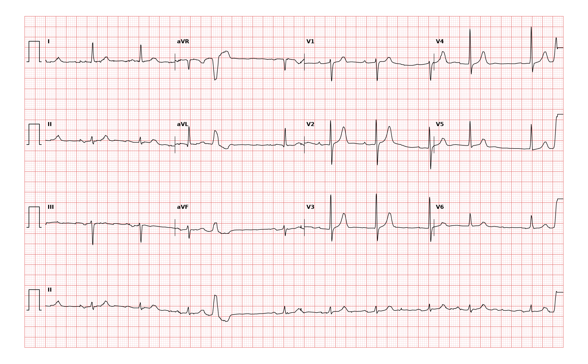

## 문제
An 80-year-old man comes to the physician because he occasionally feels that his heart skips a beat while resting in the evening. He has no chest pain, dyspnea, or syncope. He has hypertension treated with amlodipine. His pulse is 70/min and irregular at times, and blood pressure is 134/78 mm Hg. Cardiac examination shows no murmurs. Serum potassium and magnesium concentrations are within the reference ranges. A 12-lead ECG is shown. Which of the following is the most likely cause of the single wide complex in the rhythm strip?

- A. Ventricular pacing artifact
- B. Premature ventricular contraction
- C. Premature atrial contraction with aberrant conduction
- D. Intermittent left bundle branch block
- E. Ventricular escape beat

_12-lead ECG, 25 mm/s, 10 mm/mV, 3×4 + lead II rhythm strip (PTB-XL, PhysioNet, CC BY 4.0; raw signal, no filtering)_

## 정답 및 해설
> 정답: B

- **정답 핵심**: The underlying rhythm is sinus at about 70/min with a mildly prolonged PR interval (about 220 ms). In the lead II rhythm strip, one complex arrives early, is wide and bizarre with a T wave in the opposite direction to its QRS, and has no preceding premature P wave. It is followed by a full compensatory pause: the interval surrounding it equals two normal sinus cycles, because the sinus node was not reset. These features identify a premature ventricular contraction.
- **원리**: <b>Why the PVC is wide and its T wave is opposite</b>: A ventricular focus fires before the next sinus impulse and spreads cell to cell through ventricular muscle instead of the His-Purkinje system, so depolarization is slow and the QRS exceeds 120 ms. Because the order of repolarization follows the abnormal order of depolarization, the ST segment and T wave point opposite to the main QRS deflection (secondary ST-T change).  <b>Why the pause is fully compensatory</b>: The ventricular impulse usually does not conduct backward into the atria in time to discharge the sinus node. The sinus node keeps its rhythm; its next P wave falls while the ventricles are refractory and is not conducted, and the following P wave conducts on schedule. The R-R interval around the PVC therefore equals exactly two sinus cycles. A premature atrial contraction, by contrast, enters and resets the sinus node, so the pause is usually less than compensatory.  <b>Why it matters</b>: Isolated PVCs in a person without structural heart disease are usually benign; frequent PVCs (over about 10% of beats) warrant echocardiography to look for cardiomyopathy.
- **비교**: <table><thead><tr><th style="width:24%">Feature</th><th style="width:38%">Premature ventricular contraction (answer)</th><th>Premature atrial contraction with aberrancy (closest distractor)</th></tr></thead><tbody> <tr><td>Preceding P wave</td><td><b>None</b> (sinus P may hide in the QRS or ST)</td><td>Early, differently shaped P wave, often in the previous T wave</td></tr> <tr><td>QRS</td><td>Wide, bizarre, unlike any bundle branch pattern</td><td>Typical right or left bundle branch block shape</td></tr> <tr><td>Pause</td><td>Fully compensatory (two sinus cycles)</td><td>Usually less than compensatory (sinus node reset)</td></tr> <tr><td>Initial QRS deflection</td><td>Differs from the sinus beats</td><td>Same initial vector as the sinus beats</td></tr> </tbody></table> Look first for an early P wave before the wide beat and then measure the pause; absence of the P wave plus a full compensatory pause points to a ventricular origin.
- **오답 이유**:
  - (A) A pacing artifact would be correct only in a patient with a pacemaker, where a sharp spike precedes each paced wide complex.
  - (C) A premature atrial contraction with aberrancy would be correct if an early, differently shaped P wave preceded the wide beat and the pause reset the sinus cycle.
  - (D) Intermittent left bundle branch block would be correct if the wide complexes appeared at the normal sinus timing, each preceded by a sinus P wave with a constant PR interval.
  - (E) A ventricular escape beat would be correct if the wide complex came late, after a pause longer than the sinus cycle, not early.
- **함정**: Calling every early wide beat aberrancy or bundle branch block — no premature P wave and a full compensatory pause identify a ventricular origin.
- **학습목표**: P파 없이 일찍 온 넓은 QRS 와 반대 방향 T파, 완전 보상휴지를 심실 기외수축으로 판독하고 변행전도를 동반한 심방 기외수축과 가른다
- **근거·출처**: Loscalzo J, Fauci AS, Kasper DL, et al., eds. Harrison's Principles of Internal Medicine, 22nd ed. McGraw Hill; 2025. Chapter 259: Approach to Ventricular Arrhythmias · Loscalzo J, Fauci AS, Kasper DL, et al., eds. Harrison's Principles of Internal Medicine, 22nd ed. McGraw Hill; 2025. Chapter 247: Electrocardiography

## 출처
- PTB-XL ECG dataset v1.0.3 (PhysioNet, CC BY 4.0) · record 17672 · Creative Commons Attribution 4.0 International · https://physionet.org/content/ptb-xl/1.0.3/LICENSE.txt
