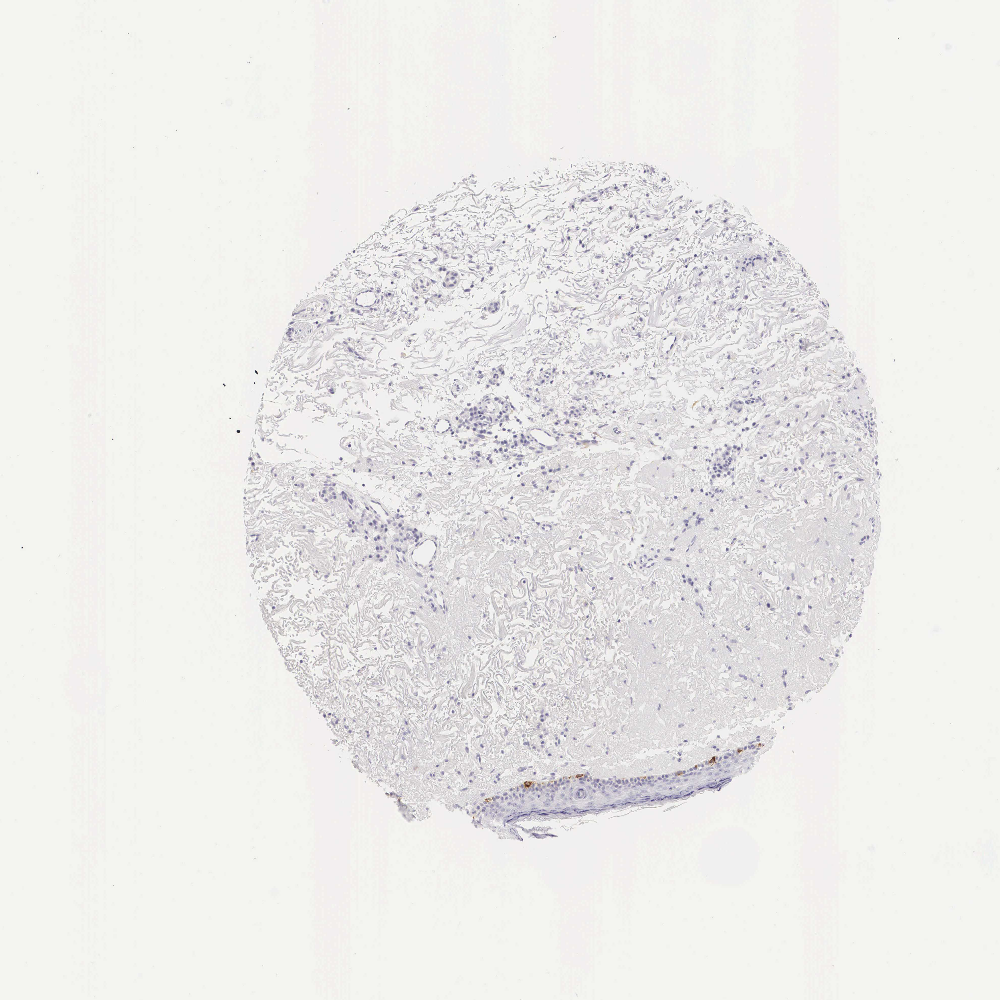

## 문제
90세 여자가 등에 생긴 피부 병변을 절제하였다. 절제 검체 가장자리의 정상 피부에서 얻은 조직 절편에 한 효소 단백질에 대한 면역조직화학염색을 하였다. 사진은 그림과 같다(갈색 = 양성, 파란색 = 헤마톡실린 대조염색). 표피의 각질형성세포와 진피의 섬유모세포는 염색되지 않았다. 갈색으로 염색된 세포의 발생 기원으로 가장 적절한 것은?

- A. 신경관
- B. 신경능선
- C. 골수 조혈모세포
- D. 표면외배엽
- E. 중배엽

_면역조직화학염색(DAB 갈색, 헤마톡실린 대조염색) 조직 마이크로어레이 코어, 원본 배율 그대로 (Human Protein Atlas, CC BY 4.0 — 크롭·보정 없음)_

## 정답 및 해설
> 정답: B

- **정답 핵심**: 사진 아래쪽 가장자리의 얇은 표피에서 갈색 양성 세포는 바닥층에만 한 줄로 띄엄띄엄 놓여 있고, 그 위의 각질형성세포와 진피 세포는 음성이다. 표피 바닥층에 4~10개의 바닥세포마다 하나씩 끼어 있는 세포는 멜라닌세포이고, 이 절편의 염색 대상도 멜라닌 합성 효소(티로시네이스)다. 멜라닌세포는 배아기 신경능선에서 나와 피부로 이동해 바닥층에 자리 잡는다.
- **원리**: <b>왜 위치가 세포를 알려 주는가</b>: 표피의 네 가지 세포는 자리가 다르다. <b>멜라닌세포</b>는 바닥층에 띄엄띄엄 끼어 있고 가지돌기를 위쪽 각질형성세포 사이로 뻗어 멜라닌소체를 넘겨준다. <b>랑게르한스세포</b>는 그보다 위인 가시층에 흩어져 있고, <b>메르켈세포</b>는 바닥층에 있지만 손바닥·입술처럼 촉각이 예민한 곳에 몰려 있다. 각질형성세포는 표피 전 층을 채운다.  <b>왜 신경능선인가</b>: 신경관이 닫힐 때 그 가장자리에서 떨어져 나온 신경능선 세포는 몸 곳곳으로 이동해 멜라닌세포·말초신경절·슈반세포·부신속질·심장 유출로 일부가 된다. 멜라닌세포의 전구세포(멜라닌모세포)는 배아 피부로 이동해 바닥층에 자리 잡는다. 그래서 신경능선 이동 장애(예: KIT 변이의 얼룩증)는 피부 탈색반으로 나타난다.  <b>임상 연결</b>: 흑색종은 이 멜라닌세포에서 생기며, 면역염색(S100·SOX10·Melan-A·HMB-45·티로시네이스)으로 기원을 확인한다.
- **비교**: <table><thead><tr><th style="width:24%">항목</th><th style="width:38%">멜라닌세포(정답 — 신경능선)</th><th>랑게르한스세포(가장 가까운 오답 — 골수)</th></tr></thead><tbody> <tr><td>표피 안 위치</td><td><b>바닥층</b>, 바닥세포 사이에 띄엄띄엄</td><td>가시층(바닥층 위)에 흩어져 있음</td></tr> <tr><td>기능</td><td>멜라닌 합성·전달</td><td>항원 포착·림프절로 이동해 제시</td></tr> <tr><td>대표 표지자</td><td>티로시네이스, Melan-A, SOX10, S100</td><td>CD1a, 랑게린(CD207), S100</td></tr> <tr><td>전자현미경</td><td>멜라닌소체</td><td>버벡과립(테니스 라켓 모양)</td></tr> </tbody></table> 둘 다 가지돌기가 있고 S100 양성이라 헷갈린다. 바닥층에 붙어 있고 멜라닌 합성 효소에 양성이면 멜라닌세포, 그 위층에 있고 CD1a 양성이면 랑게르한스세포다.
- **오답 이유**:
  - ① 신경관은 중추신경계의 신경세포·별아교세포를 물었다면 정답이 되며, 신경관에서 떨어져 나온 신경능선과는 다르다.
  - ③ 골수 조혈모세포는 가시층에 흩어진 CD1a·랑게린 양성 랑게르한스세포를 물었다면 정답이 된다.
  - ④ 표면외배엽은 염색된 세포가 표피 전 층을 채우는 각질형성세포였다면 정답이 된다.
  - ⑤ 중배엽은 염색된 세포가 진피의 섬유모세포나 혈관 내피세포·평활근세포였다면 정답이 된다.
- **함정**: 가지돌기가 있는 표피 세포를 모두 면역세포로 보는 것 — 바닥층에 끼어 있으면 멜라닌세포이고 기원은 신경능선이다.
- **학습목표**: 피부 면역조직화학 절편에서 표피 바닥층에 띄엄띄엄 놓인 양성 세포를 멜라닌세포로 읽고 그 발생 기원을 신경능선으로 연결하며 랑게르한스세포와 가른다
- **근거·출처**: Human Protein Atlas. TYR (ENSG00000077498) tissue expression — skin. https://www.proteinatlas.org (CC BY 4.0) · Loscalzo J, Fauci AS, Kasper DL, et al., eds. Harrison's Principles of Internal Medicine, 22nd ed. McGraw Hill; 2025. Chapter 59: Approach to the Patient with a Skin Disorder

## 출처
- Human Protein Atlas, TYR / Skin 1 (CC BY 4.0), https://images.proteinatlas.org/79/994_B_8_1.jpg · Creative Commons Attribution 4.0 International · https://www.proteinatlas.org/about/licence
