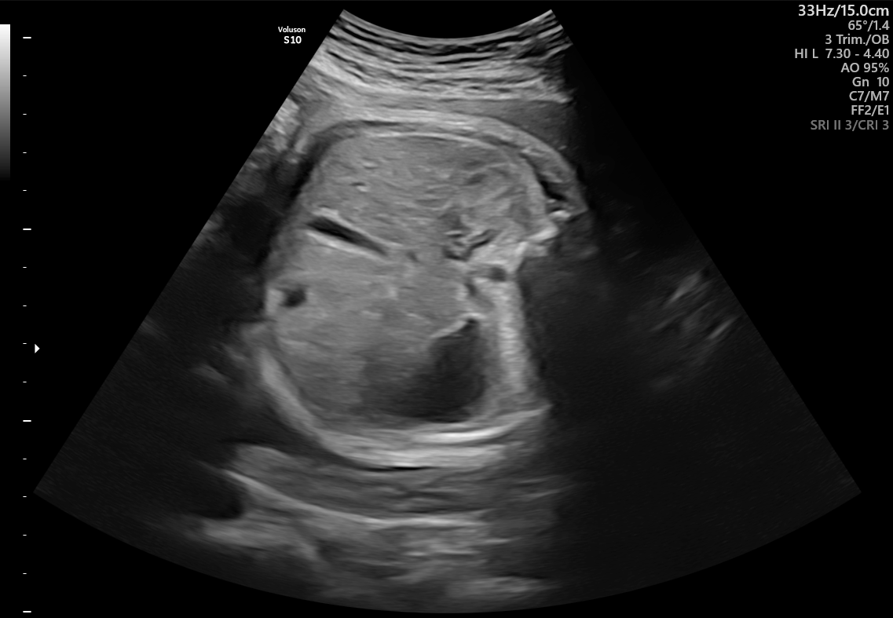

## 문제
A woman at 32 weeks' gestation comes for a routine prenatal visit. She feels the fetus moving normally. Her blood pressure is 118/72 mm Hg, and urinalysis shows no protein. Her fundal height is 28 cm. An ultrasound examination is performed to assess fetal growth, and one of the standard biometry planes is shown. Which of the following measurements is obtained in this plane?

- A. Femur length
- B. Transverse cerebellar diameter
- C. Abdominal circumference
- D. Biparietal diameter
- E. Head circumference

_Fetal ultrasound still image; text at the upper right is the machine setting, unaltered apart from scaling (FETAL_PLANES_DB, Zenodo, CC BY 4.0) ※ The clinical scenario in the stem is an authoring assumption — the source dataset has no age or clinical history_

## 정답 및 해설
> 정답: C

- **정답 핵심**: The image is a transverse section of the fetal abdomen: a round outline with the echogenic spine at one side, the homogeneous liver, and an anechoic stomach bubble, with no heart or kidneys in the section. This is the standard plane for the abdominal circumference, measured at the level of the stomach and the intrahepatic umbilical vein. Because the liver stores glycogen and shrinks first when fetal nutrition is limited, the abdominal circumference is the biometric parameter that falls earliest in growth restriction, which is why it is measured when the fundal height lags.
- **원리**: <b>Why each biometric plane has fixed landmarks</b>: A measurement is only reproducible if it is taken at the same anatomic level every time. The <b>abdominal circumference</b> is measured in a true transverse section at the level of the stomach and the umbilical vein deep in the liver, with the spine seen in cross-section; the kidneys and heart must not be in the section, because they mean the plane is too low or too high. Head measurements use a separate plane through the thalami and cavum septi pellucidi, and the femur length uses a long-axis view of the bone.  <b>Why the abdomen falls first</b>: When placental supply is limited, the fetus redistributes blood to the brain and stores less glycogen in the liver. Liver size, and therefore the abdominal circumference, declines while head growth is relatively spared. An abdominal circumference below the 10th percentile is one of the defining criteria for fetal growth restriction.
- **비교**: <table><thead><tr><th style="width:24%">Feature</th><th style="width:38%">Abdominal circumference (answer)</th><th>Biparietal diameter (closest distractor)</th></tr></thead><tbody> <tr><td>Plane</td><td>Transverse abdomen: spine, stomach, intrahepatic umbilical vein</td><td>Transverse head: thalami, cavum septi pellucidi</td></tr> <tr><td>Must not be seen</td><td>Kidneys, heart</td><td>Cerebellum (too low)</td></tr> <tr><td>In growth restriction</td><td><b>Falls first</b> (liver glycogen)</td><td>Relatively spared (brain sparing)</td></tr> <tr><td>Best use</td><td>Detecting growth restriction and macrosomia</td><td>Dating in the second trimester</td></tr> </tbody></table> If the image shows a skull outline with midline structures, the head measurements apply; a section with the stomach and spine means the abdominal circumference.
- **오답 이유**:
  - (A) Femur length would be correct if the image showed the long axis of the femoral diaphysis with the beam perpendicular to it.
  - (B) Transverse cerebellar diameter would be correct in an angled posterior head plane showing the cerebellar hemispheres and cisterna magna.
  - (D) Biparietal diameter would be correct if the image showed a transverse section of the fetal skull at the level of the thalami.
  - (E) Head circumference would be correct for the same skull plane as the biparietal diameter, traced around the outer table.
- **함정**: Choosing a head measurement because growth is in question — growth restriction is screened by the abdominal plane, and this image shows the stomach and spine, not a skull.
- **제작 가정**: FETAL_PLANES_DB 는 표준 단면 분류만 있고 산모 나이·임신 주수·병력이 없다 — 임신 32주 산전진찰과 작은 자궁저 높이를 가정했다 (가정한 정보: 32 weeks' gestation · fundal height is 28 cm)
- **학습목표**: 태아 복부 가로단면(척추·위포·간)을 복부둘레 측정 단면으로 읽고, 성장제한 평가에서 가장 먼저 줄어드는 지표임을 머리 계측과 가른다
- **근거·출처**: Cunningham FG, Leveno KJ, Dashe JS, et al. Williams Obstetrics, 26th ed. McGraw Hill; 2022. Chapter 14: Fetal Imaging; Chapter 47: Fetal-Growth Disorders · Salomon LJ, Alfirevic Z, Da Silva Costa F, et al. ISUOG Practice Guidelines: ultrasound assessment of fetal biometry and growth. Ultrasound Obstet Gynecol. 2019;53(6):715-723

## 출처
- FETAL_PLANES_DB (Zenodo 3904280, CC BY 4.0) · Patient01410_Plane2_1_of_1 · Creative Commons Attribution 4.0 International · https://creativecommons.org/licenses/by/4.0/
