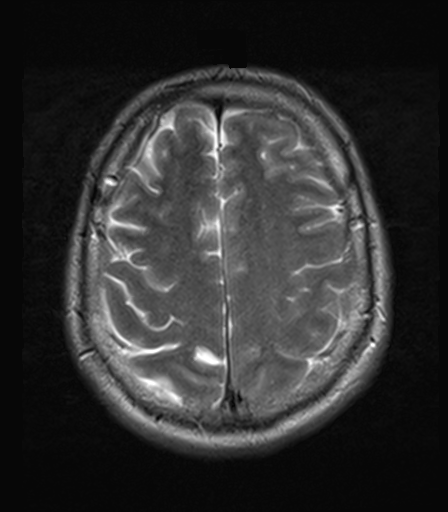

## 문제
A 57-year-old man is brought to the emergency department after his wife saw him have a generalized tonic-clonic seizure at home. He has never had a seizure before and does not drink alcohol. He is now drowsy but oriented and follows commands. Vital signs are within normal limits. Serum glucose and sodium concentrations are within the reference ranges. MRI of the brain with a standard protocol is performed, and one axial image near the vertex is shown. Which of the following sequences is most likely shown?

- A. T2-weighted
- B. Fluid-attenuated inversion recovery (FLAIR)
- C. T1-weighted without contrast
- D. T1-weighted after gadolinium
- E. Diffusion-weighted imaging

_Axial brain MRI, single image from a standard clinical protocol, DICOM converted without cropping (The Cancer Imaging Archive, CC BY 4.0; no window adjustment beyond default)_

## 정답 및 해설
> 정답: A

- **정답 핵심**: Cerebrospinal fluid in the sulci and along the falx is bright, and the cortical gray matter is brighter than the underlying white matter. Bright fluid with gray matter brighter than white matter is the signature of a T2-weighted image. On FLAIR the fluid signal is nulled, so the sulci would be dark; on T1-weighted images, fluid is dark and white matter is brighter than gray matter. Diffusion-weighted images also show dark cerebrospinal fluid and have much lower spatial detail.
- **원리**: <b>Why water is bright on T2</b>: T2 relaxation reflects how quickly protons lose phase coherence. Free water, as in cerebrospinal fluid, keeps its coherence for a long time, so it retains signal on a long-echo-time sequence and appears bright. Myelinated white matter has more lipid and less free water than gray matter, so its T2 is shorter and it appears darker than the cortex.  <b>Why FLAIR looks similar but differs in one place</b>: FLAIR is a T2-weighted sequence with an inversion pulse timed to null the signal of free water. Tissue water remains bright, but cerebrospinal fluid becomes dark, so periventricular and cortical lesions stand out against dark sulci.  <b>Why T1 is the reverse</b>: On T1-weighted images, fluid with a long T1 is dark and fat-rich white matter is brighter than gray matter, giving an image that resembles gross anatomy. Gadolinium shortens T1, so enhancing lesions and vessels become bright.
- **비교**: <table><thead><tr><th style="width:24%">Feature</th><th style="width:38%">T2-weighted (answer)</th><th>FLAIR (closest distractor)</th></tr></thead><tbody> <tr><td>Cerebrospinal fluid</td><td><b>Bright</b></td><td>Dark (nulled)</td></tr> <tr><td>Gray vs white matter</td><td>Gray brighter</td><td>Gray brighter</td></tr> <tr><td>Edema, most lesions</td><td>Bright</td><td>Bright, more conspicuous near CSF</td></tr> <tr><td>Best use</td><td>Fluid, cysts, flow voids</td><td>Periventricular and cortical lesions</td></tr> </tbody></table> Both sequences show gray matter brighter than white matter; the single discriminator is the cerebrospinal fluid — bright on T2, dark on FLAIR.
- **오답 이유**:
  - (B) FLAIR would be correct if the sulci and ventricles were dark while gray matter stayed brighter than white matter.
  - (C) T1-weighted without contrast would be correct if cerebrospinal fluid were dark and white matter were brighter than the cortex.
  - (D) T1-weighted after gadolinium would be correct if the image had T1 contrast with bright vessels, dura, or enhancing lesions.
  - (E) Diffusion-weighted imaging would be correct if the image were low resolution with dark cerebrospinal fluid, as used to detect acute infarction.
- **함정**: Calling any image with bright brain parenchyma FLAIR — check the cerebrospinal fluid first: bright fluid means T2, dark fluid means FLAIR or T1.
- **학습목표**: 축상 뇌 MRI 에서 뇌척수액이 밝고 회색질이 백색질보다 밝은 신호를 T2 강조영상으로 읽고 FLAIR·T1 과 가른다
- **근거·출처**: Loscalzo J, Fauci AS, Kasper DL, et al., eds. Harrison's Principles of Internal Medicine, 22nd ed. McGraw Hill; 2025. Chapter 434: Neuroimaging in Neurologic Disorders · Loscalzo J, Fauci AS, Kasper DL, et al., eds. Harrison's Principles of Internal Medicine, 22nd ed. McGraw Hill; 2025. Chapter 436: Seizures and Epilepsy

## 출처
- The Cancer Imaging Archive (CC BY 4.0) · series …03846774 · Creative Commons Attribution 4.0 International · https://www.cancerimagingarchive.net/data-usage-policies-and-restrictions/
