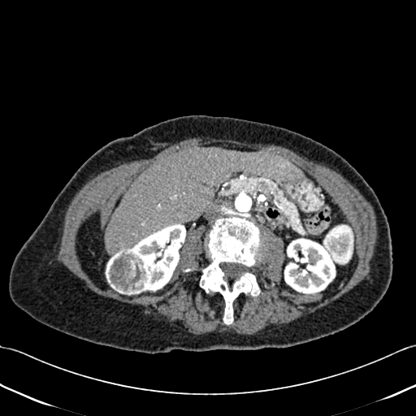

## 문제
83세 여자가 건강검진 복부 초음파에서 오른쪽 신장 종괴가 발견되어 왔다. 육안적 혈뇨, 옆구리 통증, 체중 감소는 없다. 고혈압 외 다른 질환은 없고 혼자 장을 보러 다닐 만큼 활동적이며, 수술을 원한다. 혈압 132/78 mmHg 이다. 혈색소 12.8 g/dL, 혈청 크레아티닌 0.8 mg/dL, 칼슘 9.4 mg/dL, 알칼리인산분해효소는 정상이다. 뼈 통증이나 신경학적 이상은 없다. 조영증강 복부 CT 는 그림과 같다. 수술 전 병기 결정을 위해 추가로 시행할 검사로 가장 적절한 것은?

- A. 흉부 CT
- B. 뼈 스캔
- C. 뇌 MRI
- D. 전신 PET-CT
- E. 신장 동위원소 스캔

_조영증강 복부 CT, 동맥기 축상 단면 1장, 연부조직 창, 표준 표시 방향 (TCIA, CC BY 3.0 — 크롭·보정·분할 표시 없음)_

## 정답 및 해설
> 정답: A

- **정답 핵심**: 오른쪽 신장 뒤가쪽에서 바깥으로 튀어나온 약 5 cm 의 불균질하게 조영증강되는 고형 종괴가 있고, 육안상 지방 음영이 없어 혈관근지방종으로 보기 어렵다. 조영증강되는 신장 고형 종괴는 영상만으로 양성(호산성 과립세포종)과 신세포암을 가를 수 없으므로 신세포암으로 간주해 병기를 정한다. 신세포암은 폐로 가장 흔히 전이하므로 수술 전 흉부 CT 가 표준 병기 검사다. 뼈 통증·알칼리인산분해효소 상승·고칼슘혈증, 신경 증상이 없으므로 뼈 스캔과 뇌 MRI 는 필요하지 않다.
- **원리**: <b>왜 신장 고형 종괴는 암으로 다루는가</b>: 조영증강되는 신장 고형 종괴의 대부분은 신세포암이고, 양성인 호산성 과립세포종이나 지방이 적은 혈관근지방종은 CT 에서 서로 겹쳐 보인다. 수술 병리에서야 확정되는 경우가 많아, 수술을 계획할 때는 신세포암을 전제로 병기를 정한다(이 증례의 수술 병리는 호산성 과립세포종이었다).  <b>왜 흉부인가</b>: 신세포암은 혈관이 풍부하고 신정맥·하대정맥으로 자라 들어가는 성향이 있어 혈행성으로 퍼지며, 가장 흔한 원격 전이 장소가 폐다. 그래서 병기 결정은 복부 CT(국소 범위·림프절·정맥 침범)와 흉부 CT 로 한다.  <b>왜 다른 검사는 선택적인가</b>: 뼈 전이는 증상·알칼리인산분해효소 상승·고칼슘혈증이 있을 때 확률이 올라가고, 뇌 전이는 신경 증상이 있을 때 찾는다. 신세포암은 FDG 섭취가 낮은 경우가 많아 PET-CT 는 일상 병기 검사가 아니다.
- **비교**: <table><thead><tr><th style="width:24%">항목</th><th style="width:38%">흉부 CT(정답)</th><th>뼈 스캔(가장 가까운 오답)</th></tr></thead><tbody> <tr><td>대상</td><td>모든 신세포암 의심 고형 종괴</td><td>뼈 통증, 알칼리인산분해효소 상승, 고칼슘혈증</td></tr> <tr><td>이유</td><td><b>폐가 가장 흔한 원격 전이 장소</b></td><td>무증상 뼈 전이는 드물어 검사 이득이 작다</td></tr> <tr><td>이 환자</td><td>시행</td><td>칼슘·알칼리인산분해효소 정상, 뼈 통증 없음 → 생략</td></tr> </tbody></table> 신세포암 병기의 기본은 복부와 흉부의 CT 다. 뼈와 뇌는 증상·검사 이상이 길을 열 때만 추가한다.
- **오답 이유**:
  - ② 뼈 스캔은 뼈 통증이 있거나 알칼리인산분해효소·칼슘이 올라 있어 뼈 전이가 의심될 때 정답이 된다.
  - ③ 뇌 MRI 는 두통·국소 신경 결손·경련처럼 뇌 전이를 시사하는 증상이 있을 때 정답이 된다.
  - ④ 전신 PET-CT 는 신세포암의 FDG 섭취가 낮아 일상 병기에 쓰지 않으며, 다른 원발 암을 함께 찾아야 하는 특별한 상황에서나 고려된다.
  - ⑤ 신장 동위원소 스캔은 근치적 신절제술 뒤 남는 신장 기능이 걱정되는 만성 신장병 환자에서 분할 신기능을 볼 때 정답이 된다.
- **함정**: 고령이라 전신 전이 검사를 모두 하려는 것 — 신세포암 병기의 표준은 흉부 CT 이고, 뼈·뇌 검사는 증상·검사 이상이 있을 때만이다.
- **학습목표**: 조영증강되는 신장 고형 종괴를 신세포암으로 간주해 수술 전 병기 결정에 흉부 CT 를 고르고, 증상·검사 이상이 없을 때의 뼈 스캔·뇌 MRI·PET 와 가른다
- **근거·출처**: Loscalzo J, Fauci AS, Kasper DL, et al., eds. Harrison's Principles of Internal Medicine, 22nd ed. McGraw Hill; 2025. Chapter 90: Renal Cell Carcinoma · Campbell SC, Clark PE, Chang SS, et al. Renal mass and localized renal cancer: evaluation, management, and follow-up: AUA guideline: part I. J Urol. 2021;206(2):199-208

## 출처
- The Cancer Imaging Archive (CC BY 3.0) · KiTS-00116 · Creative Commons Attribution 3.0 Unported · https://www.cancerimagingarchive.net/data-usage-policies-and-restrictions/
