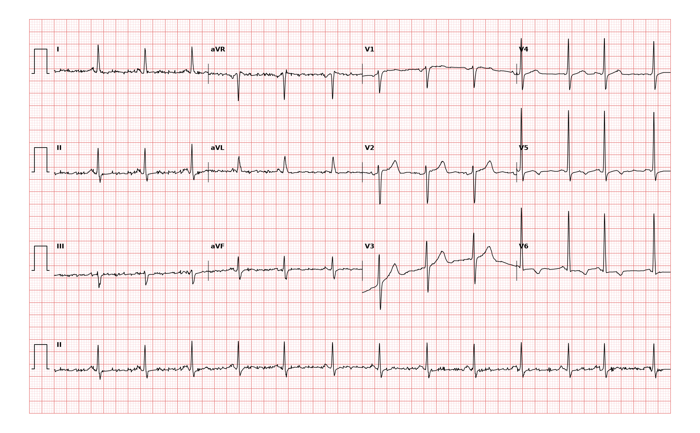

## 문제
81세 여자가 2개월 전부터 계단을 오르면 가슴이 답답하고 쉬면 5분 안에 좋아져서 외래에 왔다. 고혈압과 이상지질혈증으로 약을 먹고 있다. 혈압 136/78 mmHg, 맥박 78회/분이다. 심음은 정상이고 잡음은 없다. 지금은 흉통이 없으며 혈청 트로포닌은 기준치 이하이다. 심장초음파에서 좌심실 벽 두께는 정상이고 박출률은 60 % 이다. 혈청 칼륨 4.3 mEq/L 이다. 12유도 심전도는 그림과 같다. 심전도 판독으로 가장 적절한 것은?

- A. 저칼륨혈증에 의한 U파
- B. 측벽 유도의 허혈성 T파 변화
- C. 좌심실비대와 긴장형 ST-T 변화
- D. 급성 하벽 ST분절상승 심근경색
- E. 좌각차단

_12유도 심전도, 25 mm/s · 10 mm/mV, 3×4 + II 리듬 스트립 (PTB-XL ECG dataset, PhysioNet, CC BY 4.0 — 원신호 그대로 작도)_

## 정답 및 해설
> 정답: B

- **정답 핵심**: 동리듬 약 78회/분이고 리듬 스트립 끝 무렵 이른 박동이 하나 있다(심방 기외수축). QRS 는 좁다. V5·V6 에서 T파가 얕게 뒤집혀 있고 I·II·aVL 등 사지 유도의 T파는 평탄하다. II·III·aVF 의 ST 상승은 없다. 노작성 흉통이 있고 트로포닌이 정상이며 심장초음파의 좌심실 벽 두께가 정상이므로 좌심실비대의 긴장형 변화가 아니라 측벽(V5·V6·I·aVL)의 허혈성 T파 변화로 판독한다. 판독 전문의도 「V5·V6 T파 역위, 허혈성 심질환 가능」으로 읽었다.
- **원리**: <b>왜 허혈은 T파를 뒤집는가</b>: 재분극은 정상적으로 심외막에서 먼저 끝나 심내막 쪽으로 진행하므로 T파는 QRS 와 같은 방향(양성)이다. 만성적이거나 간헐적인 허혈은 허혈 부위 심근의 활동전위 기간을 바꿔 재분극 순서를 뒤집고, 그 부위를 바라보는 유도에서 T파가 평탄해지거나 대칭적으로 역위된다. V5·V6·I·aVL 은 좌심실 측벽을 보는 유도라, 이곳의 T파 변화는 왼회선동맥이나 대각지 영역의 허혈을 시사한다.  <b>왜 비대와 가르는가</b>: 좌심실비대에서도 V5·V6 에 비대칭 T파 역위와 ST 하강(긴장형)이 생긴다. 이는 두꺼운 벽의 재분극 지연 때문이므로, 높은 QRS 전압이 진짜 비대를 반영하는지를 심장초음파의 벽 두께로 확인해야 한다. 고령 마른 여성은 흉벽이 얇아 전압이 경계값까지 오를 수 있다.  <b>임상 의미</b>: 안정 협심증 환자의 안정 시 T파 역위는 급성 경색이 아니라 허혈성 심질환의 근거이며, 위험도 평가와 부하 검사·관상동맥 평가로 이어진다.
- **비교**: <table><thead><tr><th style="width:24%">항목</th><th style="width:38%">측벽 허혈성 T파 변화(정답)</th><th>좌심실비대의 긴장형 변화(가장 가까운 오답)</th></tr></thead><tbody> <tr><td>QRS 전압</td><td>정상~경계</td><td><b>뚜렷이 높음</b>(Sokolow-Lyon ≥ 35 mm 등)</td></tr> <tr><td>T파 모양</td><td>평탄하거나 대칭적 역위</td><td>비대칭(천천히 내려가고 빨리 올라옴), ST 하강 동반</td></tr> <tr><td>심장초음파</td><td>벽 두께 정상</td><td>좌심실 벽 두께 증가</td></tr> <tr><td>동반 임상</td><td>노작성 흉통</td><td>오래된 고혈압·대동맥판협착</td></tr> </tbody></table> V5·V6 T파 역위는 두 질환에 모두 나온다. 전압이 경계값이면 심장초음파의 벽 두께가 해석을 정한다.
- **오답 이유**:
  - ① 저칼륨혈증에 의한 U파는 칼륨이 3.0 mEq/L 아래이고 T파 뒤에 뚜렷한 U파와 긴 QU 간격이 보일 때 정답이 된다.
  - ③ 좌심실비대와 긴장형 ST-T 변화는 V5·V6 의 R파가 뚜렷이 높고 심장초음파에서 좌심실 벽이 두꺼울 때 정답이 된다.
  - ④ 급성 하벽 ST분절상승 심근경색은 II·III·aVF 에서 ST 가 1 mm 이상 올라가고 흉통이 지속되며 트로포닌이 오를 때 정답이 된다.
  - ⑤ 좌각차단은 QRS 가 120 ms 이상으로 넓고 V5·V6 에서 넓고 패인 R 과 중격 q파 소실이 있을 때 정답이 된다.
- **함정**: V5·V6 의 T파 역위를 보면 비대의 긴장형으로 넘기는 것 — 심장초음파 벽 두께가 정상이고 노작성 흉통이 있으면 허혈성 T파 변화다.
- **학습목표**: 안정 협심증 환자의 심전도에서 V5·V6 의 T파 역위와 사지 유도의 평탄한 T파를 측벽 허혈성 T파 변화로 판독하고 좌심실비대의 긴장형 변화·급성 ST분절상승 심근경색과 가른다
- **근거·출처**: Loscalzo J, Fauci AS, Kasper DL, et al., eds. Harrison's Principles of Internal Medicine, 22nd ed. McGraw Hill; 2025. Chapter 247: Electrocardiography · Loscalzo J, Fauci AS, Kasper DL, et al., eds. Harrison's Principles of Internal Medicine, 22nd ed. McGraw Hill; 2025. Chapter 284: Ischemic Heart Disease

## 출처
- PTB-XL ECG dataset v1.0.3 (PhysioNet, CC BY 4.0) · record 3531 · Creative Commons Attribution 4.0 International · https://physionet.org/content/ptb-xl/1.0.3/LICENSE.txt
