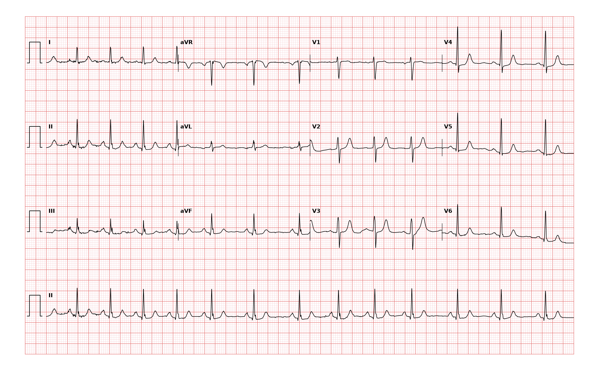

## 문제
67세 여자가 건강검진에서 맥이 불규칙하다는 말을 듣고 걱정이 되어 왔다. 두근거림, 어지럼, 실신, 흉통은 없고 일상생활에 불편이 없다. 고혈압으로 암로디핀을 먹고 있다. 혈압 128/76 mmHg, 맥박 76회/분으로 약간 불규칙하다. 심음은 정상이고 잡음은 없다. 갑상샘 기능과 혈청 전해질은 정상이다. 심장초음파에서 좌심방 크기와 좌심실 박출률은 정상이다. 12유도 심전도는 그림과 같다. 가장 적절한 처치는?

- A. 영구 심박동기 삽입
- B. 전기적 심율동전환
- C. 추가 치료 없이 경과 관찰
- D. 경구 항응고제 시작
- E. 비소프롤롤 투여

_12유도 심전도, 25 mm/s · 10 mm/mV, 3×4 + II 리듬 스트립 (PTB-XL ECG dataset, PhysioNet, CC BY 4.0 — 원신호 그대로 작도)_

## 정답 및 해설
> 정답: C

- **정답 핵심**: 리듬 스트립에서 모든 QRS 앞에 같은 모양의 양성 P파가 있고 PR 간격이 일정하다. RR 간격은 약 0.63~0.89 초 사이에서 갑자기가 아니라 서서히 늘었다 줄었다 한다. 동결절에서 나온 리듬의 박동수가 주기적으로 변하는 동성 부정맥이다. P파가 뚜렷하므로 심방세동이 아니고, 증상과 구조적 심질환이 없으므로 치료할 대상이 아니다 — 안심시키고 경과를 본다.
- **원리**: <b>왜 동성 부정맥이 생기는가</b>: 들숨 때 흉강 내압이 떨어져 정맥 환류가 늘고, 폐의 신장 수용체와 압수용체 반사를 거쳐 미주신경 긴장이 줄어 동결절 박동이 빨라진다. 날숨 때는 반대로 느려진다. 그래서 RR 간격이 호흡 주기에 맞춰 서서히 변하고, P파 모양·PR 간격은 그대로다. 젊은 사람일수록 뚜렷하고, 나이가 들면 자율신경 반응이 둔해져 줄어든다.  <b>왜 심방세동과 가르는가</b>: 심방세동은 조직된 심방 흥분이 없어 P파가 없고 기저선이 불규칙하게 떨리며, RR 간격이 무작위로(불규칙하게 불규칙) 변한다. 뇌졸중 위험 때문에 CHA2DS2-VASc 점수로 항응고를 정하는 리듬이다. 동성 부정맥에 항응고제를 쓰면 이득 없이 출혈 위험만 진다.  <b>언제 더 볼 것인가</b>: 호흡과 무관한 동성 부정맥(비호흡성)이 고령에서 서맥·휴지기와 함께 나타나면 동기능부전의 일부일 수 있어 증상이 있을 때 홀터 검사를 한다.
- **비교**: <table><thead><tr><th style="width:24%">항목</th><th style="width:38%">동성 부정맥(정답 — 경과 관찰)</th><th>심방세동(가장 가까운 오답 — 항응고)</th></tr></thead><tbody> <tr><td>P파</td><td><b>모든 QRS 앞에 같은 모양</b></td><td>없음, 불규칙한 f파</td></tr> <tr><td>PR 간격</td><td>일정</td><td>측정 불가</td></tr> <tr><td>RR 변화</td><td>서서히, 주기적(호흡)</td><td>무작위</td></tr> <tr><td>뇌졸중 위험</td><td>증가 없음</td><td>증가 — CHA2DS2-VASc 로 항응고 결정</td></tr> </tbody></table> 「맥이 불규칙하다」는 같은 호소라도 P파가 있는지가 처치를 가른다. P파가 매번 있으면 동성 리듬이고, 없으면 심방세동을 생각한다.
- **오답 이유**:
  - ① 영구 심박동기 삽입은 증상성 동서맥·동정지 같은 동기능부전이나 고도 방실차단이 확인될 때 정답이 된다.
  - ② 전기적 심율동전환은 혈역학적으로 불안정한 빈맥성 부정맥이나 리듬 조절을 택한 심방세동·조동일 때 정답이 된다.
  - ④ 경구 항응고제 시작은 P파가 없고 RR 이 불규칙하게 불규칙한 심방세동이며 CHA2DS2-VASc 점수가 높을 때 정답이 된다.
  - ⑤ 비소프롤롤 투여는 빠른 심실 반응의 심방세동이나 증상성 동빈맥에서 박동수 조절이 필요할 때 정답이 된다.
- **함정**: 「불규칙한 맥 = 심방세동」으로 보고 항응고제를 시작하는 것 — 모든 QRS 앞에 같은 P파가 있으면 동성 리듬이다.
- **학습목표**: RR 간격이 서서히 변하지만 모든 QRS 앞에 같은 P파가 있는 동성 부정맥을 심방세동과 구분하고 치료 없이 경과 관찰을 처치로 고른다
- **근거·출처**: Loscalzo J, Fauci AS, Kasper DL, et al., eds. Harrison's Principles of Internal Medicine, 22nd ed. McGraw Hill; 2025. Chapter 254: Physiologic and Nonphysiologic Sinus Rhythm · Loscalzo J, Fauci AS, Kasper DL, et al., eds. Harrison's Principles of Internal Medicine, 22nd ed. McGraw Hill; 2025. Chapter 247: Electrocardiography

## 출처
- PTB-XL ECG dataset v1.0.3 (PhysioNet, CC BY 4.0) · record 7096 · Creative Commons Attribution 4.0 International · https://physionet.org/content/ptb-xl/1.0.3/LICENSE.txt
