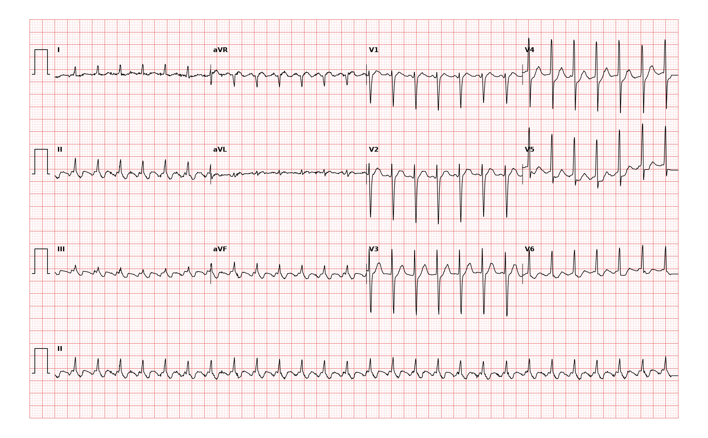

## 문제
A 76-year-old man comes to the emergency department because of palpitations that began suddenly 3 hours ago while he was watching television. He has mild lightheadedness but no chest pain or syncope. He has hypertension and chronic obstructive pulmonary disease. His temperature is 36.8°C, blood pressure is 128/80 mm Hg, pulse is 160/min and regular, and respirations are 18/min. Oxygen saturation is 95% on room air. Hemoglobin concentration and serum thyroid-stimulating hormone concentration are within the reference ranges. A 12-lead ECG is shown. Which of the following is the most likely diagnosis?

- A. Atrial flutter with 2:1 atrioventricular conduction
- B. Sinus tachycardia
- C. Atrial fibrillation with rapid ventricular response
- D. Multifocal atrial tachycardia
- E. Ventricular tachycardia

_12-lead ECG, 25 mm/s, 10 mm/mV, 3×4 + lead II rhythm strip (PTB-XL, PhysioNet, CC BY 4.0; raw signal, no filtering)_

## 정답 및 해설
> 정답: A

- **정답 핵심**: The rhythm is a regular, narrow-complex tachycardia at about 160/min. In leads II, III, and aVF, the baseline between QRS complexes is not flat but shows regular undulating atrial waves, about two for each QRS complex, consistent with flutter waves at roughly 320/min. A regular ventricular rate near 150 to 160/min with inferior flutter waves is the classic presentation of typical atrial flutter with 2:1 conduction. The abrupt onset, fixed rate, and absence of fever, anemia, or hyperthyroidism argue against sinus tachycardia. The cardiologist's report read a rapid regular supraventricular tachycardia with inferior lead appearances of atrial flutter.
- **원리**: <b>Why flutter waves are best seen inferiorly</b>: Typical atrial flutter is a macroreentrant circuit around the tricuspid annulus, usually running counterclockwise: up the interatrial septum and down the right atrial free wall, through the cavotricuspid isthmus. Because activation sweeps continuously, there is no isoelectric baseline, and the large septal component directed away from the inferior leads gives negative sawtooth waves in II, III, and aVF, with a positive deflection in V1.  <b>Why the ventricular rate is about 150</b>: The circuit fires at about 250 to 350/min. The atrioventricular node cannot conduct every impulse and usually lets through every second one, so the ventricles beat at half the atrial rate, typically near 150/min and regular. Any regular narrow-complex tachycardia fixed near this rate should prompt a search for hidden flutter waves.  <b>Why it matters</b>: Adenosine or vagal maneuvers transiently increase block and unmask the flutter waves. Stroke risk and anticoagulation are handled as in atrial fibrillation, and catheter ablation of the cavotricuspid isthmus is highly effective.
- **비교**: <table><thead><tr><th style="width:24%">Feature</th><th style="width:38%">Atrial flutter with 2:1 conduction (answer)</th><th>Sinus tachycardia (closest distractor)</th></tr></thead><tbody> <tr><td>Onset</td><td><b>Abrupt</b></td><td>Gradual, tracks a cause</td></tr> <tr><td>Rate</td><td>Fixed, often 140–160/min</td><td>Varies with fever, pain, volume, activity</td></tr> <tr><td>Atrial activity</td><td>Sawtooth waves in II, III, aVF, two per QRS</td><td>One upright P wave in II before each QRS</td></tr> <tr><td>Response to adenosine</td><td>Transient higher-grade block unmasks flutter waves</td><td>Gradual slowing, then return</td></tr> </tbody></table> A regular narrow-complex rhythm stuck near 150/min in a patient without a cause for sinus tachycardia is atrial flutter until proved otherwise.
- **오답 이유**:
  - (B) Sinus tachycardia would be correct if one upright P wave preceded each QRS in lead II and the rate rose gradually with a cause such as fever, bleeding, or pain.
  - (C) Atrial fibrillation with rapid ventricular response would be correct if the RR intervals were irregularly irregular with no organized atrial waves.
  - (D) Multifocal atrial tachycardia would be correct in a patient with lung disease if at least three different P-wave morphologies and irregular RR intervals were seen.
  - (E) Ventricular tachycardia would be correct if the QRS complexes were wide (120 ms or more) with atrioventricular dissociation or fusion beats.
- **함정**: Calling a regular narrow tachycardia at about 160/min sinus tachycardia — with abrupt onset and inferior sawtooth waves, it is atrial flutter with 2:1 conduction.
- **학습목표**: 약 160회/분의 규칙적인 좁은 QRS 빈맥에서 하벽 유도의 규칙적 조동파를 읽어 2:1 전도 심방조동으로 판독하고 동빈맥·심방세동과 가른다
- **근거·출처**: Loscalzo J, Fauci AS, Kasper DL, et al., eds. Harrison's Principles of Internal Medicine, 22nd ed. McGraw Hill; 2025. Chapter 257: Common Atrial Flutter and Macroreentrant and Multifocal Atrial Tachycardias · Loscalzo J, Fauci AS, Kasper DL, et al., eds. Harrison's Principles of Internal Medicine, 22nd ed. McGraw Hill; 2025. Chapter 253: Approach to Supraventricular Arrhythmias

## 출처
- PTB-XL ECG dataset v1.0.3 (PhysioNet, CC BY 4.0) · record 1173 · Creative Commons Attribution 4.0 International · https://physionet.org/content/ptb-xl/1.0.3/LICENSE.txt
