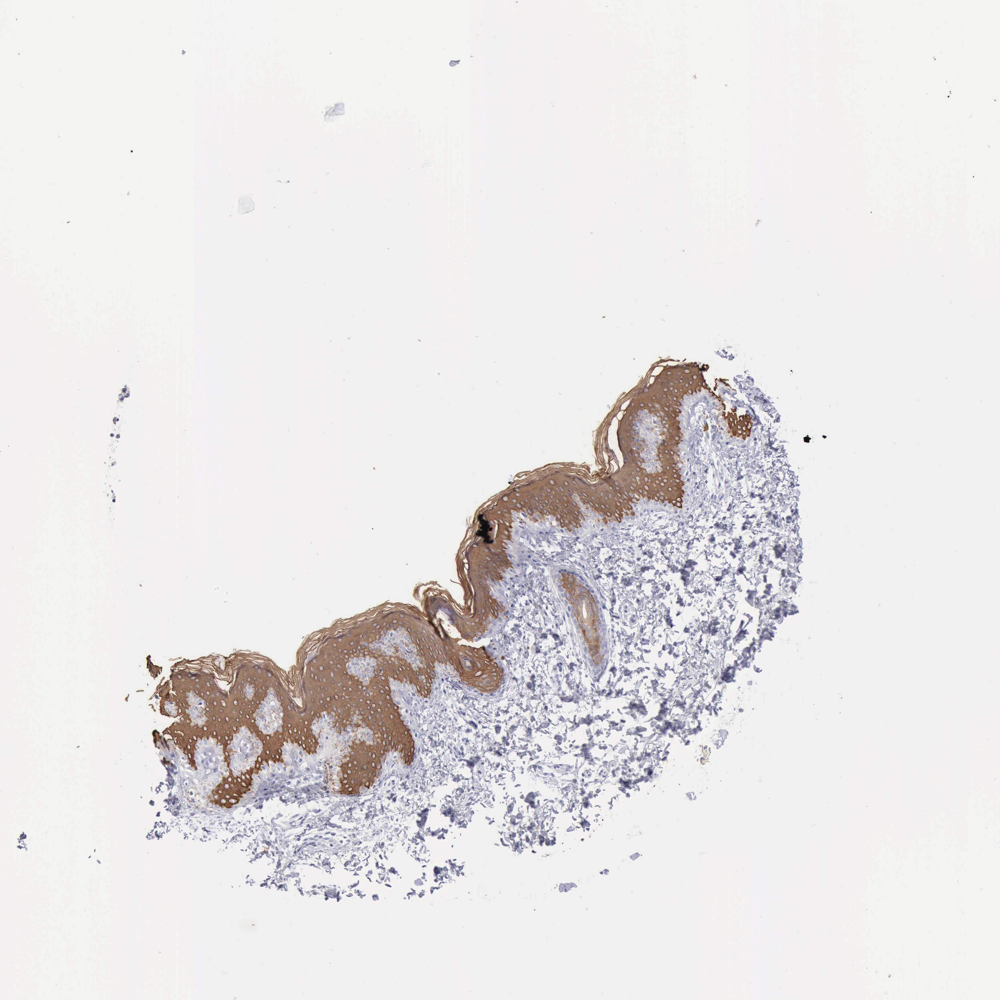

## 문제
4세 여아가 배꼽 탈장 수술을 받으면서 절개 부위의 정상 피부를 조금 절제하였다. 이 피부 조직 절편에 한 세포골격 중간섬유 단백질에 대한 면역조직화학염색을 하였다. 사진은 그림과 같다(갈색 = 양성, 파란색 = 헤마톡실린 대조염색). 진피와 표피 맨 아래 한 줄의 세포는 염색되지 않았다. 이 단백질을 만드는 유전자의 변이로 생기는 질환으로 가장 적절한 것은?

- A. 심상성 천포창
- B. 수포성 유사천포창
- C. 표피박리성 어린선
- D. 단순 수포표피박리증
- E. 심상성 어린선

_면역조직화학염색(DAB 갈색, 헤마톡실린 대조염색) 조직 마이크로어레이 코어, 원본 배율 그대로 (Human Protein Atlas, CC BY 4.0 — 크롭·보정 없음)_

## 정답 및 해설
> 정답: C

- **정답 핵심**: 갈색 양성은 표피의 가시층·과립층 각질형성세포 세포질 전체에 있고, 진피와 맞닿은 바닥층 한 줄과 진피는 음성이다. 바닥층 위에서만 켜지는 중간섬유는 분화 케라틴 K1·K10 이다(바닥층은 K5·K14). 이 절편의 염색 대상은 K10 이고, K1 또는 K10 유전자의 우성 변이는 바닥층 위 세포의 중간섬유 망을 무너뜨려 출생 때 물집·짓무름, 이후 두꺼운 과각화가 생기는 표피박리성 어린선을 일으킨다.
- **원리**: <b>왜 층마다 다른 케라틴이 켜지는가</b>: 각질형성세포는 바닥층에서 분열하고 위로 올라가며 분화한다. 분열하는 <b>바닥층 세포는 K5·K14</b> 쌍을, 바닥층을 떠나 가시층에 들어선 세포는 <b>K1·K10</b> 쌍으로 바꿔 만든다. 케라틴은 산성(제1형, K10·K14)과 염기성(제2형, K1·K5) 하나씩이 짝을 지어야 중간섬유가 된다.  <b>왜 변이 위치가 물집 높이를 정하는가</b>: 변이 케라틴은 정상 짝까지 망가뜨리는 우성 음성 방식으로 작용해, 그 케라틴을 쓰는 층의 세포를 기계적 힘에 약하게 만든다. K5·K14 변이는 바닥층 세포가 터져 물집이 바닥층에서 생기고(단순 수포표피박리증), K1·K10 변이는 바닥층 위 세포가 망가져 가시층에서 세포 용해(표피박리성 과각화)가 보이고 과각화로 이어진다(표피박리성 어린선).  <b>임상 연결</b>: 같은 「물집 + 유전」이라도 염색되는 층을 보면 어느 케라틴 쌍의 질환인지 알 수 있다.
- **비교**: <table><thead><tr><th style="width:24%">항목</th><th style="width:38%">표피박리성 어린선(정답 — K1/K10)</th><th>단순 수포표피박리증(가장 가까운 오답 — K5/K14)</th></tr></thead><tbody> <tr><td>케라틴이 있는 층</td><td><b>바닥층 위</b>(가시층·과립층)</td><td>바닥층</td></tr> <tr><td>조직 소견</td><td>가시층 이상의 세포 용해·과립층 거친 과립</td><td>바닥층 세포 안에서 갈라지는 물집</td></tr> <tr><td>임상 경과</td><td>신생아 물집·짓무름 → 두꺼운 과각화(어린선)</td><td>마찰 부위 물집, 흉터 없이 낫는다</td></tr> <tr><td>이 절편의 염색 양상</td><td>바닥층 음성 · 위층 양성 — 일치</td><td>바닥층 양성이어야 한다 — 불일치</td></tr> </tbody></table> 바닥층이 비어 있고 위층이 채워져 있으면 분화 케라틴, 바닥층 한 줄만 채워져 있으면 바닥 케라틴이다.
- **오답 이유**:
  - ① 심상성 천포창은 표피세포 사이 데스모글레인 3 에 대한 자가항체를 물었다면 정답이 되며, 유전자 변이 질환이 아니다.
  - ② 수포성 유사천포창은 반데스모솜의 BP180·BP230 에 대한 자가항체를 물었다면 정답이 되며, 고령의 후천 질환이다.
  - ④ 단순 수포표피박리증은 염색이 바닥층 한 줄에만 있는 K5·K14 를 물었다면 정답이 되며, 이 절편처럼 바닥층이 음성이면 맞지 않는다.
  - ⑤ 심상성 어린선은 과립층의 필라그린 단백질을 염색했을 때 그 결손 질환으로 정답이 되며, 중간섬유 단백질의 변이가 아니다.
- **함정**: 물집이 생기는 유전 케라틴 질환을 모두 수포표피박리증으로 묶는 것 — 염색이 바닥층 위에만 있으면 K1/K10, 표피박리성 어린선이다.
- **학습목표**: 피부 면역조직화학 절편에서 바닥층은 음성이고 바닥층 위 각질형성세포만 양성인 양상을 분화 케라틴(K1/K10) 발현으로 읽고, 그 유전자 변이 질환을 바닥층 케라틴(K5/K14) 질환과 가른다
- **근거·출처**: Human Protein Atlas. KRT10 (ENSG00000186395) tissue expression — skin. https://www.proteinatlas.org (CC BY 4.0) · Loscalzo J, Fauci AS, Kasper DL, et al., eds. Harrison's Principles of Internal Medicine, 22nd ed. McGraw Hill; 2025. Chapter 59: Approach to the Patient with a Skin Disorder · Bolognia JL, Schaffer JV, Cerroni L, eds. Dermatology, 5th ed. Elsevier; 2024. Chapter 57: Ichthyoses, Erythrokeratodermas, and Related Disorders

## 출처
- Human Protein Atlas, KRT10 / Skin 1 (CC BY 4.0), https://images.proteinatlas.org/132/2531_B_7_1.jpg · Creative Commons Attribution 4.0 International · https://www.proteinatlas.org/about/licence
