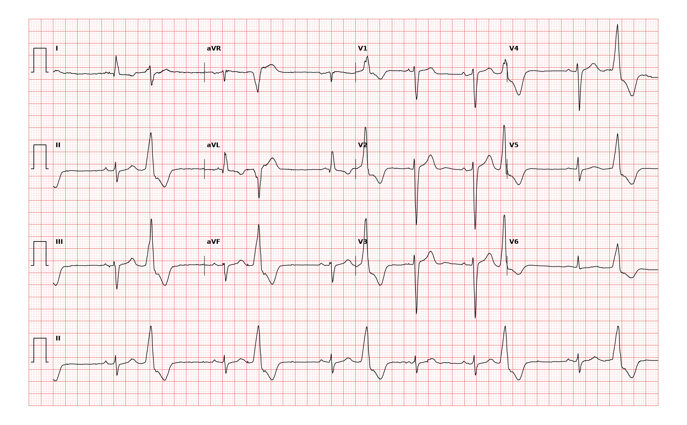

## 문제
A 74-year-old man comes to the physician because of a 3-week history of a sensation that his heart is skipping beats. He has had no chest pain, shortness of breath, dizziness, or syncope, and he walks 3 km daily without difficulty. He has hypertension treated with amlodipine. He drinks 2 cups of coffee daily. His blood pressure is 134/80 mm Hg, and pulse is 72/min and irregular. The lungs are clear. Heart sounds are normal, and there are no murmurs. There is no leg edema. Serum potassium, magnesium, and thyroid-stimulating hormone concentrations are within the reference ranges. A 12-lead ECG is shown. Which of the following is the most appropriate next step in management?

- A. Synchronized cardioversion
- B. Transthoracic echocardiography
- C. Catheter ablation
- D. Amiodarone therapy
- E. Implantable cardioverter-defibrillator placement

_12-lead ECG, 25 mm/s, 10 mm/mV, 3×4 + lead II rhythm strip (PTB-XL, PhysioNet, CC BY 4.0; raw signal, no filtering)_

## 정답 및 해설
> 정답: B

- **정답 핵심**: Every other beat is a premature, wide (>120 ms), bizarre QRS complex that is not preceded by a P wave and has a T wave pointing opposite to the QRS, alternating with normally conducted sinus beats with narrow QRS complexes. This is ventricular bigeminy. In a patient with premature ventricular contractions, the first question is whether there is structural heart disease, because that determines prognosis and treatment. Transthoracic echocardiography is the next step; antiarrhythmic drugs, ablation, or a defibrillator are not chosen before the heart's structure and function are known.
- **원리**: <b>Why the beat looks wide and bizarre</b>: A premature ventricular contraction starts in ventricular myocardium outside the His-Purkinje system, so depolarization spreads slowly from cell to cell. The QRS is wide, and because repolarization follows the same abnormal path, the T wave points opposite to the QRS. The sinus node is usually not reset, so a compensatory pause follows. When every second beat is a PVC, the pattern is <b>bigeminy</b>; the pulse can feel irregular or even slow because a premature beat may eject little blood.  <b>Why echocardiography comes first</b>: In a structurally normal heart, PVCs are usually benign and are treated only if symptoms are bothersome or if a very high burden (often > 10–15 %) causes PVC-induced cardiomyopathy. In a heart with prior infarction or reduced ejection fraction, PVCs mark risk of sustained ventricular arrhythmia, and management shifts to the underlying disease. Echocardiography separates these two groups; ambulatory monitoring quantifies burden alongside it.  <b>Treatment ladder</b>: reassurance and removal of triggers → β-blocker or nondihydropyridine calcium-channel blocker for symptoms → catheter ablation for drug-refractory symptoms or high-burden cardiomyopathy.
- **비교**: <table><thead><tr><th style="width:24%">Feature</th><th style="width:38%">Transthoracic echocardiography (answer)</th><th>Catheter ablation (closest distractor)</th></tr></thead><tbody> <tr><td>When it is chosen</td><td><b>First evaluation</b> of any patient with frequent PVCs</td><td>After evaluation, for drug-refractory symptoms or PVC-induced cardiomyopathy</td></tr> <tr><td>Information needed beforehand</td><td>None</td><td>PVC burden, structural assessment, failed medical therapy</td></tr> <tr><td>Risk</td><td>None</td><td>Invasive procedure risks</td></tr> <tr><td>This patient</td><td>Structure and ejection fraction unknown</td><td>Not yet indicated</td></tr> </tbody></table> Whatever the PVC pattern, the order is the same: look for structural disease first, then decide whether the PVCs themselves need treatment.
- **오답 이유**:
  - (A) Synchronized cardioversion would be used for an unstable sustained tachyarrhythmia, which this hemodynamically stable intermittent ectopy is not.
  - (C) Catheter ablation would be appropriate if symptoms persisted despite β-blockers or a high PVC burden had already reduced the ejection fraction.
  - (D) Amiodarone therapy would be considered for recurrent sustained ventricular tachycardia in structural heart disease, not for first-presentation PVCs.
  - (E) Implantable cardioverter-defibrillator placement would be indicated if echocardiography showed an ejection fraction ≤ 35 % despite therapy or after sustained ventricular tachycardia.
- **함정**: Treating the arrhythmia before assessing the heart — premature ventricular beats are judged by the structure of the heart they come from.
- **학습목표**: Read alternating sinus beats and wide premature beats without preceding P waves as ventricular bigeminy and choose echocardiography to look for structural heart disease before any antiarrhythmic therapy
- **근거·출처**: Loscalzo J, Fauci AS, Kasper DL, et al., eds. Harrison's Principles of Internal Medicine, 22nd ed. McGraw Hill; 2025. Chapter 260: Premature Ventricular Contractions, Nonsustained Ventricular Tachycardia, and Accelerated Idioventricular Rhythm · Loscalzo J, Fauci AS, Kasper DL, et al., eds. Harrison's Principles of Internal Medicine, 22nd ed. McGraw Hill; 2025. Chapter 247: Electrocardiography · Al-Khatib SM, Stevenson WG, Ackerman MJ, et al. 2017 AHA/ACC/HRS guideline for management of patients with ventricular arrhythmias and the prevention of sudden cardiac death. Circulation. 2018;138(13):e272-e391

## 출처
- PTB-XL ECG dataset v1.0.3 (PhysioNet, CC BY 4.0) · record 12644 · Creative Commons Attribution 4.0 International · https://physionet.org/content/ptb-xl/1.0.3/LICENSE.txt
