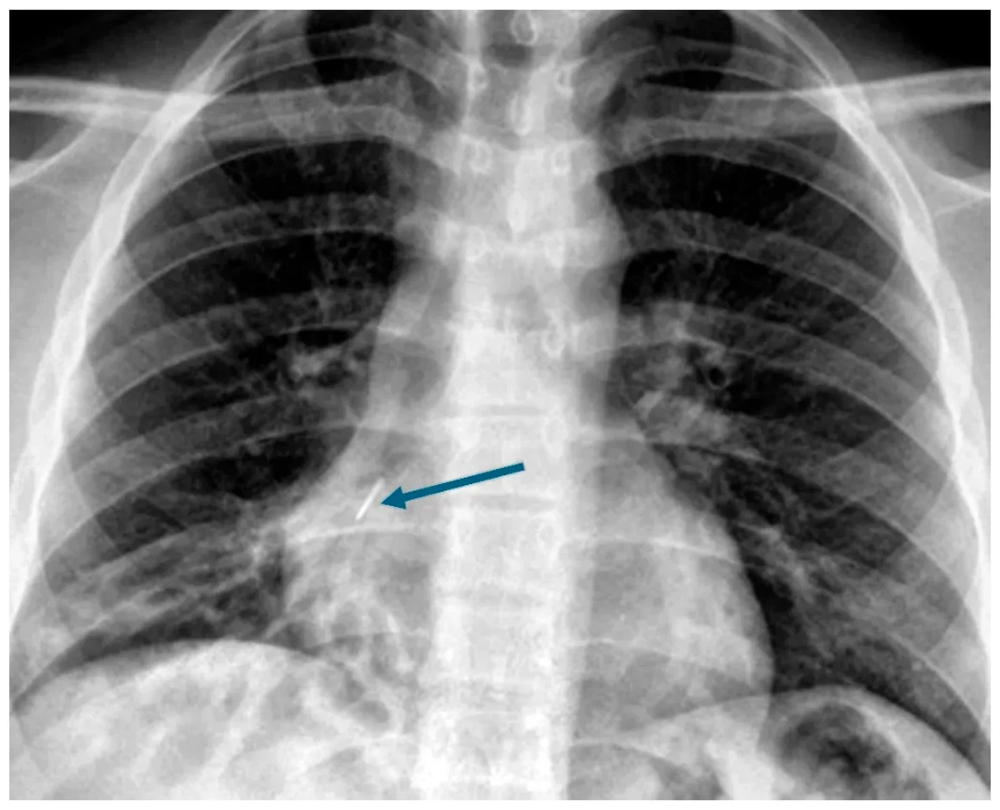

## 문제
16세 남자가 1주 전부터 기침과 누런 가래, 열이 있어 왔다. 3년 전부터 1년에 3~4번씩 기관지염과 폐렴으로 항생제 치료를 받았고, 그때마다 오른쪽 아래 폐에 염증이 있다는 말을 들었다. 천식과 부비동염은 없고 체중 증가와 키 성장은 정상이며 예방접종은 모두 받았다. 체온 37.9℃, 호흡 20회/분, 산소포화도 97 %(실내 공기)이다. 오른쪽 아래 등에서 수포음이 들린다. 흉부 X선 사진은 그림과 같다(화살표). 다음 단계로 가장 적절한 것은?

- A. 3개월 장기 마크로라이드 치료
- B. 흡입 코르티코스테로이드 시작
- C. 기관지내시경으로 이물 제거
- D. 땀 염화물 검사
- E. 오른쪽 하엽 절제술

_흉부 전후면 X선, 화살표는 원 그림의 것 — 출판된 증례 그림 한 컷 그대로 (PMC Open Access Subset, CC BY — 크롭·보정 없음)_

## 정답 및 해설
> 정답: C

- **정답 핵심**: 흉부 X선에서 오른쪽 심장 경계 뒤, 오른쪽 하엽 기관지가 지나는 자리에 가늘고 곧은 금속성 방사선 비투과성 음영(화살표)이 있다. 같은 폐엽(오른쪽 아래)에만 3년간 폐렴이 반복된 것은 국소 기관지 폐쇄를 뜻하고, 그 원인이 보이는 이물이다. 이물이 남아 있는 한 감염이 되풀이되고 기관지확장증이 진행하므로 기관지내시경으로 이물을 꺼내는 것이 다음 단계다.
- **원리**: <b>왜 「같은 자리」가 단서인가</b>: 반복 폐렴은 자리가 매번 같은지 다른지로 원인이 갈린다. <b>같은 폐엽</b>에 되풀이되면 그 엽의 기관지가 막혀 있다는 뜻이다(이물·기관지 안 종양·외부 압박·선천 기형). <b>여러 폐엽</b>을 옮겨 다니면 전신 방어 장애(낭성섬유증·섬모운동이상증·면역결핍·흡인)를 먼저 찾는다.  <b>왜 이물이 기관지확장증을 만드는가</b>: 기관지가 막히면 그 아래 분비물이 빠지지 못해 세균이 자라고, 반복 염증이 기관지벽의 근육·탄력섬유를 파괴해 기관지가 늘어난다(낭상 기관지확장증). 오른쪽 주기관지는 왼쪽보다 짧고 넓으며 수직에 가까워 흡인된 이물이 오른쪽 하엽으로 잘 들어간다.  <b>처치 순서</b>: 원인 제거가 먼저다. 이물을 꺼낸 뒤에도 손상된 폐엽이 감염을 되풀이할 때만 폐엽 절제를 고려한다. 오래된 금속 이물은 육아조직에 묻혀 있어 경성 기관지내시경이 필요할 수 있다.
- **비교**: <table><thead><tr><th style="width:24%">항목</th><th style="width:38%">기관지내시경 이물 제거(정답)</th><th>땀 염화물 검사(가장 가까운 오답)</th></tr></thead><tbody> <tr><td>찾는 원인</td><td><b>국소 기관지 폐쇄</b></td><td>전신 점액 청소 장애(낭성섬유증)</td></tr> <tr><td>폐렴 위치</td><td>같은 폐엽에 반복</td><td>여러 폐엽, 양쪽 위엽 우세</td></tr> <tr><td>동반 소견</td><td>영상의 이물·국소 소견</td><td>부비동염·성장 부진·췌장 기능부전</td></tr> <tr><td>이 환자</td><td>오른쪽 하엽만, 금속성 이물이 보임</td><td>부비동염 없고 성장 정상</td></tr> </tbody></table> 반복 폐렴의 자리가 하나면 그 기관지를 보고, 여러 곳이면 전신 원인을 검사한다.
- **오답 이유**:
  - ① 3개월 장기 마크로라이드 치료는 원인이 제거된 기관지확장증에서 1년에 3번 이상 악화가 반복될 때 악화 예방으로 정답이 된다.
  - ② 흡입 코르티코스테로이드 시작은 천명·가역적 기류 제한이 있는 천식이 반복 증상의 원인일 때 정답이 된다.
  - ④ 땀 염화물 검사는 폐렴이 여러 폐엽에 반복되고 부비동염·성장 부진·지방변이 함께 있을 때 낭성섬유증을 찾는 검사로 정답이 된다.
  - ⑤ 오른쪽 하엽 절제술은 이물을 꺼낸 뒤에도 파괴된 하엽이 감염을 되풀이하거나 객혈이 반복될 때 정답이 된다.
- **함정**: 반복 폐렴을 보자마자 낭성섬유증 검사를 하는 것 — 같은 폐엽에만 반복되고 영상에 이물이 보이면 그 기관지를 연다.
- **학습목표**: 같은 폐엽에 반복되는 폐렴이 있는 청소년의 흉부 X선에서 기관지 안 금속성 이물을 읽고, 기관지내시경 제거를 원인 질환 검사·폐엽 절제와 가른다
- **근거·출처**: Loscalzo J, Fauci AS, Kasper DL, et al., eds. Harrison's Principles of Internal Medicine, 22nd ed. McGraw Hill; 2025. Chapter 301: Bronchiectasis · PMC Open Access Subset 증례 그림(CC BY) — 저자 캡션: radiopaque foreign body (arrow). 원 논문은 채점 후 부록

## 출처
- Three-Year Retained Endobronchial Push Pin in an Adolescent Causing Saccular Bronchiectasis: A Case Report and Review of the Literature. Children (Basel). 2026 Oct 13;13(10):1395. doi: 10.3390/children13101395 (CC BY) — Figure 1 · CC BY · https://creativecommons.org/licenses/
