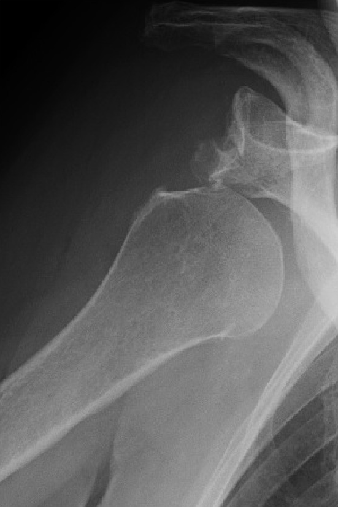

## 문제
A 61-year-old woman is brought to the emergency department 1 hour after she slipped on an icy sidewalk and fell onto her outstretched right hand. She has severe right shoulder pain and cannot move the arm. She holds the right arm slightly abducted and externally rotated and resists any movement. Her blood pressure is 142/86 mm Hg, and pulse is 92/min. The normal rounded contour of the right shoulder is lost, and the acromion is prominent. The right radial pulse is palpable, and capillary refill is normal. A radiograph of the right shoulder is shown. Before closed reduction, documentation of which of the following is most important?

- A. Sensation over the little finger
- B. Sensation over the lateral forearm
- C. Sensation over the medial aspect of the upper arm
- D. Sensation over the lateral aspect of the upper arm
- E. Sensation over the dorsum of the first web space

_Anteroposterior radiograph of the shoulder at the time of injury; one panel of the published case figure, no other change (PMC Open Access Subset, CC BY)_

## 정답 및 해설
> 정답: D

- **정답 핵심**: The radiograph shows the humeral head displaced out of the glenoid fossa, lying inferior and medial to it beneath the coracoid process, with an empty glenoid and a small bony fragment at the inferior glenoid rim. With the arm held in abduction and external rotation and a squared-off shoulder, this is an anterior (subcoracoid) dislocation. The axillary nerve winds around the surgical neck just below the joint capsule and is the nerve most often stretched by an anterior dislocation. Its sensory territory is the skin over the lateral upper arm (regimental badge area), which must be documented before reduction so a deficit is not attributed to the maneuver.
- **원리**: <b>Why the axillary nerve</b>: The axillary nerve (C5–C6) leaves the posterior cord, passes through the quadrangular space just below the inferior joint capsule, and wraps around the surgical neck of the humerus to supply the deltoid and teres minor and the skin over the lower deltoid. In an anterior dislocation the humeral head is driven forward and down, directly stretching the nerve against the capsule. Deltoid strength cannot be tested in a painful dislocated shoulder, so <b>sensation over the lateral upper arm</b> is the practical bedside test.  <b>Why before reduction</b>: Nerve injury can be caused by the dislocation or by the reduction maneuver. Documenting function before and after reduction distinguishes the two, guides follow-up, and is a medicolegal standard. Most axillary neuropraxias recover over months.  <b>Age matters</b>: In patients older than 40, anterior dislocation is more often accompanied by rotator cuff tear and nerve injury, and a glenoid rim fragment (bony Bankart lesion) may change management after reduction.
- **비교**: <table><thead><tr><th style="width:24%">Feature</th><th style="width:38%">Axillary nerve — lateral upper arm (answer)</th><th>Radial nerve — first dorsal web space (closest distractor)</th></tr></thead><tbody> <tr><td>Course</td><td>Quadrangular space, around the <b>surgical neck</b></td><td>Spiral groove of the <b>humeral shaft</b></td></tr> <tr><td>Typical injury</td><td>Anterior shoulder dislocation, surgical neck fracture</td><td>Midshaft humerus fracture</td></tr> <tr><td>Motor loss</td><td>Deltoid, teres minor (abduction beyond 15°)</td><td>Wrist and finger extensors (wrist drop)</td></tr> <tr><td>Sensory test</td><td>Skin over the lower deltoid</td><td>Dorsum of the first web space</td></tr> </tbody></table> The injured level picks the nerve: joint and surgical neck → axillary; shaft → radial.
- **오답 이유**:
  - (A) Sensation over the little finger tests the ulnar nerve and would be the priority with a medial epicondyle fracture or elbow dislocation.
  - (B) Sensation over the lateral forearm tests the musculocutaneous nerve, injured occasionally by anterior dislocation but much less often than the axillary nerve.
  - (C) Sensation over the medial aspect of the upper arm tests the medial brachial cutaneous and intercostobrachial nerves, which are rarely affected in this injury.
  - (E) Sensation over the dorsum of the first web space tests the radial nerve and would be the priority with a midshaft humerus fracture.
- **함정**: Checking only the radial pulse and hand sensation — the nerve stretched by an anterior dislocation supplies the skin over the deltoid, not the hand.
- **학습목표**: Read an inferomedially displaced humeral head with an empty glenoid as anterior shoulder dislocation and document axillary nerve function before reduction
- **근거·출처**: Tintinalli JE, Ma OJ, Yealy DM, et al., eds. Tintinalli's Emergency Medicine: A Comprehensive Study Guide, 9th ed. McGraw Hill; 2020. Chapter 268: Shoulder and Humerus Injuries · PMC Open Access Subset case figure (CC BY) — author caption: X-ray imaging at the time of injury; source article in the post-grading appendix

## 출처
- Concurrent Rotator Cuff Tear and Axillary Nerve Palsy Associated with Anterior Dislocation of the Shoulder and Large Glenoid Rim Fracture: A “Terrible Tetrad”. Case Rep Orthop. 2014 Jun 12;2014:312968. doi: 10.1155/2014/312968 (CC BY) — Figure 1 · CC BY · https://creativecommons.org/licenses/
