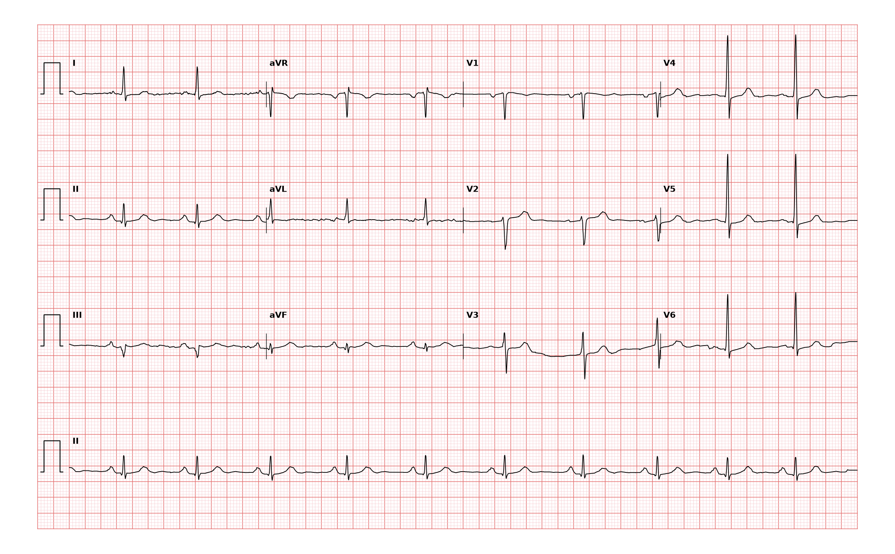

## 문제
69세 남자가 서혜부 탈장 수술을 앞두고 수술 전 검사를 받으러 왔다. 지금은 흉통이나 숨참이 없고 계단 두 층을 쉬지 않고 오른다. 6년 전 밤에 가슴을 짓누르는 통증이 1시간 넘게 이어진 적이 있었으나 저절로 나아 병원에 가지 않았다. 고혈압과 2형 당뇨병으로 약을 먹고 있다. 혈압 132/80 mmHg, 맥박 70회/분이다. 심음은 정상이고 잡음은 없다. 혈청 트로포닌 I 는 기준치 이하이다. 12유도 심전도는 그림과 같다. 심전도 판독으로 가장 적절한 것은?

- A. 전벽 심근경색
- B. 오래된 하벽 심근경색
- C. 급성 하벽 ST분절상승 심근경색
- D. 좌전섬유속 차단
- E. 급성 심낭염

_12유도 심전도, 25 mm/s · 10 mm/mV, 3×4 + II 리듬 스트립 (PTB-XL ECG dataset, PhysioNet, CC BY 4.0 — 원신호 그대로 작도)_

## 정답 및 해설
> 정답: B

- **정답 핵심**: 동리듬 약 70회/분이다. III 와 aVF 에 넓고 깊은 Q파(III 는 QS 에 가까움)가 있고, 같은 유도에 ST 상승이나 과급성 T파는 없다. V1~V4 의 R파 진행은 보존되어 있다. 하벽을 보는 유도(II·III·aVF)의 병적 Q파는 하벽의 경색 흉터를 뜻하고, ST 가 기저선에 있고 흉통이 없으며 트로포닌이 정상이므로 급성이 아니라 오래된 하벽 심근경색이다. 6년 전 치료받지 않은 긴 흉통이 그 경색이었을 가능성이 높다. 판독 전문의도 「하벽 경색, 아마 오래된 것」으로 읽었다.
- **원리**: <b>왜 Q파가 흉터를 뜻하는가</b>: 정상 심실은 중격이 왼쪽에서 오른쪽으로 먼저 탈분극해 작은 중격 q파를 만들고, 이어서 두꺼운 좌심실벽이 큰 R파를 만든다. 경색으로 한 벽이 전기적으로 죽으면 그 벽을 바라보는 유도는 「창문」처럼 반대편 벽이 멀어지는 전류만 보게 되어 깊고 넓은 Q파(≥ 40 ms 또는 R파의 25 % 이상)가 생긴다. 흉터는 사라지지 않으므로 Q파는 몇 년이 지나도 남는다.  <b>시간 순서</b>: 급성 경색은 과급성 T파 → ST 상승(분~시간) → Q파 형성(시간~일) → ST 가 기저선으로 돌아오고 T파 역위(일~주) → Q파만 남음(수개월 이후)의 순서다. 그래서 <b>Q파 + ST 기저선 + 증상 없음 + 트로포닌 정상</b>이면 오래된 경색이다.  <b>하벽의 혈관</b>: 하벽은 대개 오른관상동맥(약 80 %), 나머지는 왼회선동맥이 공급한다. 무증상 당뇨병 환자는 경색을 알아채지 못하고 지나가는 경우가 많아 수술 전 심전도에서 처음 발견된다.
- **비교**: <table><thead><tr><th style="width:24%">항목</th><th style="width:38%">오래된 하벽 심근경색(정답)</th><th>급성 하벽 ST분절상승 심근경색(가장 가까운 오답)</th></tr></thead><tbody> <tr><td>II·III·aVF 의 ST</td><td><b>기저선</b></td><td>1 mm 이상 상승, I·aVL 거울상 하강</td></tr> <tr><td>Q파</td><td>깊고 넓게 굳어 있음</td><td>처음 몇 시간은 없거나 생기는 중</td></tr> <tr><td>증상·트로포닌</td><td>흉통 없음, 트로포닌 정상</td><td>지속 흉통, 트로포닌 상승</td></tr> <tr><td>처치</td><td>이차 예방, 수술 전 위험도 평가</td><td>즉시 재관류</td></tr> </tbody></table> Q파는 「언제든 있었던 경색」, ST 상승은 「지금 진행 중인 손상」이다. 둘을 따로 읽어야 시점을 정할 수 있다.
- **오답 이유**:
  - ① 전벽 심근경색은 V1~V4 에 병적 Q파가 있거나 R파 진행이 소실되었을 때 정답이 되며, 이 심전도는 흉부 유도 R파가 보존되어 있다.
  - ③ 급성 하벽 ST분절상승 심근경색은 II·III·aVF 에서 ST 가 1 mm 이상 올라가고 흉통이 지속되며 트로포닌이 오를 때 정답이 된다.
  - ④ 좌전섬유속 차단은 II·III·aVF 에 Q파가 아니라 작은 r 뒤의 깊은 S(rS)가 있고 aVL 에 qR 이 보일 때 정답이 된다.
  - ⑤ 급성 심낭염은 여러 유도에 걸친 오목한 ST 상승과 PR 하강이 있고 앉으면 나아지는 흉통이 있을 때 정답이 된다.
- **함정**: Q파를 보고 급성 경색으로 읽는 것 — 시점은 Q파가 아니라 ST 분절과 증상·트로포닌이 정한다.
- **학습목표**: III·aVF 의 병적 Q파와 ST 상승 없음을 오래된 하벽 심근경색으로 판독하고, 급성 하벽 ST분절상승 심근경색과 좌전섬유속 차단을 가른다
- **근거·출처**: Loscalzo J, Fauci AS, Kasper DL, et al., eds. Harrison's Principles of Internal Medicine, 22nd ed. McGraw Hill; 2025. Chapter 247: Electrocardiography · Loscalzo J, Fauci AS, Kasper DL, et al., eds. Harrison's Principles of Internal Medicine, 22nd ed. McGraw Hill; 2025. Chapter 286: ST-Segment Elevation Myocardial Infarction · Thygesen K, Alpert JS, Jaffe AS, et al. Fourth Universal Definition of Myocardial Infarction (2018). Circulation. 2018;138(20):e618-e651

## 출처
- PTB-XL ECG dataset v1.0.3 (PhysioNet, CC BY 4.0) · record 13313 · Creative Commons Attribution 4.0 International · https://physionet.org/content/ptb-xl/1.0.3/LICENSE.txt
